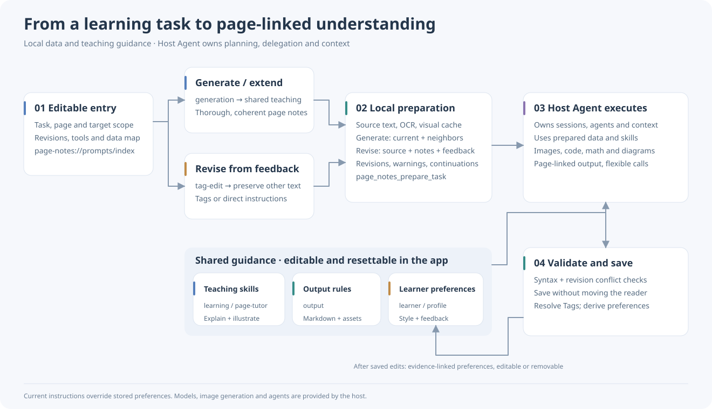

# pagenote Beta

## Platform guides

[Windows](docs/windows/README.md) · [macOS](docs/macos/README.md) · [Android](docs/android/README.md). Each guide links to illustrated tutorials, feature coverage and version notes. Published desktop downloads remain beta.4 and Android beta.5; integration sources are unreleased. Linux and HarmonyOS are planned, not supported builds. [Contributing](CONTRIBUTING.md) · [Integration evidence](docs/INTEGRATION-2026-10-30.md).

**License: PolyForm Noncommercial 1.0.0 for newly licensed original material. Personal noncommercial use and modification are permitted; other commercial use requires separate authorization. [Scope and historical-license exceptions](LICENSING.md).**

**[⬇ Windows beta installer](https://github.com/laihong06/pagenote/releases/download/v1.1.0-beta.4/pagenote-1.1.0-beta.4-windows-x64-setup.exe)** · [Beta portable ZIP](https://github.com/laihong06/pagenote/releases/download/v1.1.0-beta.4/pagenote-1.1.0-beta.4-windows-x64.zip) · [Beta source](https://github.com/laihong06/pagenote/releases/download/v1.1.0-beta.4/pagenote-1.1.0-beta.4-source.zip) · [Release notes and checksums](https://github.com/laihong06/pagenote/releases/tag/v1.1.0-beta.4)

**[⬇ Mac Apple Silicon beta DMG](https://github.com/laihong06/pagenote/releases/download/v1.1.0-beta.4/pagenote-1.1.0-beta.4-mac-arm64.dmg)** · [Mac beta ZIP](https://github.com/laihong06/pagenote/releases/download/v1.1.0-beta.4/pagenote-1.1.0-beta.4-mac-arm64.zip)

**[⬇ Android tablet beta APK](https://github.com/laihong06/pagenote/releases/download/android-v1.0.0-beta.5/pagenote-android-1.0.0-beta.5-arm64-v8a.apk)** · [Android release notes, source and checksums](https://github.com/laihong06/pagenote/releases/tag/android-v1.0.0-beta.5)

This is the **beta branch**. Desktop downloads remain **1.1.0-beta.4**; Android is independently fixed at **1.0.0-beta.5**. Platforms are tested and released separately. [Stable branch](https://github.com/laihong06/pagenote/tree/main).

Android requires **Android 14+ and ARM64**. It includes page-linked PDF/Markdown reading, notes, ink, offline OCR and an in-app tutoring agent. The APK preserves the contributor's signature and uses a separate beta application ID. Office editing and full desktop parity remain incomplete; physical stylus pressure/buttons still need validation. Future updates require the same signing key; back up projects before uninstalling. [Android testing scope and provenance](android/docs/RELEASE-1.0.0-beta.5.md).

Beta installs as **pagenote Beta**, with a separate installation identity, shortcuts and local settings/data directory. It does not take over stable project file associations. Project files you explicitly open are still shared files: copy a project before testing if you want to keep its stable copy unchanged.

**In development: desktop 1.1.0-beta.5** unifies project folders: `project.pagenote` links the source and raw Markdown under `src/`. Standalone imports create projects and older entries are converted without deleting their managed history. [Project layout](docs/PROJECTS.zh-CN.md). Published downloads above remain Beta 4.


English · [简体中文](README.md)

pagenote puts a document on the left and notes for the current page on the right.

## Where pagenote started

As AI becomes part of everyday life, using it to study is a familiar choice. We give it slides and papers, hoping it will build on what we already know and guide us, step by step, toward an understanding of difficult material.

Yet this way of learning has practical shortcomings. The source and explanation sit in separate windows, and switching between them makes it easy to lose our place. AI sometimes rearranges the material, disrupting the order of the lesson. Asking it to explain an entire document at once can run into context and output limits, producing a summary that skips derivations, unfamiliar notation and examples. We may feel we have understood it, only to struggle when solving a problem or putting it into practice.

These frustrations led to Pagenote. The idea is to keep each source page beside its explanation and give it the attention of a separate request: start from familiar knowledge, fill in the intermediate steps and continue from the preceding page. When something is unclear, select a passage or a figure and leave a request for another example or a different explanation. Notes can be revised as we learn, without repeatedly copying text and explaining the background. Illustrations, runnable code, mathematical notation and flowcharts give AI more ways to make abstract ideas understandable. That was the original purpose of Pagenote.

## Prompt and data routing (beta)



The left side follows generation and revision through preparation, execution and saving. The right side holds shared teaching skills, output rules and learner preferences. Solid lines show execution and data flow; dashed lines mark editable prompts. [View the full diagram](docs/images/prompt-routing-en.svg).

The editable entry routes generation and revision to shared teaching skills, output rules and learner preferences. Local tools prepare source/neighbor pages, notes, Tags, OCR and images; the host Agent owns sessions, delegation and context. Edit the guidance in **Settings → AI settings**, without copying prompts. See the [workflow](docs/AI-TEACHING.zh-CN.md) and [full prompt/tool catalog](docs/PROMPTS.zh-CN.md).

## Features in pictures

These are real screenshots of the current development build, using original demonstration content. The interface shown is in Chinese.

### Read the source beside its explanation

The left pane shows the document; the right holds Markdown notes for the active page. Notes follow page changes, and each pane scrolls independently. Read PDF and Markdown directly; Word and PowerPoint conversion uses locally installed Microsoft Office.


### Formulas, code and diagrams

Notes support LaTeX, syntax-highlighted code, Mermaid diagrams, tables and pasted images. Keep derivations and verification code on the same page, with the results rendered for reading.

Code highlighting runs locally, without downloading grammars. If rendering fails, include the app version, a minimal code block and a screenshot in your report; see the [rendering notes](docs/CODE-RENDERING.md).

If formulas appear as backslash commands, copied TeX delimiters may be double-escaped. Beta.5 now handles these forms; see the [formula compatibility notes](docs/FORMULA-RENDERING.md).


### Expand the editor when needed

Choose the notes pane from the editing menu to expand it and reveal its tools. Edit rendered content directly, with code highlighting updating as you type. Source edits for Word, PDF and PowerPoint open in the system default app; save and return to refresh the preview.


### Leave feedback where it belongs

Select text or an area and add an AI annotation, such as “Add an example here” or “Explain this in words before introducing the formula.” A movable panel opens in the same pane.


Annotations collect in a workbench for the corresponding pane. You can also record requests about the whole document. Double-click a marker to open its workbench, or right-click to delete it. A connected AI client can read the requests through MCP and revise the notes.


Pagenote currently supports two-pane reading, page-linked notes and AI annotations. Its MCP interface lets AI read and edit page content. The app does not include a model; detailed page-by-page explanations and image generation require an AI client with the relevant capabilities.

Follow the [page-by-page teaching workflow](docs/MCP.en-US.md#page-by-page-teaching): produce thorough, coherent page-linked explanations. The host Agent decides sessions, delegation and context management; local tools provide prepared current/neighbor source material without enforcing one request per page.

Beta.5 includes a [page tutor skill](skills/pagenote-page-tutor/SKILL.md). Use **AI Annotations → Copy page-by-page teaching prompt**, or select the MCP prompt `pagenote-page-tutor` and supply a learner background, page range and goal. AI clients can also read `page-notes://skills/page-tutor`. The template guides a connected client; it does not call a model by itself.

Use **Settings → AI settings** to edit or restore the default system prompt. General document tasks keep their scope; the page tutor applies only to relevant learning requests. The prompt is saved locally. Reconnect the AI client after saving. MCP supplies the instructions; the client controls its actual system-prompt layer.

Beta.5 reads source and notes separately, fetches only the needed note passages, and saves concise page handoffs inside the project. Handoffs are marked stale when source or notes change, leaving more context for the current explanation. See the [MCP read options](docs/MCP.en-US.md#token-efficient-reads).

It also bundles offline Chinese/English OCR and prepares reusable positioned text, confidence, page/region images and native Markdown table/Mermaid assets. Sources and visuals remain available for checking uncertain formulas and charts. See [local page preparation](docs/LOCAL-PREPARATION.md).

**Current Windows beta version: 1.1.0-beta.4**.

## Download and install

[Windows x64 installer](https://github.com/laihong06/pagenote/releases/download/v1.1.0-beta.4/pagenote-1.1.0-beta.4-windows-x64-setup.exe) · [Complete Windows ZIP](https://github.com/laihong06/pagenote/releases/download/v1.1.0-beta.4/pagenote-1.1.0-beta.4-windows-x64.zip) · [Release notes and checksums](https://github.com/laihong06/pagenote/releases/tag/v1.1.0-beta.4)

1. Download `pagenote-VERSION-windows-x64-setup.exe` from this repository's **Releases**. **Code → Download ZIP** contains source code, not an installer.
2. Run the installer and choose a location. Installation is per user and normally does not require administrator privileges.
3. Launch **pagenote Beta** from the desktop or Start menu.
4. Choose Simplified Chinese or English under **Settings → Language / 语言**.

Alternatively, extract the complete Windows ZIP distribution and run `pagenote.exe`. Keep its accompanying resources together.

Releases should include `SHA256SUMS.txt` and pass security review. The current local build has no publisher signature. If security software blocks it, stop and report the detection; **do not disable protection or add an exclusion**.

### macOS beta availability

Matching Apple Silicon (arm64) DMG and ZIP packages are provided as experimental builds. Intel packages are not offered in this beta. Builds are unsigned and not notarized; macOS may block the first launch. Platform setup: [Mac Office](docs/MAC-OFFICE.md).

## Other controls

- **Hand** pans the page. **Pen** provides ink, highlighting and erasing.
- Ctrl + mouse wheel zooms the current pane. Notes zoom changes the displayed font size.
- Notes follow the active source page as page boundaries cross the viewport midpoint. Page-transition animation can be disabled in settings.
- Automatic note history and restore. Projects, ink and annotations stay on the local machine.
- Data shared with an external AI client is governed by that client's privacy policy.

## Portable projects

Create a project using **File → New project** and choose its name and folder:

```text
My project/
  project.pagenote          # JSON manifest with relative links
  src/
    left.md                # Source: may become left.pdf, left.docx, etc.
    right.md               # Page notes separated by <!-- pagebreak -->
    assets/                # Images and attachments
    annotations.json       # Ink, created when used
    ai-reviews.json         # AI annotations, created when used
```

Open **pagenote Beta**, then choose **File → Open project** and select `project.pagenote`. This beta installer and ZIP deliberately do not register project associations; double-clicking a project may still open stable. For isolated testing, copy the complete project folder first.

Legacy `project.page-notes.json` files remain supported through the app. The `left` and `right` links are read on opening. Move the complete folder, not just its manifest.

The brand is now pagenote. When the legacy document store exists and the new document store does not, data is copied while preserving the legacy folder. Existing projects do not need to be renamed or rebuilt.

Beta.3 fixes migration, staged file replacement and cross-volume copy failures in some encrypted or redirected Windows data folders. Interrupted copies retain recovery files; these fallback paths cannot offer the same power-loss guarantees as atomic renames.

On Mac, move pagenote to Applications and open projects through Finder or **File → Open project**. If needed, select pagenote under **Open With**; Windows `.cmd` registration scripts do not apply to Mac.

## Requirements

- Windows 10/11, x64: v1.0 stable, approved by the founder after accepting LTH0001's tests together with their own supplementary local tests.
- macOS 12 or later: experimental Apple Silicon arm64 builds; no Intel package in this beta; Windows stable acceptance does not apply to macOS.
- ARM64 Windows is not yet verified.
- PDF and Markdown do not require Office. Word/PPT import, project preview and post-save refresh need locally licensed **Microsoft Word / PowerPoint** on Windows and macOS.
- On first Mac integration, allow pagenote to control Word / PowerPoint; if denied, enable it under **System Settings → Privacy & Security → Automation**. Mac Word editing uses a separate window with MCP read, selection, revision-checked replacement and PDF-rendered screenshots. See [Mac Office notes](docs/MAC-OFFICE.md).
- The distribution includes the Node.js runtime used by MCP. End users do not need a Node.js installation.

## Build from source

Use the [beta branch](https://github.com/laihong06/pagenote/tree/beta) for development and testing; `main` is reserved for stable releases. New features and routine fixes target `beta` first. Promote them through a PR to `main` only after real-use testing and explicit founder approval. Passing tests do not automatically publish a release, and beta source is not an installer.

Install Node.js 22.13 or newer, then run:

```bash
npm ci
npm run build
npm run desktop
```

Use `npm run dev` for browser development, `npm run package:desktop` for the Windows installer and ZIP, or `npm run package:dir` for a folder build. Use `npm run package:mac` for macOS DMG and ZIP (Apple Silicon arm64), or `npm run package:mac:local` for an arm64 folder build. The test suite runs on Windows and macOS.

See the [release guide](docs/RELEASING.en-US.md), [terminology specification](docs/TERMINOLOGY.md) and [release-readiness report](docs/RELEASE-READINESS.md). Bug reports should include the version, Windows version, reproduction steps and redacted logs. Do not upload private projects or MCP connection keys.

## Feedback and contact

Please [open an issue](https://github.com/laihong06/pagenote/issues/new) to report a bug, with the app version, reproduction steps and a screenshot so I can investigate.

For suggestions or a conversation about the project, email me at [chennanfeng310@gmail.com](mailto:chennanfeng310@gmail.com).

## License

See [LICENSE](LICENSE) and [LICENSING.md](LICENSING.md). The founder’s newly licensed original material uses PolyForm Noncommercial 1.0.0; existing MIT releases and contributions retain their permissions and preserved notices. Third-party licenses remain independent. This is source-available software with noncommercial restrictions for the applicable material. Commercial authorization inquiries: [email](mailto:chennanfeng310@gmail.com).

MCP integration: [English](docs/MCP.en-US.md) · [中文](MCP接口说明.md)

Editor and icon changes: [reference](docs/EDITOR-REFERENCE.md).
Standalone imports edit the managed local copy; projects edit the linked file in `src`. Save, then return to pagenote.

Beta.5 routes tasks through `page-notes://prompts/index`. Read only relevant, changed modules via `page_notes_read_prompt`. AI settings can customize each module. Page requests may run concurrently: recommend `max(1, floor(total pages / 10))`, capped by remaining pages, client/service limits and available resources. `page_notes_validate_note` checks formatting and local image assets before publication; it is not a guarantee of factual correctness or cross-device rendering.

## Contributors

Thanks to [obroccolio](https://github.com/obroccolio) for Mac support and downloadable builds, and [LTH0001](https://github.com/LTH0001) for formula regression coverage and acceptance-test improvements. Windows v1.0 was approved from LTH0001’s tests plus the founder’s supplementary local tests. Forks and PRs are welcome; include a changelog entry and describe the platforms and scope tested.

[Release policy](docs/RELEASE-POLICY.md) · [Known issues](KNOWN_ISSUES.md)

Beta 1.1 adds a soft page-edge highlight, editable entry/strategies/teaching/profile modules, prepared task context and evidence-linked preferences. See [workflow](docs/AI-TEACHING.zh-CN.md); stable downloads above remain v1.0.

Windows touchpads (beta): pinch continuously in the pane under the pointer; two-finger scrolling pans both axes. Ctrl + wheel remains supported. Small pages zoom around their center; filled pages keep the pointer anchor. PDF detail refreshes after the gesture without rebuilding the text layer; the toolbar does not zoom.
