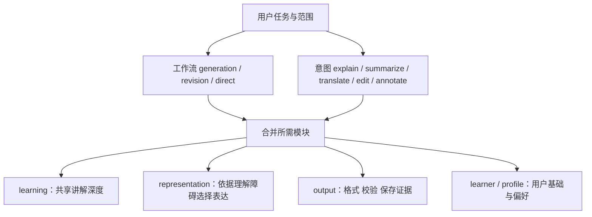
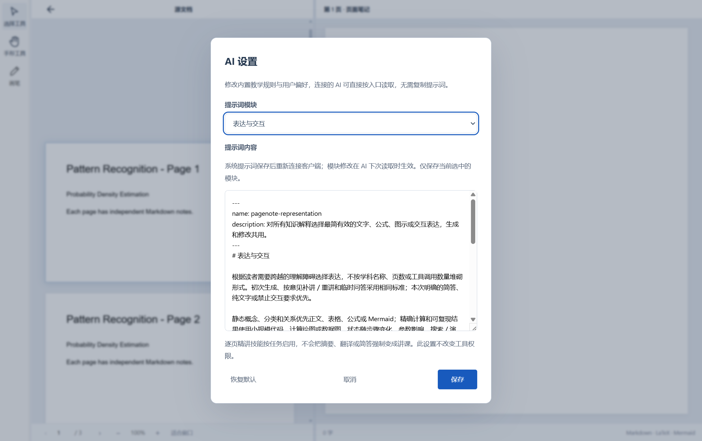

# 统一讲解与表达路由

生成新讲解、按意见补讲／重讲、临时解释，共用相同的教学深度与展示标准。差异仅在读取材料、定位意见、保护已有内容和写入方式。统一的是受影响知识单元的质量，不是要求所有修改重写整页，也不强制每页增加动画。

## 各层职责

| 层级 | 负责什么 |
| --- | --- |
| 系统提示与 entry | 所有解释路线进入共享标准，尊重用户范围与纯文字要求 |
| generation / tag-edit | 各自材料准备、意见定位、保留未涉及内容、版本保护 |
| learning | 直觉、准确概念、符号、条件、中间步骤与完整小例子 |
| representation | 判断哪种表达更能降低理解成本，适用时实际制作而非只建议 |
| page-tutor | 页码对应、符号沿用、前后知识衔接，不另设教学深度 |
| output | 围栏与数据契约、静态校验、expectedRevision 写入、如实报告运行证据 |
| capabilities | 当前开发版本实际支持的能力，不是未来引擎愿望清单 |
| profile | 可调整篇幅、风格、展示积极程度，不覆盖技术限制 |

`page_notes_prepare_task` 保留 generation／revision 场景，新增可选 intent。默认 explain，让已有客户端的生成与知识修改均得到共享模块；仅纠正错字／符号／格式时使用 intent=edit。临时问答无需为了加载规则创建文档任务：从索引 intentRoutes 读取 explain 模块即可。意图由上层 AI 根据本次任务选择，软件不声称已经实现自然语言意图分类器。

## 主动表达的边界

规则不绑定 ACO 或任何学科。静态关系用正文、公式、表格或 Mermaid；精确数值用计算绘图／数据；步骤变化、参数影响、反馈与随机过程适合时主动制作交互；只有空间关系确有需要才使用三维。一个演示承担一个理解任务，正文仍可独立阅读。不以调用次数或花哨程度判定质量。

原生 Markdown S 当前仅支持 genetic-lab；索引明确这一限制。没有适用模板的知识用静态图、代码或上层工具的真实计算绘图，不生成虚构 kind，不强套遗传算法，不回退成整页 HTML iframe 作为原生交付。旧沙盒只保留兼容。

## AI 如何获得反馈

`page_notes_validate_note` 新增 counts.enhancedBlocks 和 visualBlocks，报告引擎、UTF-8 字节数、数据错误、重复标识及警告；所有静态结果 runtimeVerified=false。原生校验与真实渲染器共用同一数据契约。历史图表校验 JSON，未知增强围栏拒绝；网络资源扫描仅为启发式警告，不能代替执行隔离或运行验证。不执行用户代码，也不证明讲解正确。

## 设置与已有用户

AI 设置新增“表达与交互”，可编辑并恢复默认，沿用模块 revision 与覆盖机制。既有用户自定义系统提示和模块覆盖保持原样；需要采用新默认时在对应模块恢复默认，而非自动覆盖用户内容。默认系统提示更新需要重新连接 AI 客户端；模块与索引下次读取即生效。能力索引 revision 随路由、能力或模块内容变化。

## 验证与限制

2026-10-30 Windows 本轮通过：生产构建、`npm run test:workflows`、`node tests/ai-settings.mjs`、`npm run test:markdown-native`、公式渲染、代码渲染、富文本编辑和 i18n 专项。工作流测试包含双轴路由、共享模块、非教学意图不扩写、可编辑模块版本与恢复默认，以及真实 Electron＋MCP 能力发现、原生数据预检、重复标识、未知引擎、非法图表、UTF-8 超限和文件读取。未将本轮定向测试说成完整套件通过；上一轮菜单剪贴板断言失败的记录仍保留。Windows 截图的环境见 [来源记录](windows/guide/images/ai-representation/provenance.json)。Mac 原生选择项已接入，未在本轮 Windows 主机进行 Mac 实机验证。

这些是路由／输出契约的确定性检查，不是“模型更愿意使用工具”的效果实验。后续可用多个知识领域比较解释完整度、首次格式通过率、实际操作结果、无意义动画比例和保存重开保真；不能将测试路由成功当成模型已达到某个主动展示比例。
