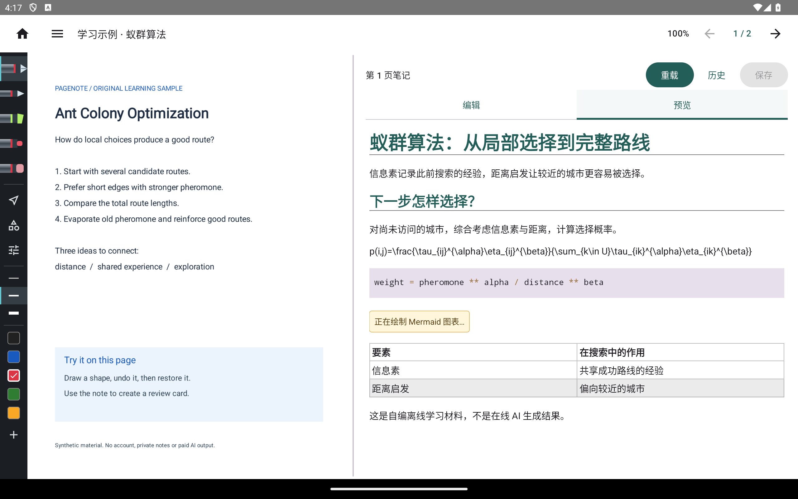

# PageNote Android 平板版

PageNote 的 Android 版是 **Kotlin／Jetpack Compose 原生应用**，围绕平板触控、手写和系统文件授权设计。它不是 Windows／Mac 桌面程序移植出的相同界面，功能与操作以本页及 Android 教程为准。[返回项目总览](../../README.md)。

## 下载与版本

- 公开测试版：**1.0.0-beta.5**，[下载 ARM64 APK](https://github.com/laihong06/pagenote/releases/download/android-v1.0.0-beta.5/pagenote-android-1.0.0-beta.5-arm64-v8a.apk) · [说明、源码与校验](https://github.com/laihong06/pagenote/releases/tag/android-v1.0.0-beta.5)。
- 开发版本：**1.0.0-beta.6-dev.1**，源码中的新增模块不代表上述 APK 已包含。
- 要求 **Android 14+、ARM64**；尚无获批稳定版。公开包沿用贡献者签名，开发 debug／preview 包不能冒充同一发行包。

## Android 的操作与功能

| 模块 | 平板上怎么用 | 重要区别／限制 |
| --- | --- | --- |
| 书架与文件 | 通过系统文件选择器授权目录，再导入或打开项目 | Android 文档授权机制，不是桌面文件路径操作 |
| 阅读与笔记 | 触控翻页、选择文字，在笔记区编辑 | 布局及工具栏独立实现 |
| 手写与批注 | 选择笔、颜色及粗细，用手写笔或触控标注 | 真机压感、侧键和持久授权需另验 |
| 内置 AI 入口 | 配置自己的兼容模型服务，再按页讲解或修改 | 不等同桌面外部 MCP 客户端流程 |
| OCR 与搜索 | 识别扫描页，索引支持的本地内容 | 需要本地模型；识别质量依材料而定 |
| 学习与辅助工具 | 开发源码含闪卡、录音转写、素材、悬浮工具等模块 | 逐项状态见功能表，不能全部算作公开包承诺 |

**不具备桌面完整功能对等性。** 桌面原生 Markdown S 交互作品未在 Android 执行验收；Office 进程内编辑未实现。共享项目格式不代表共享全部界面与能力。

## Android 截图与验证状态

以下为 **2026-10-30 当前共享源码**在 Android 14／API 34 的 Pixel Tablet ARM64 模拟器上的整屏图：2560×1600、320dpi、浅色、中文应用设置。系统原生窗口及悬浮服务部分文案仍显示英文。[采集环境与复现](guide/capture.md) · [逐项截图和状态](features.md)。

本轮补充 30 张原始整屏图及形状、键盘编辑、闪卡、夜览、悬浮工具的编号过程。手工新增形状不能立即撤销、悬浮笔记文字低对比和标题换行已记录为[已知问题](../../KNOWN_ISSUES.md)，没有按截图齐全判定布局通过。OCR／ASR 只采集模型设置；没有把入口写成识别质量、录音或在线 AI 通过。

源码基线 `6388245` 的 [Android CI](https://github.com/laihong06/pagenote/actions/runs/41019223250/job/123942472417) 单测、应用／测试源码编译与 Debug APK 通过；作者本轮另完成 Debug 编译和三个定向采集流程。没有重跑当前源码的全部模拟器测试，也没有验证公开 APK、真机手写笔或全部服务。[验证范围与审查待办](../review/PR13-evidence-2026-10-30.md)。

## 教程与版本记录

[按功能查看完整清单与截图状态](features.md) · [操作教程](guide/README.md) · [更新日志](CHANGELOG.md) · [各版本说明](releases/README.md) · [独立版本配置](../../platforms/android/version.json)

教程和对应图片共同保存在 guide/ 目录，未采集的本系统截图明确标为待补；不以其他系统的截图冒充。开发源码不等于已发布包。

## 开发入口

[android/beta](https://github.com/laihong06/pagenote/tree/android/beta) 是独立平台测试线。源码保留在 android/，尚未搬迁到 apps/android/；不为目录形式破坏 Gradle 工程。Windows 使用 android/gradlew.bat；其他系统使用 ./gradlew，运行 testDebugUnitTest、compileDebugAndroidTestKotlin、assembleDebug。
