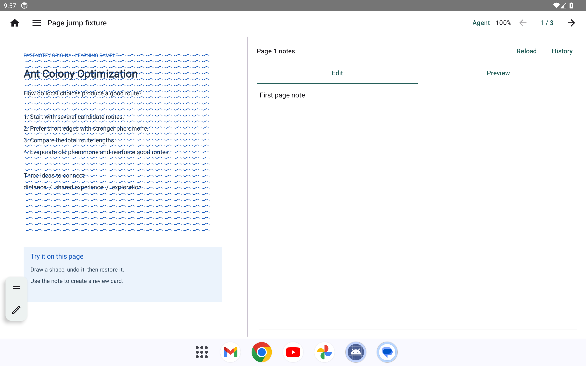
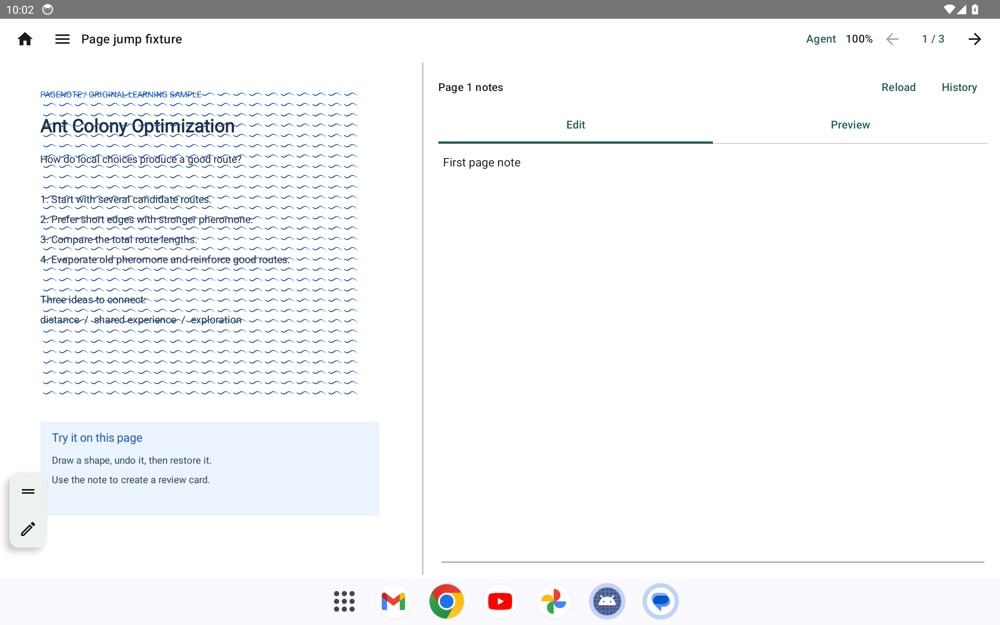

# Android 密集笔迹性能对照

## 测试条件

Android 14／API 34 ARM64 Pixel Tablet 模拟器，2560×1600、320 dpi、60 Hz、浅色主题，使用宿主机 GPU。调试版应用打开同一份自编 PDF，页面预置 600 条压感变化的合成笔迹；测试注入 8 笔手写笔轨迹，每笔 90 个移动事件，事件之间等待 8 ms。注入调用同步等待系统处理，因此实际输入速率会受设备和应用负载影响；它不是固定的硬件采样率。

改前基于源码 `1e437985ed65b03fdfdd2409fe9a4352b219c252`，另加仅用于对照的笔迹层诊断开关；本组测试中两个开关均关闭，笔迹正常绘制。改后为干净运行源码 `675ff1282e7082faab9ccef741e031ef129daddb`，只在测试 APK 中注入相同的场景。截图均为测试开始时的完整应用画面。

| 指标 | 改前 | 改后 |
| --- | ---: | ---: |
| 实际注入速率 | 约 70.5 次／秒 | 约 97.9 次／秒 |
| 屏幕呈现频率，最后 127 帧 | 48.8 fps | 54.8 fps |
| Android 判定的慢帧，整个书写阶段 | 99 / 516（19.19%） | 11 / 426（2.58%） |

呈现频率按 `SurfaceFlinger --latency` 的有效呈现时间计算，覆盖末尾约 2.3–2.6 秒，不是整个阶段平均值；慢帧统计来自 `gfxinfo`，覆盖整个书写阶段。改后另一次带诊断开关、但未启用开关的测试为约 58.6 fps、慢帧 2.60%。模拟器性能存在波动，改后这一轮仍出现过单次约 85 ms 的呈现间隔，不能据此保证完全没有卡顿。压感样例为合成输入，真机硬件、真实手写笔、不同刷新率和长时间使用尚未测试。

改前：



改后：



截图 SHA-256：改前 `bd99f68698e47050ab0f0bdde8b2abc75413f5fa1ed19acfc3dfd1202d811d02`；改后 `df09ffcc2dd872b752e19be9ddbf0893f2d52d535525cbb2a5295a17348a27fd`。原始数据见 [改前 gfxinfo](before-gfxinfo.txt)、[改前呈现时间](before-present.txt)、[改后 gfxinfo](after-gfxinfo.txt) 和 [改后呈现时间](after-present.txt)。

## 复现

在干净工作树中，将 [测试补丁](profiler.patch) 应用于 Android 阅读器测试，启动相同规格的模拟器后运行下列命令。补丁只增加测试，测完可反向应用移除；勿覆盖已有的未提交更改。

```sh
git apply --unidiff-zero docs/android/benchmarks/ink-rendering-2026-11-06/profiler.patch
cd android
./gradlew :app:connectedDebugAndroidTest -Pandroid.testInstrumentationRunnerArguments.class=io.pagenote.android.ReaderPageJumpActivityTest\#temporaryFrameProfile
cd ..
git apply -R --unidiff-zero docs/android/benchmarks/ink-rendering-2026-11-06/profiler.patch
```

测试将图像、系统帧数据和实际输入时间写入模拟器的 `/sdcard/Download/pagenote-frame-profile/`。该数据不代表公开发行版，也不代替真机验收或维护者的视觉审查。
