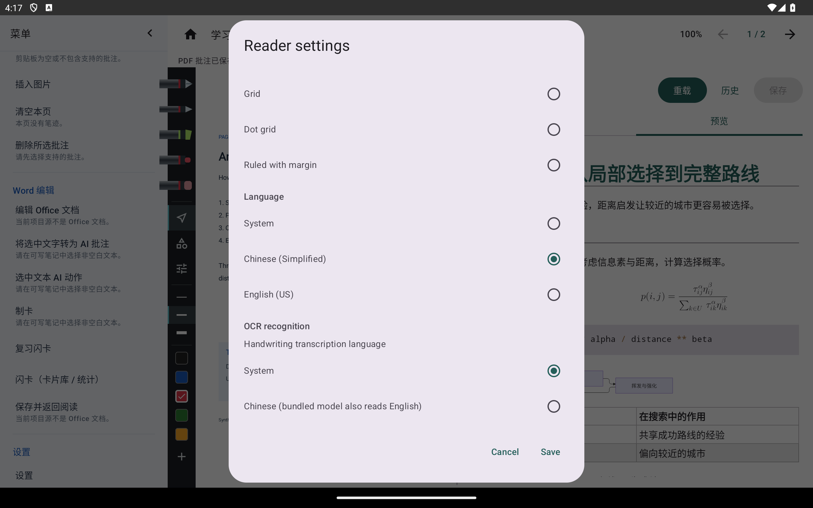
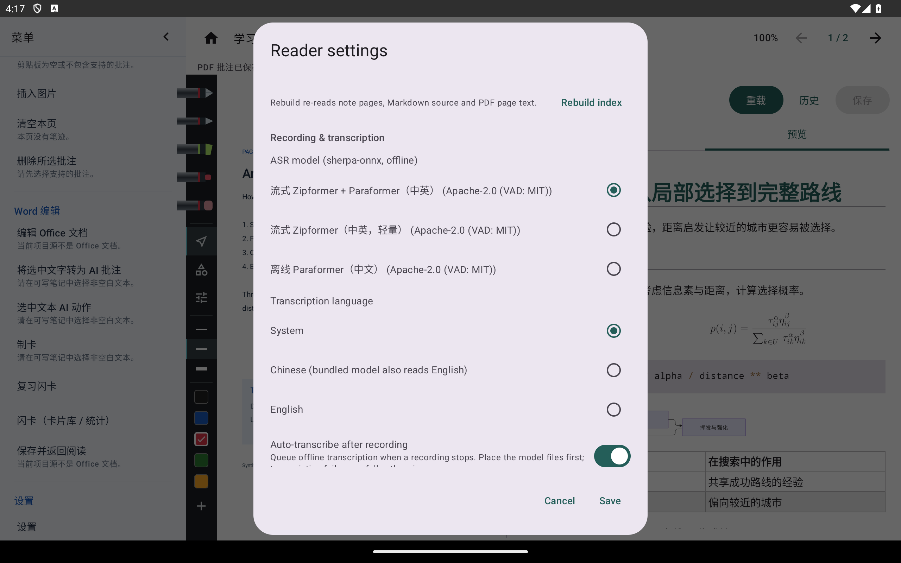
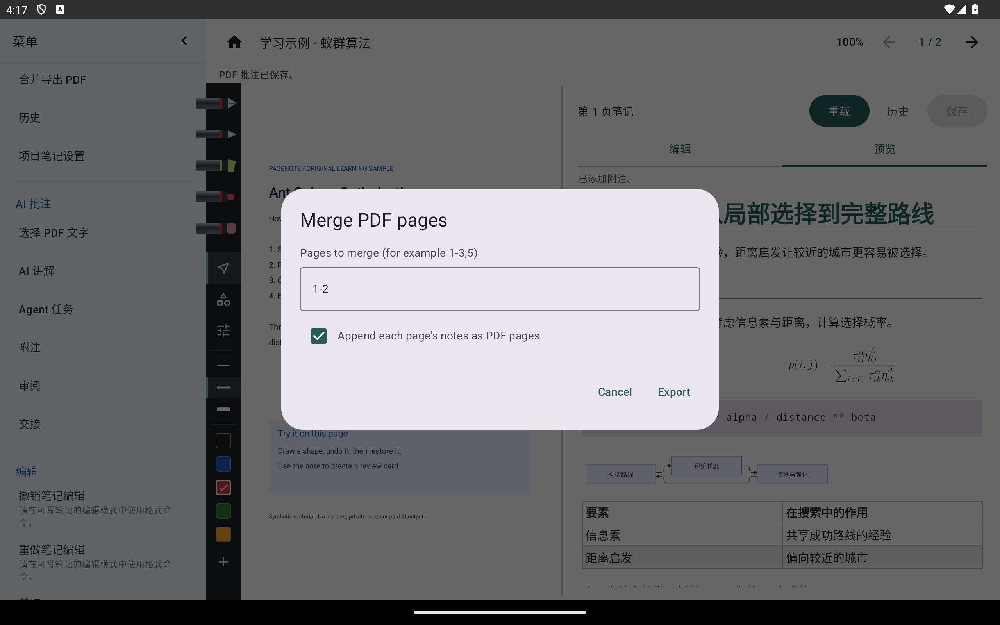
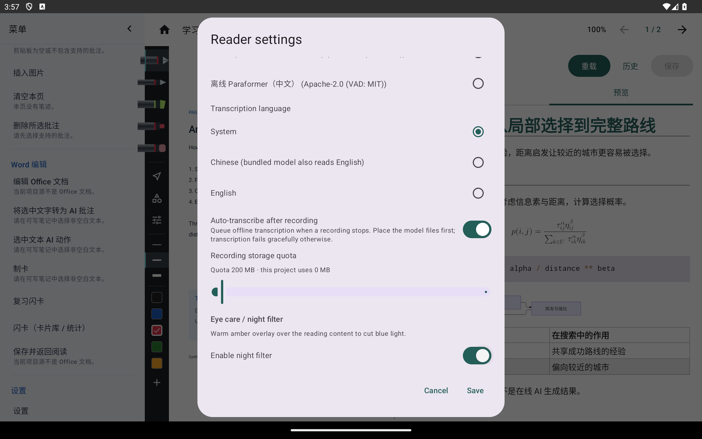
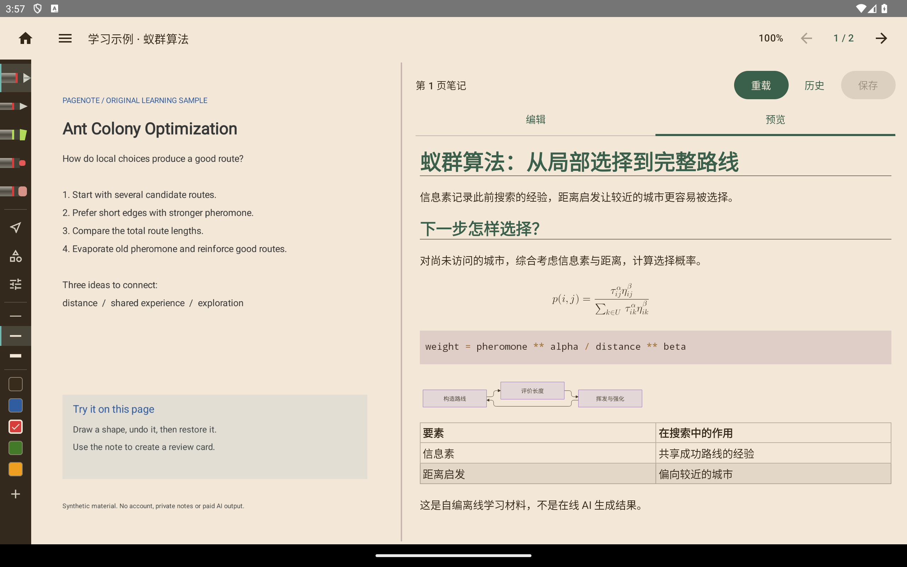

# 设置、权限与尚未接通的能力

[教程目录](README.md) · [功能与状态表](../features.md)

## OCR与公式识别

阅读器设置可选择识别语言和公式模型；手写／公式识别从“手写”组进入，整页／区域 OCR 从“阅读”组进入。先安装兼容的本地模型，再框选并核对识别结果；取消识别面板返回阅读。模型许可证和文件名按模型清单，不能用不兼容模型凑数。

这张图只证明配置界面存在。本轮没有安装识别模型，没有执行扫描页、手写文字或公式识别，不能将其写成质量通过。

## 录音与离线转写

从“阅读”组发起录音需麦克风权限；停止后录音保存为关联 PDF 页的音频记录，播放和转写从对应记录进入。离线语音转文字依赖兼容的 sherpa-onnx 模型，设置中还可控制语言、自动转写和项目配额。

本轮没有启用麦克风或录下环境声音，也没有安装 ASR 模型。录音、播放、转写质量、耗电与空间不足处理仍需专门验收。

## Office与导入导出

Android 当前未注册可用的 Office 转 PDF 引擎，Word 编辑和保存返回不能当作可用编辑功能介绍。Windows／Mac 的本机 Office 桥接操作不适用于 Android。

PDF 项目可从“文件 → 合并 PDF 导出”选择范围，再通过系统选择输出位置。导入 JSON 笔记备份时会显示合并策略；PDF 项目不能任意附加不存在的原文页。取消对话框或选择器不会等同于导出成功。

本轮只打开导出范围窗口，未生成或检查导出文件；导入合并策略的当前截图待补。原文和笔记仍应通过复制完整项目目录备份。

## 夜览滤镜

在“设置 → 夜览滤镜”打开开关、调整强度并保存，阅读区会出现暖色遮罩；关闭开关并保存可恢复。它是阅读显示设置，不会把课件或笔记文件染色。

## 系统截屏

从“阅读 → 系统截屏”进入系统 MediaProjection 授权，允许后才能抓取屏幕，再识别或取色。关闭结果面板退出。本轮没有执行该系统授权或截屏 OCR／取色，截图与结果待补；悬浮窗的授权也不能替代系统截屏授权。

## 未完整接通的功能

- 素材／贴纸／GIF：已合入素材存储、公式与 GIF 元数据，公式识别结果可保存素材；完整素材浏览和插入面板、GIF 动画播放本轮没有端到端证据。没有随项目复制第三方贴纸、字体或模板。
- 旋转与矩形擦除：底层策略已合入，当前教程未验证独立菜单入口，不能照 API 名称编造用户操作。
- 思维导图、网页摘录、视频笔记、云账号与云同步：不属于批次 0–12 已完成的 UI 承诺，未在本轮实现或补图。
- `genetic-lab` 原生 Markdown S：Android 保留兼容源码降级，不执行桌面原生交互作品。

## 项目与文件兼容

项目入口仍为版本 1 的 `project.pagenote`，链接原文与按 `<!-- pagebreak -->` 分页的 Markdown。画布对象在 `src/annotations.json`，纸张／口令在 `src/note-settings.json`，录音和素材还涉及各自清单与资源。此轮文档与截图没有改变格式或写文件协议。

共享格式并不等于全平台会显示每种扩展对象；迁移前复制完整目录，先检查未识别内容能否往返保留。闪卡和部分设置使用本机数据库／私有目录，不能把“项目可移动”解释为所有本机状态自动跨设备同步。

## 本轮没有验证的范围

真机手写笔、长期目录授权、不同 Android／输入法、录音和本地模型、真实 AI／翻译服务、雨课堂登录与课程请求、系统截屏、完整 Office 引擎和发布包升级均未在本轮验收。既有 2026-10-26 测试结果保留在[补充审查记录](../../review/PR13-evidence-2026-10-30.md)，不能替代当前提交的 CI 或维护者复核。
