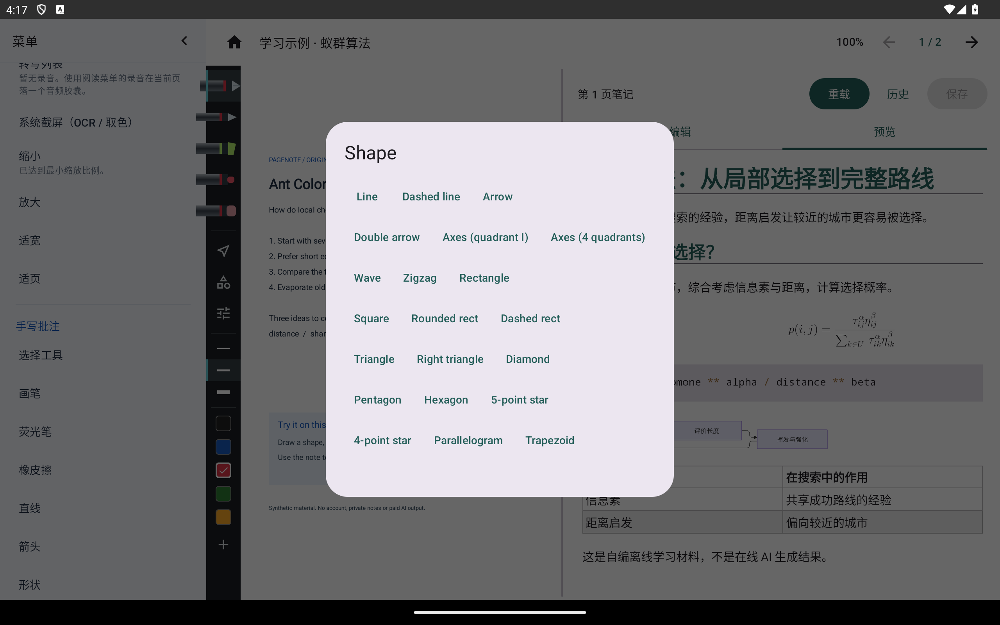
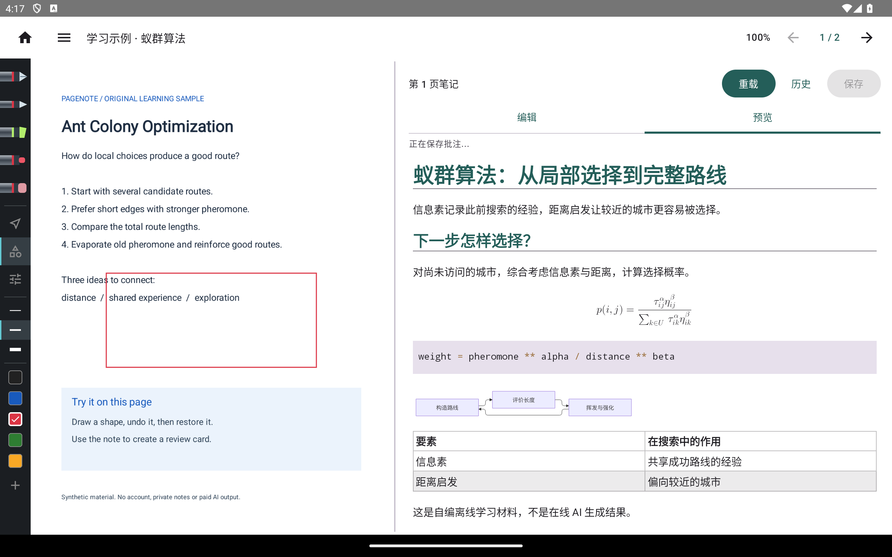
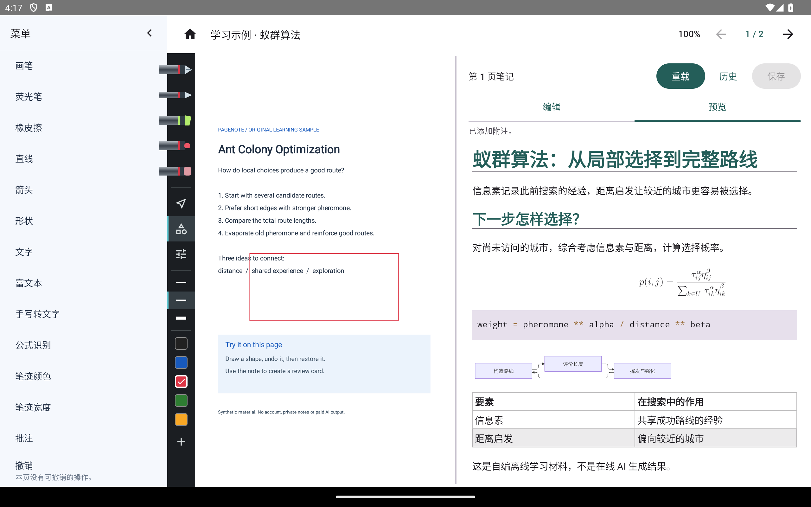
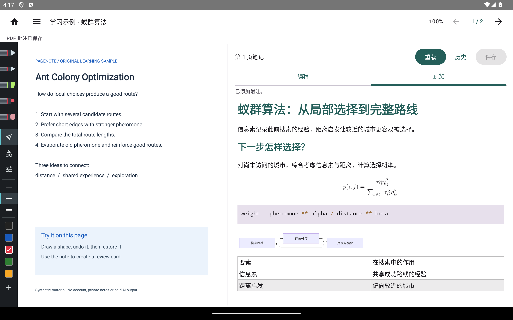
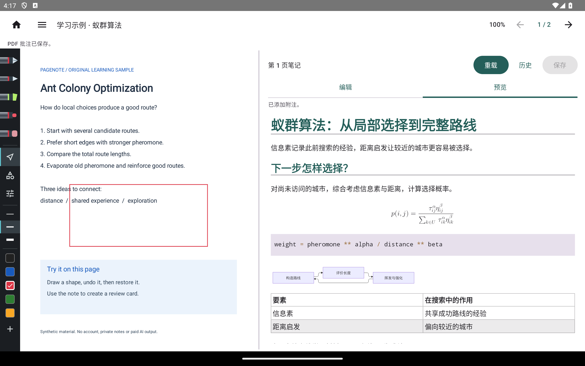
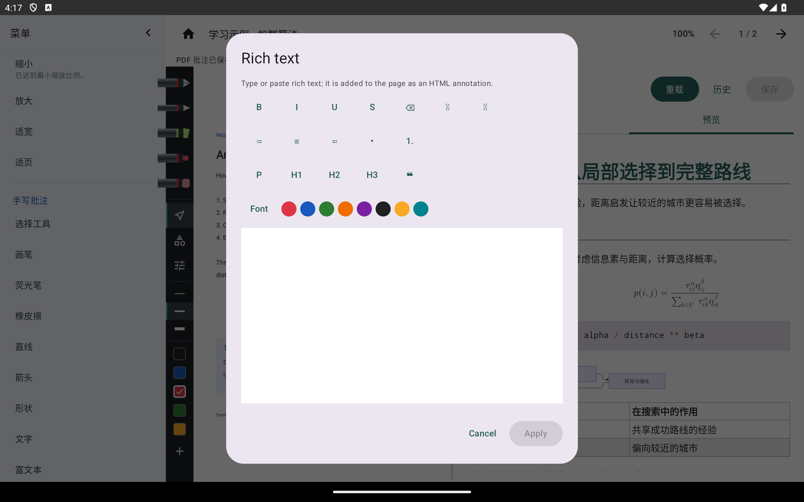
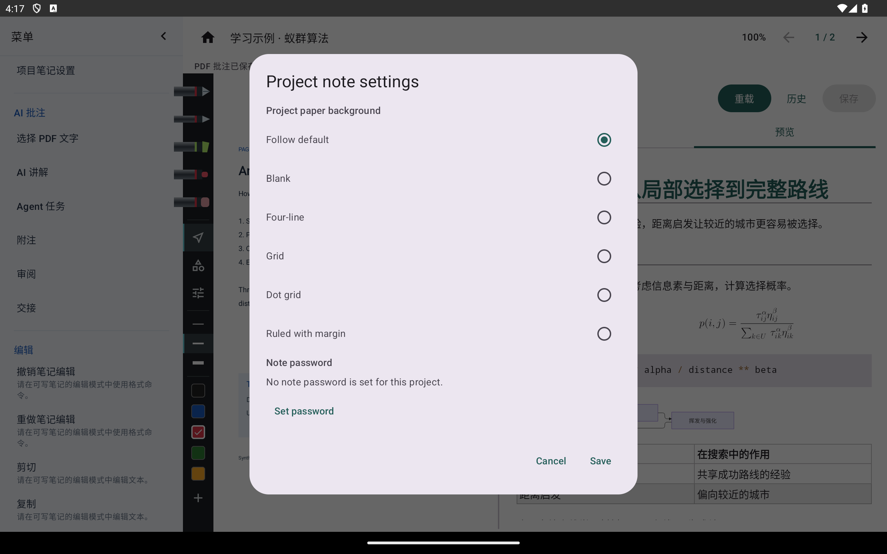

# 画布、形状与项目笔记设置

[教程目录](README.md) · [功能覆盖](../features.md) · [截图环境](capture.md)

## 画出一个形状

打开 PDF 项目，展开菜单的“手写”组，选择“形状”。也可以使用左侧形状入口。当前选择器列出直线、箭头、坐标轴、矩形、多边形、星形和圆等 24 种形状。

选择矩形后回到 PDF，在需要的位置按住并拖动，松开后写入当前页。下面的红色矩形是通过这一实际手势创建的，没有把形状画到截图文件上。

**当前限制：新画形状的创建动作没有进入撤销历史。** 本次新建矩形后，“撤销”仍显示“本页没有可撤销的操作”。创建处理直接写批注文件，与已有对象编辑使用的历史路径不同。此处保留失败证据，不能把“形状可创建”扩大为“创建可撤销”。

## 选中、删除和撤销删除

1. 切换到“选择”工具，点形状边缘使其选中。
2. 使用“删除”移除选中对象。删除后的页面见下图。
3. 使用“撤销”恢复此次删除。这个操作进入了已有对象的批注历史，区别于上面的创建缺口。

同一组菜单还提供复制、粘贴、颜色、粗细和重做；剪贴板内容或当前选区不合适时会禁用并说明原因。跨页粘贴、缩放后的移动／拉伸仍需按对应场景验收，不能仅凭这组三张图判定全部通过。自由笔迹的真实压力和侧键需要手写笔真机。

## 富文本批注

通过“手写 → 富文本”打开实际编辑窗口，选择字体、颜色和格式，输入后确认将创建画布文字对象；取消关闭编辑草稿。选择已有富文本对象后可从同一入口继续编辑。

该编辑窗处理受限制的 HTML 画布对象；它不是桌面 `genetic-lab` 原生 Markdown S 课件，也不表示 Android 可以运行任意网页脚本。本轮采集的是窗口和工具状态，没有把未执行的插入结果写成已验证。

## 纸张和项目口令

从“文件 → 项目笔记设置”设置项目背景，或管理项目口令。保存后使用项目设置，取消保留原设置；没有项目覆盖时沿用阅读器默认值。

项目口令用于应用打开时的检查，**不会加密整个项目目录或原文**。不要将它解释为文件系统加密。加密 JSON 导出是另外的流程，本轮未设置口令、未验收加密导出。素材、贴纸和 GIF 的边界见[未完整接通的功能](advanced.md#未完整接通的功能)。
