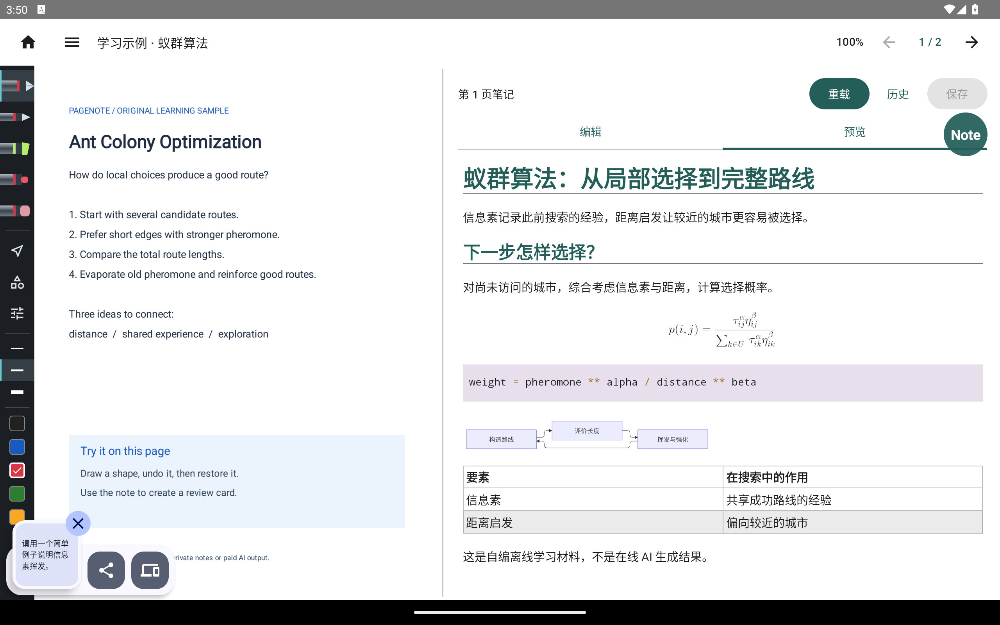
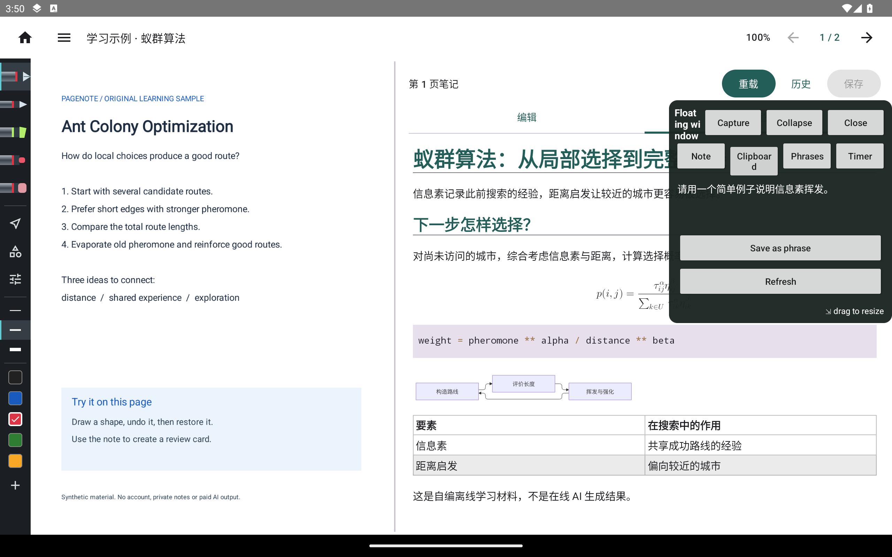
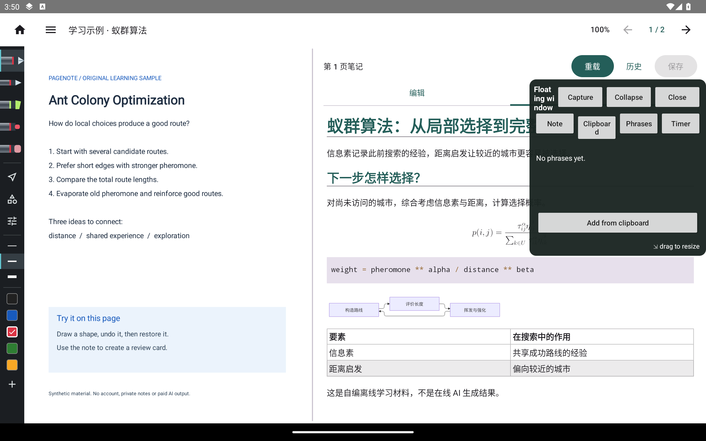
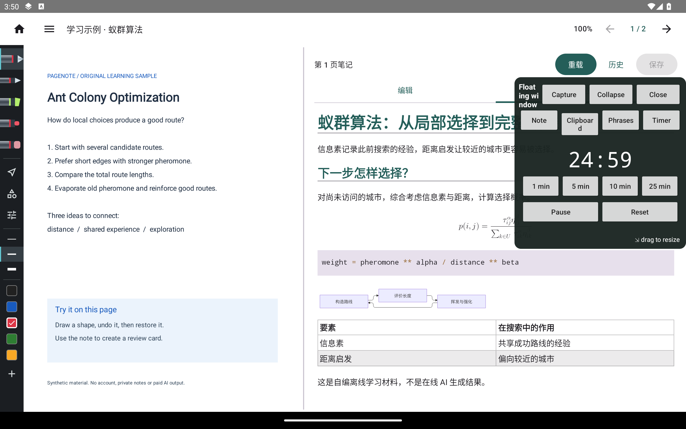
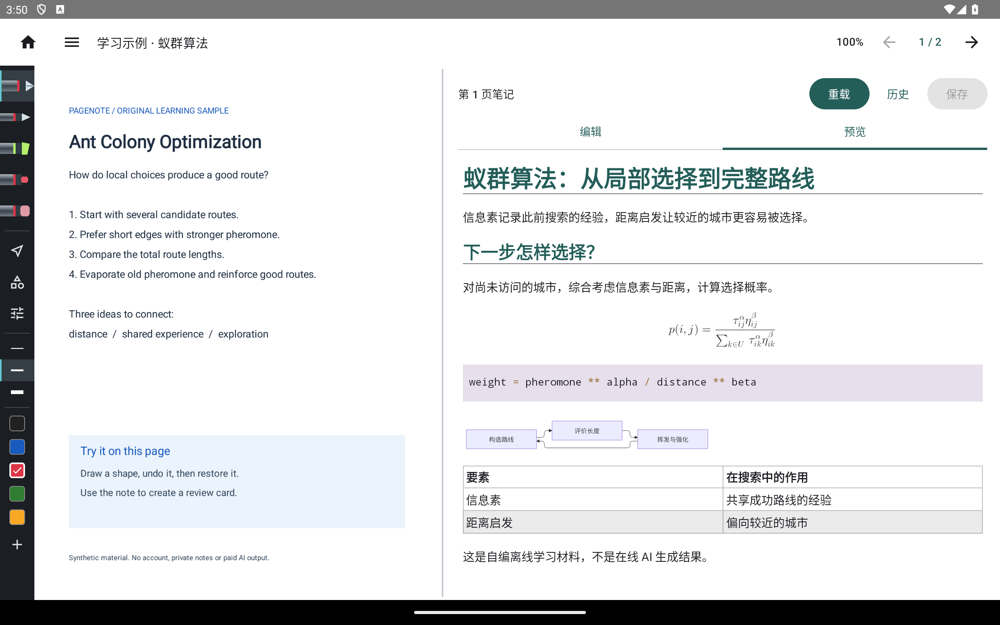

# 悬浮工具：从打开到关闭

[教程目录](README.md) · [功能表](../features.md) · [截图环境](capture.md)

打开项目后，在“设置 → 悬浮窗”启动。首次需要在 Android 系统设置授予“显示在其他应用上层”；系统拒绝时不能显示小窗。再次使用菜单或面板“关闭”可停止服务。悬浮球可拖动，点球展开；面板标题可拖动，右下角可改变大小。

本轮模拟器的主界面语言为中文，服务窗口沿用系统英文。原样保留这一区别，没有在图片里替换文字。

## 按顺序查看操作

**1. 启动后只显示悬浮球。** 阅读区仍可见，点球展开工具。

**2. 笔记页绑定打开时的项目和页码。** 编辑后“Save to note”请求回写；切项目、切页或主笔记基线改变时会拒绝过时草稿。本轮只打开该页，没有验收回写。

**3. 剪贴板页取用一段合成文字。** 本轮预置的是“请用一个简单例子说明信息素挥发”，不含系统私人剪贴板内容。

**4. 常用语页管理可复用文本。** 本轮查看页面，没有新增或删除个人常用语。

**5. 计时器选择时长并开始。** 可以暂停或重置；本轮启动了倒计时，未等待结束通知，因此不声称通知已验收。

**6. 关闭后回到无遮挡的阅读器。** 收起与关闭不同：收起保留悬浮球，关闭停止服务。

## 这组图片暴露的布局问题

悬浮笔记的深色背景与输入文字对比不足，英文标题和页签有挤压换行；应用内语言选择没有同步到服务窗口。这些是当前源码的实际缺陷，已列入[已知问题](../../../KNOWN_ISSUES.md)。本组用于维护者判断遮挡、对齐和可读性，**尚未通过维护者布局审查**。没有通过改色、裁剪或重排来隐藏问题。
