# Android 分支整合：横屏平板运行截图

- 运行代码：`a315827d98b1302db3df95159e1bb6d9c2829c4a`。后续合并 fork 的 `f8fc341` 只保留祖先关系，没有树内容差异。
- Android 14/API 34 ARM64，`Pixel_Tablet_API34_Acceptance`，`emulator-5558`，横屏 2560 × 1600、320 dpi、浅色主题。
- 实际应用完整屏幕，由 `UiAutomation.takeScreenshot()` 捕获；合成 PDF、自编学习材料与合成触控／stylus。不是实体笔或真机验收。
- [整合决策、验证与限制](../../../BRANCH-INTEGRATION-2026-11-14.md)。当前为本地未发布 debug 源码与包。

## 阅读器与设置对照

改前为 `f8ef443` 的连续阅读界面和侧边设置，材料为相同三页合成 PDF 模板，项目标识不同：

整合后保留参考笔盒和连续列表，工具栏加入可关闭的 Agent 入口，设置成为全页分类页面：

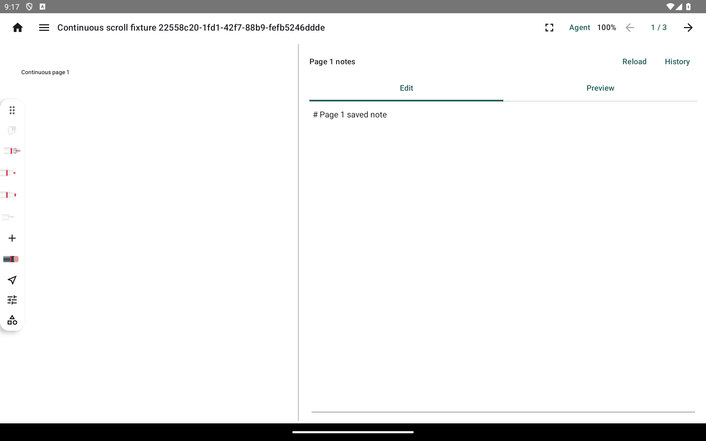

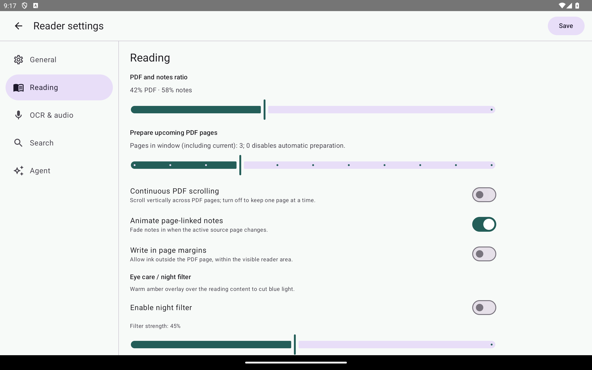

## 操作过程

滚动到第三页，页码和笔记一起切换；返回第一页保留该页草稿：

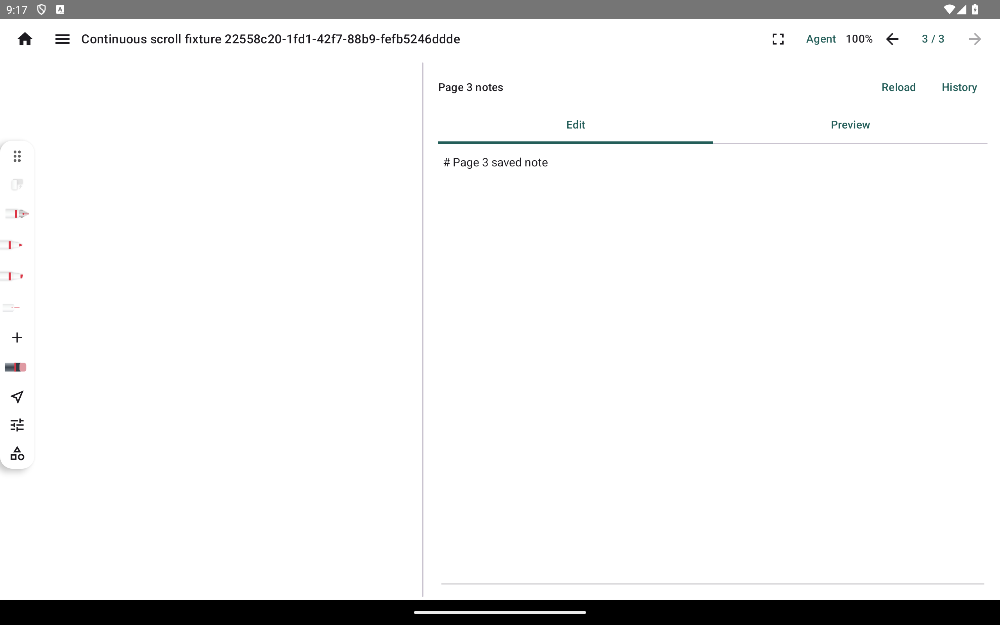

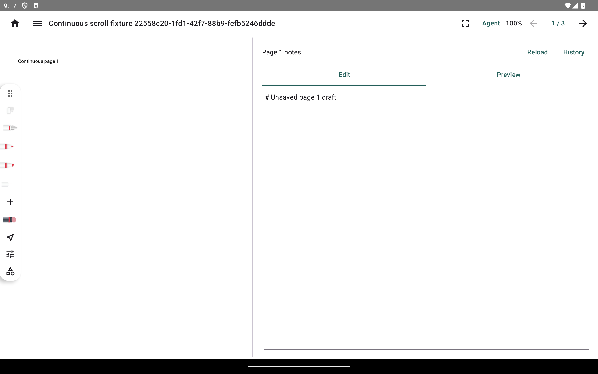

参考笔盒拖到右侧，打开 Agent 面板再关闭后仍保留页码和草稿。本组使用自编蚁群算法学习材料，没有请求外部模型：

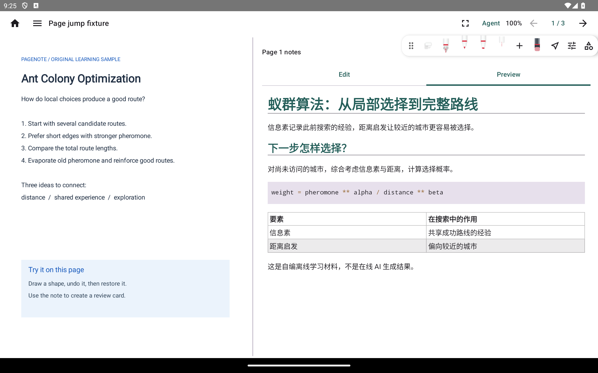

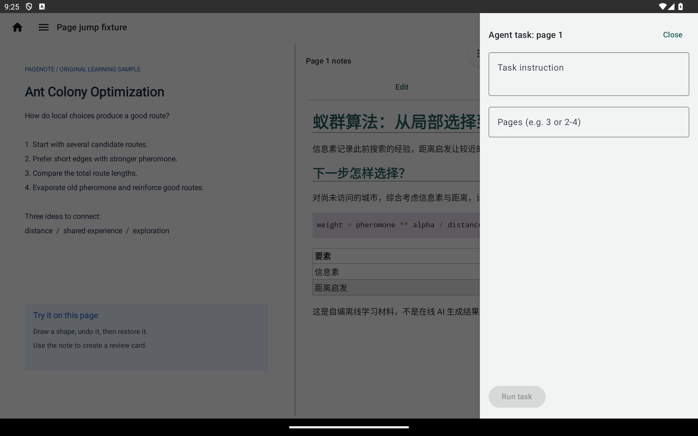

## 保留的笔迹行为

非箭头最小二乘曲线：输入前、识别保存、单步撤销。箭头回退仍只有既有识别器级覆盖，不用这些图片代替箭头端到端验收：

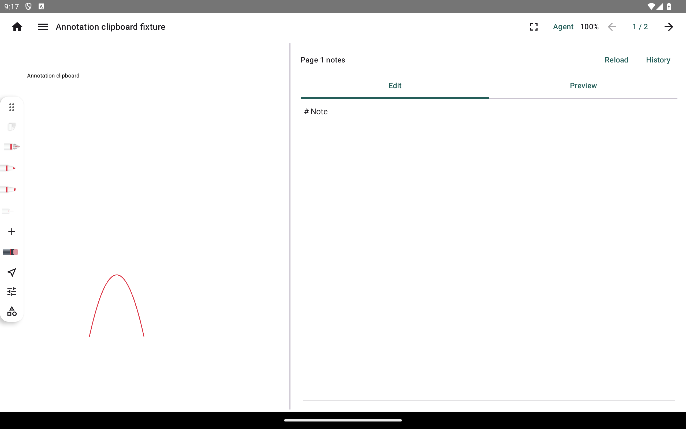

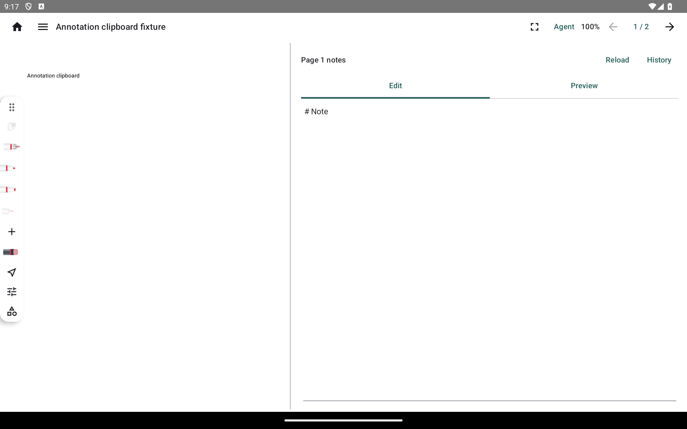

原生矩形区域擦除：擦除前、拖动中边界、提交后的碎片、单步撤销：

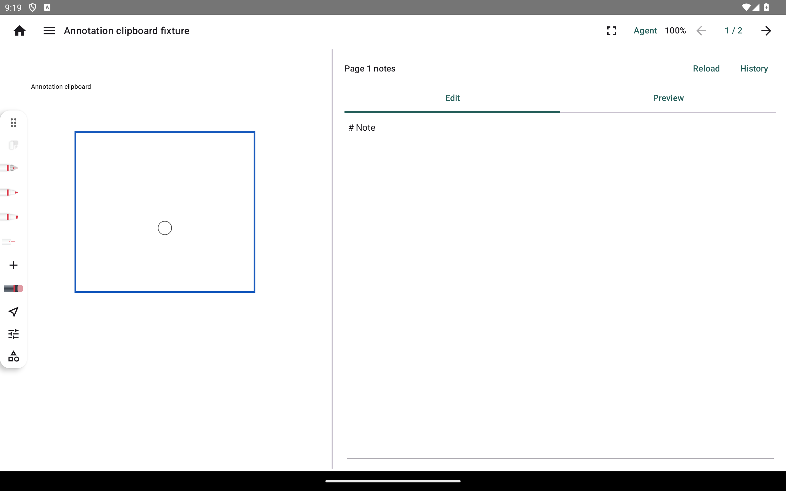

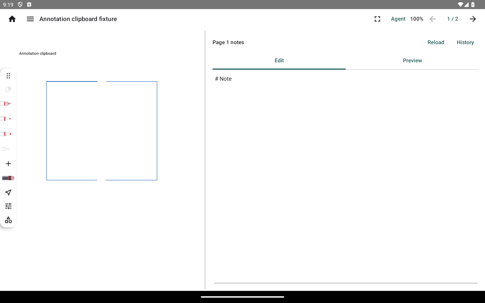

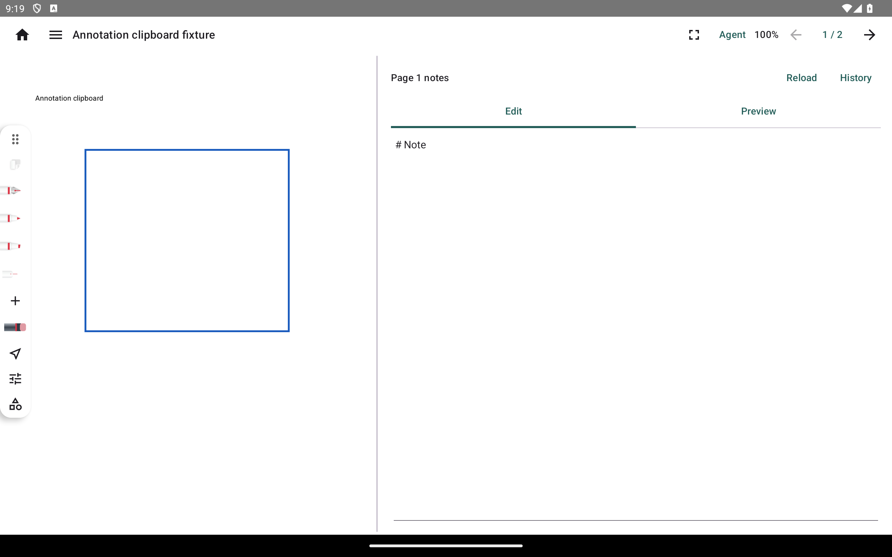

这些过程由本次定向测试触发；没有据此声明参考 App 浮点逐位一致、全量平台支持、真机性能或维护者视觉审查已经通过。
