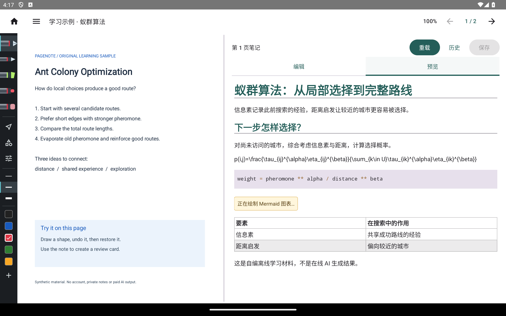
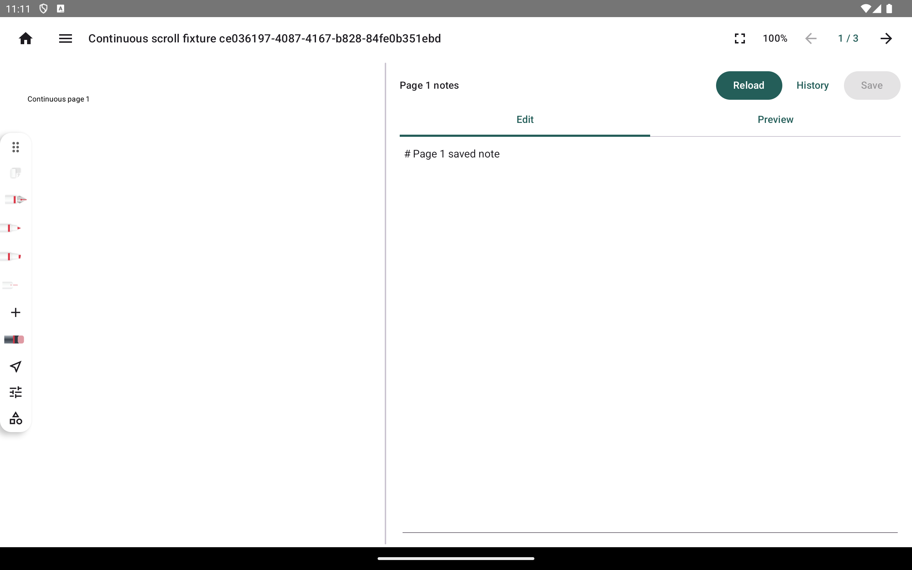
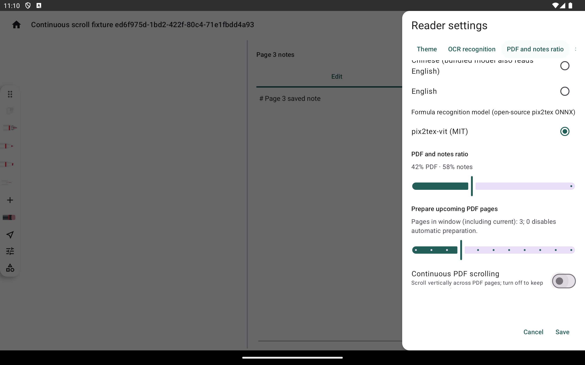

# PDF 连续翻页：横屏 API 34 验收

## 运行环境

- 平台：Android 14／API 34 ARM64，AVD `Pixel_Tablet_API34_Acceptance`，ADB `emulator-5558`。
- 方向与尺寸：横屏 2560 × 1600，320 dpi；浅色主题。
- 运行代码提交：`f8ef443162a1319dd88209ccf6b7a4ff9d28c555`（连续 PDF 阅读器及回归修复）。
- 截图来自实际应用全屏 `UiAutomation` 捕获，使用三页合成 PDF 和测试合成触控／手写事件；不是实体手写笔或真机证据。

## 对照图

改前使用原有单页 PDF 阅读器；下面的历史图来自 2026-10-30 的 Android 14/API 34 横屏 AVD，运行代码 `6388245cbc919ca7b1335fbf59f36abc6cf5a5be`。它与本轮合成 PDF 不同，因此作为原有布局参考，不构成同材料逐像素比较：

改后默认连续模式，工具栏页码和右侧笔记对应当前页：

滚动到第 3 页时，页码和笔记内容同步到第 3 页：

滚动离开后，返回第 1 页仍显示该页未保存草稿：

设置中关闭连续阅读并保存后回到单页阅读器；开关和结果画面如下：

重新打开连续模式后回到连续列表：

## 验收范围

| 验收 ID | 结果 | 证据／范围 |
| --- | --- | --- |
| `PDF-CONT-01` | 通过 | 默认连续模式；三页间滚动不按页吸附。 |
| `PDF-CONT-02` | 通过 | 视口中心页更新页码和笔记；滚动离开后草稿保留。 |
| `PDF-CONT-03` | 部分覆盖 | 相邻页面滚动和按页关联状态已验；本用例未单独核对每种批注和笔迹类型。 |
| `PDF-CONT-04` | 通过 | 连续阅读中的触控滚动、合成 stylus 书写和 pinch 路径通过仪器测试。 |
| `PDF-CONT-05` | 部分覆盖 | 模式切换保留活动页并写入 checkpoint；进程重启恢复及所有页码／键盘跳转入口未由本组用例覆盖。 |
| `PDF-CONT-06` | 部分覆盖 | 设置可切回单页并保持页码，另有目标页笔记关联回归；单页模式的所有旧手势边界沿用原流程，本组未重复穷举。 |

目标页笔记关联、旧项目保存隔离和取消渲染资源释放另有回归覆盖；App JVM 667/667、feature-pen JVM 158/158、连续阅读仪器类 3/3 通过。单页目标笔记关联仪器用例单独通过。

这是本地开发源码和 Android debug 包，不是公开发行。项目格式、Windows 和 macOS 均未改。
