# 参考直线识形运行截图

- `reference-line.png`：Android 14 API 34、ARM64 `Pixel_Tablet_API34_Acceptance` AVD、横屏 2560 × 1600、320 dpi、浅色主题，使用测试生成的 PDF。
- `PdfAnnotationSelectionClipboardActivityTest.referenceSampledLinePersistsAndUndoRemovesIt` 注入多段 stylus `MotionEvent` 并停留；截图在原生直线落盘后、撤销前采集。测试读取页面数据核对采样端点并检查一次撤销清除直线。运行产品代码 commit `a5666a4`。
- 此图是横屏平板上的运行结果，不含改前截图，也不代表实体触控笔、其他设备或参考应用运行时差分；桌面往返和维护者视觉对比尚未完成。

## 参考阈值内的短直线

- 验收用例 `REF-SHAPE-05`：`PdfAnnotationSelectionClipboardActivityTest.referenceMinimumLengthLinePersistsAndUndoesAsNativeLine`。16px 采样端点在旧的 48 文档单位门槛下会退回自由笔迹；移除额外门槛后按参考 `GraphUtils.isLine` / `createLine` 阈值识别为 `line`，保存后一次撤销清除。
- `reference-short-line.png` 由 Android 14 API 34 ARM64 `Pixel_Tablet_API34_Acceptance` 横屏 AVD（2560 × 1600、320 dpi）中的真实阅读器通过 `UiAutomation.takeScreenshot()` 采集，画面为短直线保存后、撤销前；运行产品代码 commit `fca9d56`。测试输入为合成 stylus `MotionEvent`，不是实体手写笔。
- 本次只改识形候选门槛，界面布局和已有线条渲染不变；此截图展示短线落盘结果，不代表参考 App 运行时逐帧差分或其他平台往返。

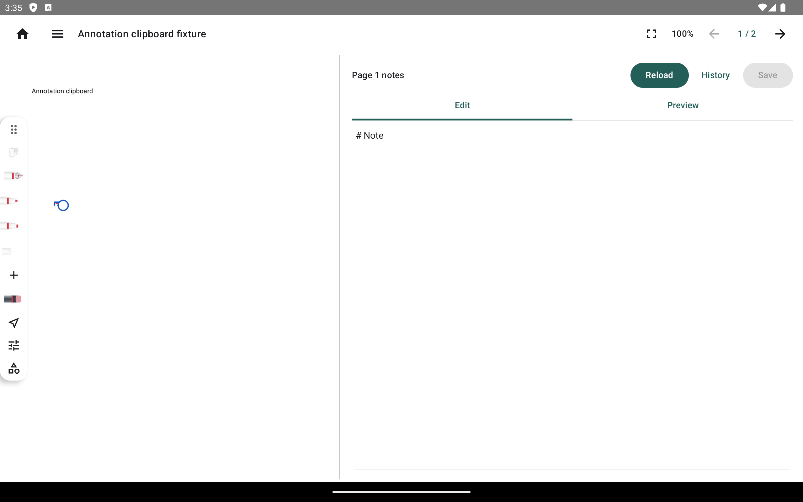

## 参考折线运行截图

- `reference-polyline.png`：Android 14 API 34、ARM64 `Pixel_Tablet_API34_Acceptance` AVD、横屏 2560 × 1600、320 dpi，合成 PDF 项目。`PdfAnnotationSelectionClipboardActivityTest.referencePolylinePersistsAndUndoesAsOneStroke` 模拟先横后竖的 stylus 输入；截图在单个 `pen` 对象保存后、撤销前采集。运行产品代码 commit `a5666a4`。
- 截图包含测试工作区和打开的菜单面板。端到端测试检查落盘对象仍为带 `pagenotePolyline` 的多点 `pen`，一次撤销后对象被移除。实体触控笔、真机、桌面往返和参考 App 运行时对比仍未验收；此图不证明曲线、闭合图形或多材料选择。

## 参考曲线运行截图

- `reference-curve.png`：Android 14 API 34、ARM64 `Pixel_Tablet_API34_Acceptance` AVD、横屏 2560 × 1600、320 dpi，合成 PDF 项目。`PdfAnnotationSelectionClipboardActivityTest.referenceCurvePersistsAndUndoesAsOneStroke` 输入弧线；图中为参考 `BezierTool` 路径保存后的曲线。运行产品代码 commit `a5666a4`。
- 阅读器端到端测试确认保存为 33 点 `pen` 对象并可一次撤销。截图来自菜单切换附近，包含打开的菜单面板；它记录实际运行状态，不代表最终菜单视觉对比。实体触控笔、桌面往返和参考 App 运行时差分仍未验收。

## 参考曲线最小二乘回退

- 验收项 `REF-CURVE-04`：`PdfAnnotationSelectionClipboardActivityTest.referenceCurveLeastSquaresFallbackPersistsAndUndoesAsOneStroke`。输入让端点距离不大于包围盒短边，触发 `GraphUtils.isCurveAndCreate` 对直接 Bezier 分支的回退；页面数据保存为兼容 `pen` + `pagenoteCurve`，拟合采样点数超过固定 33 点 Bezier 分支，并由一次撤销整项移除。
- 运行环境：Android 14 API 34 ARM64 `Pixel_Tablet_API34_Acceptance` AVD，横屏 2560 × 1600、320 dpi、浅色主题；测试 PDF 和合成 stylus `MotionEvent`。截图均来自完整应用屏幕的 `UiAutomation.takeScreenshot()`，运行代码提交 `1f7f7a5`。
- 输入前截图展示空白测试页面，保存后截图展示拟合曲线，撤销后截图展示曲线已清除。非箭头曲线回退通过阅读器保存／撤销与截图验收；箭头分类进入该回退的分支由 `REF-CURVE-05` 识别器级单测覆盖，尚无箭头特例的阅读器落盘截图。拟合器要求至少 6 个点；参考实现 3–5 点的空系数退化输出被明确拒绝。非实体笔、非参考 App 运行时差分，也未验证 Windows／macOS 重新打开与保存往返。

识别前：

拟合保存后：

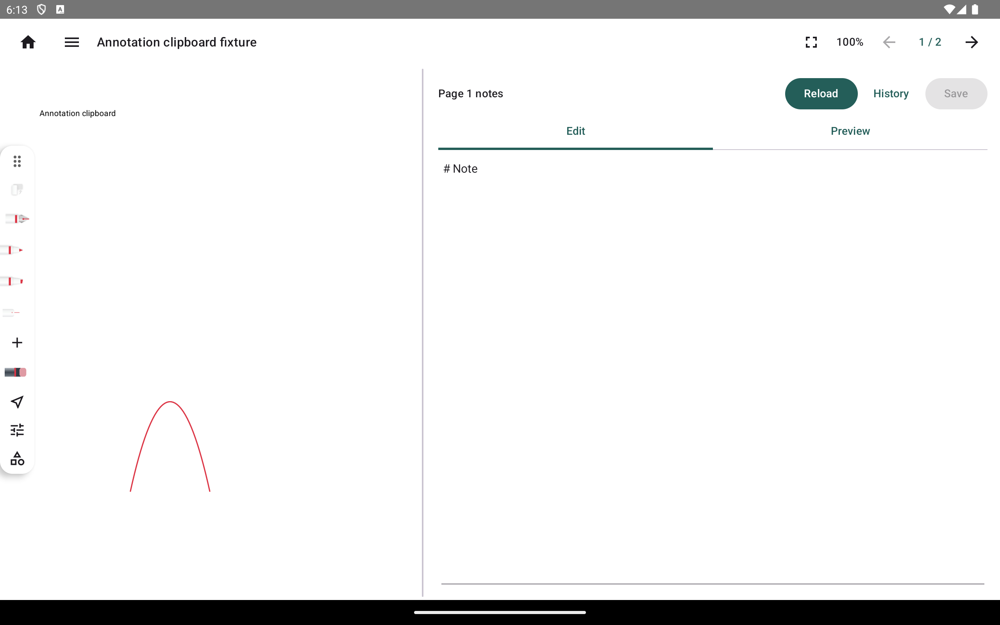

一次撤销后：

## 停留识形与异步保存的撤销顺序

- 验收用例 `REF-HISTORY-02`：`PdfAnnotationSelectionClipboardActivityTest.lateShapeSaveDoesNotOverrideNewerInkGestureOrder`。锁住异步笔迹保存，先完成一条停留识别直线，再写入较新的自由笔迹并放开保存队列；撤销一次应只移除后写的自由笔迹，保留直线。
- 回归确认识形动作先预留历史位置，原生图形写入完成后再完成该历史事务；写入中的最新事务不会使撤销落到更旧操作。运行环境为 Android 14 API 34、ARM64 `Pixel_Tablet_API34_Acceptance` AVD、横屏 2560 × 1600、320 dpi。合成 stylus 输入，不是实体手写笔。
- 该修正只保证这类识形图形与后续笔迹的撤销顺序，不代表参考 App 的统一动作栈已完整移植；真机和桌面往返尚未验收。

## 参考闭合椭圆识形（横屏平板）

- 运行环境：Android 14 API 34、ARM64 `Pixel_Tablet_API34_Acceptance` AVD、横屏 2560 × 1600、320 dpi、浅色主题。页面为测试生成的 PDF；产品运行代码 commit `a5666a4`。
- `reference-closed-ellipse-before.png` 是阅读器启用钢笔后、尚未输入闭合笔迹的状态；`reference-closed-ellipse.png` 是合成 stylus 输入停留识别后保存的椭圆。二者均由 `PdfAnnotationSelectionClipboardActivityTest.referenceClosedEllipsePersistsAsOneClosedPolylineAndUndoes` 从真实应用运行中采集。
- 用例检查磁盘页面中仅有一个 `type: "pen"` 对象、带 `pagenotePolyline` 字段、首尾闭合，并检查一次撤销清空该笔迹。输入是仪器测试生成的触控笔事件，不代表实体触控笔。桌面重开保存往返、参考 App 运行时差分尚未验收。

识别前：

识别后：

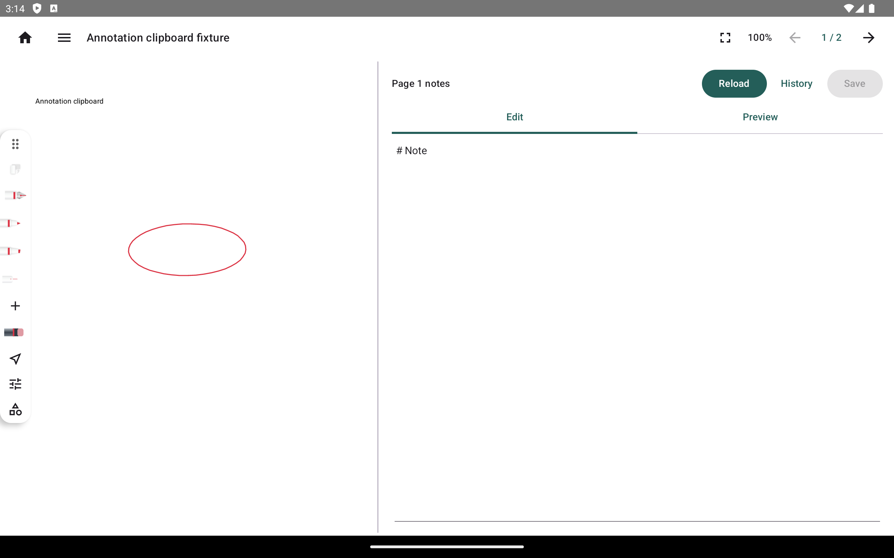

## 闭合圆形、矩形和三角形落盘与撤销

- 运行环境：Android 14 API 34、ARM64 `Pixel_Tablet_API34_Acceptance` AVD、横屏 2560 × 1600、320 dpi、浅色主题；输入为测试生成的 PDF 和合成 stylus `MotionEvent`，不是实体触控笔。产品代码 commit：`149f7ea`。
- `referenceClosedCirclePersistsAsCircleMaterialAndUndoes` 验证圆形写为兼容的 `ellipse` 主类型和 `shape: "circle"` 扩展；`referenceClosedRectangleAndTrianglePersistAndUndoAsOneMaterialEach` 验证近直角闭合轮廓写为原生 `rect`，三角形写为一个闭合多点 `pen`。每种材料均检查页面数据及一次撤销清空。
- `PdfAnnotationSelectionClipboardActivityTest` 在该运行树上 25/25 通过；底层闭合轮廓 OpenCV 仪器用例 4/4 通过。截图由应用运行中的 `UiAutomation.takeScreenshot()` 采集，均为完整屏幕；分别展示输入前、保存后和撤销后的状态。
- 没有新增文件主类型。图片仅证明横屏 Android 合成输入结果；桌面程序重新打开／保存往返、实体笔真机和参考 App 运行时差分仍未验证。

圆形识别前：

圆形保存后：

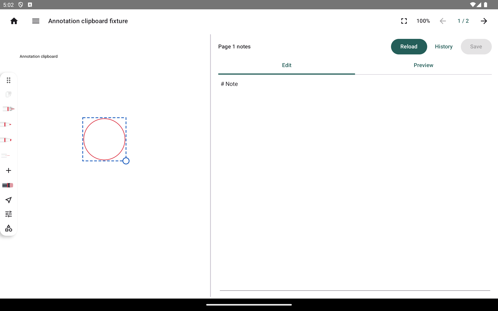

一次撤销后：

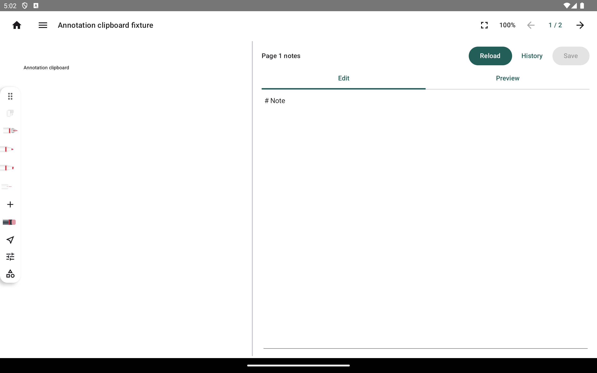

矩形识别前：

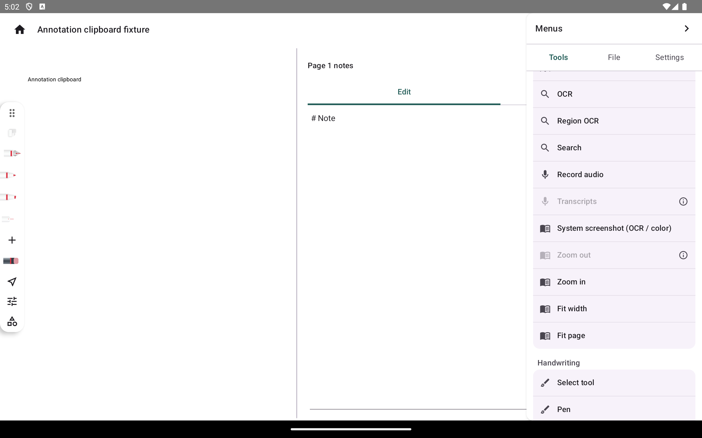

矩形保存后：

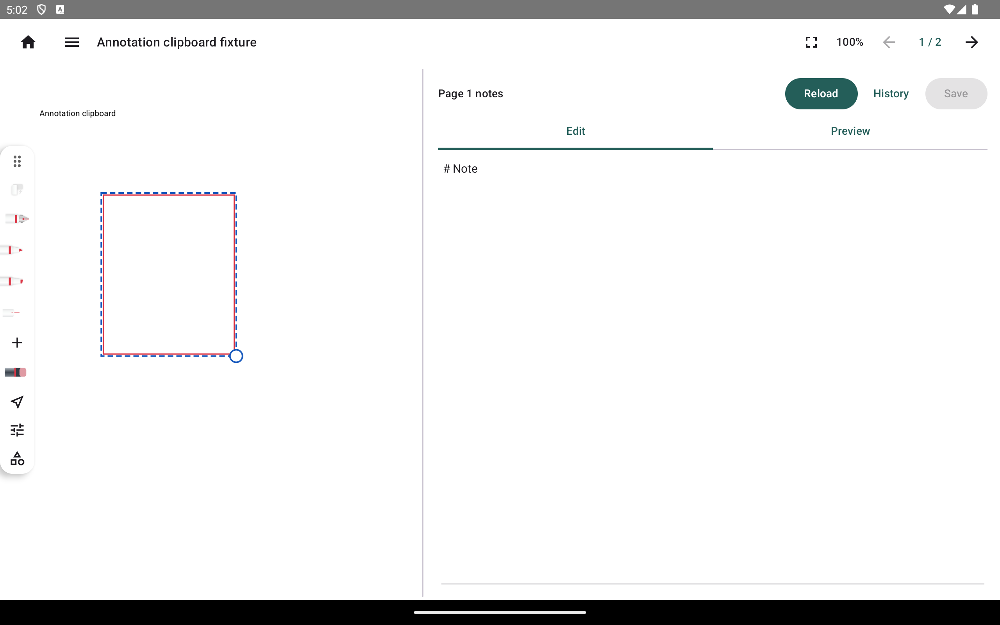

一次撤销后：

三角形识别前：

三角形保存后：

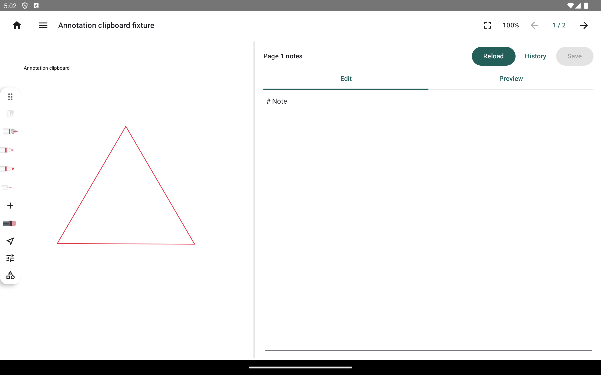

一次撤销后：

## 原生矢量图形区域擦除

- 验收用例 `REF-ERASE-04`：`PdfAnnotationAreaEraserInstrumentedTest.referenceVectorPathIsSampledBeforePenSplitAndFragmentsStayContinuous` 与 `referenceAreaEraserSplitsEveryNativeVectorShapeKind`。参考路径采样后生成的擦除碎片仍保存为连续多点笔迹；图形种类覆盖直线、箭头、矩形与椭圆。
- 参考源码 `ShapeTool.split` 先用 `PathMeasure` 每 2px 采样，再按 `autoShapeLineFactor`（0.8）创建 Pen 并调用 `Pen.split_v2`；后者把两端擦除矩形按笔宽的三分之一扩展，构造擦除走廊并按 1px 路径采样拆分连续片段。`EllipseTool.split` 先将椭圆轮廓每 2px 采样，再走同一 Pen 切分流程。Android 阅读器现把切开的片段临时显示为多点折线，提交时保存为现有 `pen` + `pagenotePolyline` 格式并同步到笔迹层。
- 运行环境：Android 14 API 34 ARM64 `Pixel_Tablet_API34_Acceptance` AVD，横屏 2560 × 1600、320 dpi、浅色主题。测试项目使用生成的 PDF；截图由运行中的 Android 应用 `UiAutomation.takeScreenshot()` 采集。产品擦除实现 commit `dc1c5b8`；合入当前 `beta` 后的验收运行树 commit `169131f`。
- `reference-area-erase-native-before.png` 显示擦除前的完整矩形；`reference-area-erase-native-erasing.png` 显示手势中途的圆形边界（光标位于矩形内部，尚未碰到边线）；`reference-area-erase-native-after.png` 显示擦除后保存的连续笔迹片段；`reference-area-erase-native-undo.png` 显示菜单撤销恢复的原矩形。
- `REF-ERASE-04` 相关几何用例 5/5 通过；当前 `PdfAnnotationSelectionClipboardActivityTest` 在同一 AVD 上 25/25 通过，覆盖擦除预览、原生矩形落盘、一次撤销及自由笔迹／原生图形混合擦除的一次撤销和重做。测试用 stylus `MotionEvent` 驱动真实 `PenCanvasView`，不代表实体触控笔验收。
- 片段点列按参考默认 `PathHelp` 规则重建；annotations.json 不保存笔迹平滑模式，因此非默认参考平滑配置未移植。箭头轮廓按当前 annotations 端点数据重建。参考中心 `ActionStack` 仍未整体移植；本次只把该区域擦除手势作为一条跨笔迹层和批注层的撤销事务。

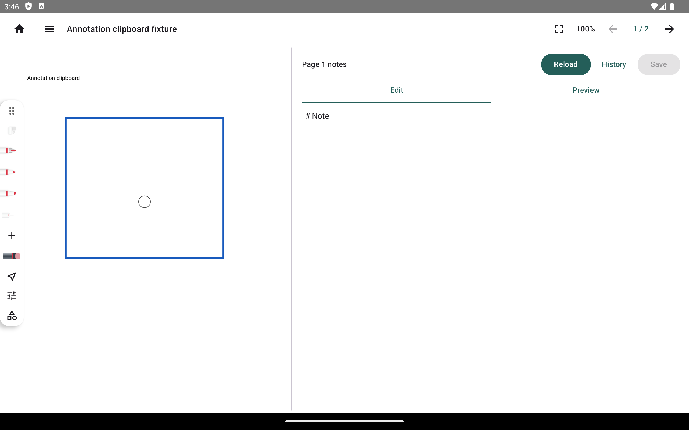
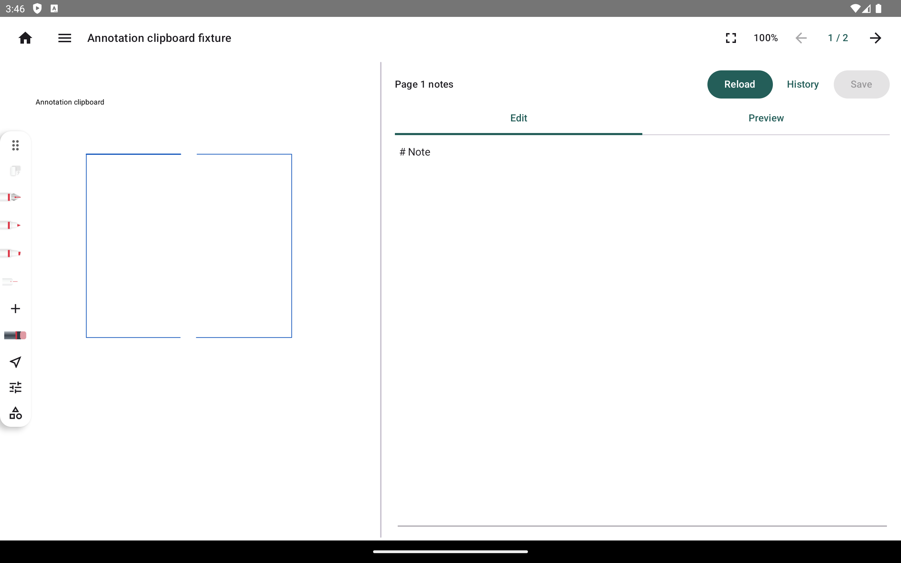

## 原生图形与自由笔迹混合撤销顺序

- `reference-mixed-history-before.png` 与 `reference-mixed-history-undone.png` 由 `PdfAnnotationSelectionClipboardActivityTest.interleavedShapesAndInkUndoInGestureOrder` 在 Android 14 API 34 ARM64 `Pixel_Tablet_API34_Acceptance` AVD、横屏 2560 × 1600、320 dpi 上采集；运行代码为 `0458e5b`。测试在同一页依次写入原生图形、自由笔迹、原生图形，再连续撤销三次并重做三次。识别手势由多段 stylus 事件采样后停留触发。
- 测试检查每一步的 `annotations.json` 类型数量；三次撤销后页面对象为空，截图显示画布已清空。重做后恢复到两个原生图形和一个自由笔迹。输入为注入到真实阅读器 `PenCanvasView` 的合成 stylus `MotionEvent`，不是实体触控笔。
- 该实现将操作顺序路由到 Android 现有的批注历史和笔迹历史，未移植参考应用的中心 `ActionStack` 对象模型。区域橡皮跨层单步事务已有单独验证；其他跨层操作、保存失败竞态、OCR 与进程重建仍未完成验证。

初始状态（图形—笔迹—图形）：

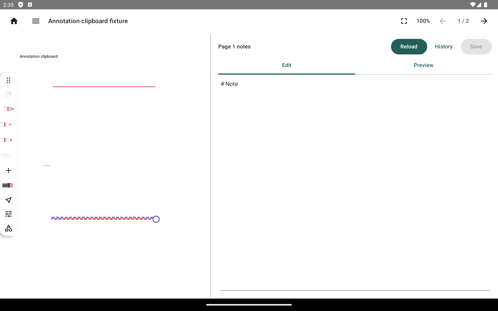

连续撤销三次后的空白画布：

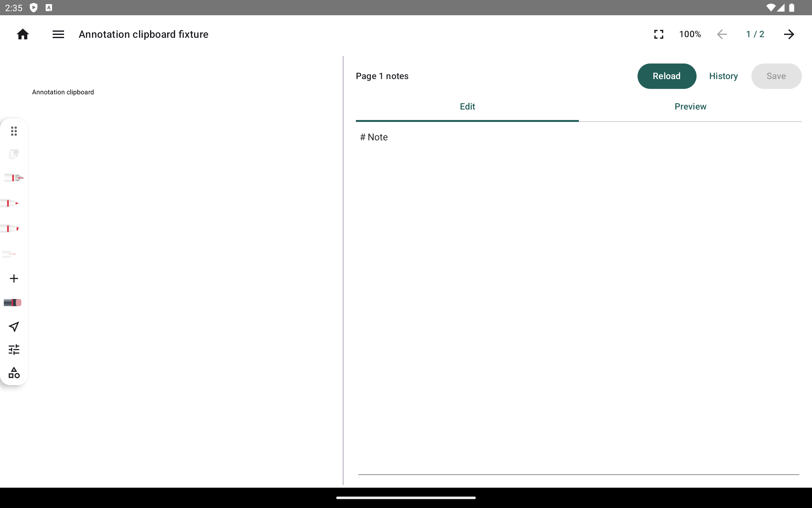

## 跨层区域擦除单步撤销与重做

- 验收用例 `REF-ERASE-03`：`PdfAnnotationSelectionClipboardActivityTest.oneAreaEraseGestureAcrossFreehandAndNativeShapeIsOneUndoStep`。在同一条连续区域橡皮手势中擦过原生矩形和自由笔迹，检查两层都被切开；一次撤销恢复两层，一次重做再次擦除。
- 运行环境：Android 14/API 34、ARM64 `Pixel_Tablet_API34_Acceptance` AVD、横屏 2560 × 1600、320 dpi、浅色主题；测试生成的 PDF 与合成 stylus `MotionEvent`，不是实体触控笔。产品擦除实现 commit `dc1c5b8`；合入当前 `beta` 后的验收运行树 commit `169131f`。
- 四张完整屏幕截图来自应用运行中的 `UiAutomation.takeScreenshot()`：`reference-area-erase-mixed-before.png`（擦除前）、`reference-area-erase-mixed-erased.png`（一条手势擦除两层）、`reference-area-erase-mixed-undo.png`（一次撤销恢复矩形和笔迹）、`reference-area-erase-mixed-redo.png`（一次重做再次擦除）。
- 页面文件格式不变。实现只把同一擦除手势关联的笔迹历史和原生批注历史作为一个用户可见撤销项；它仍使用 Android 两套页面快照，并未完整移植参考项目的中心 `ActionStack`。其他跨层编辑、失败注入、进程重启和真机笔迹尚未验证。

擦除前：

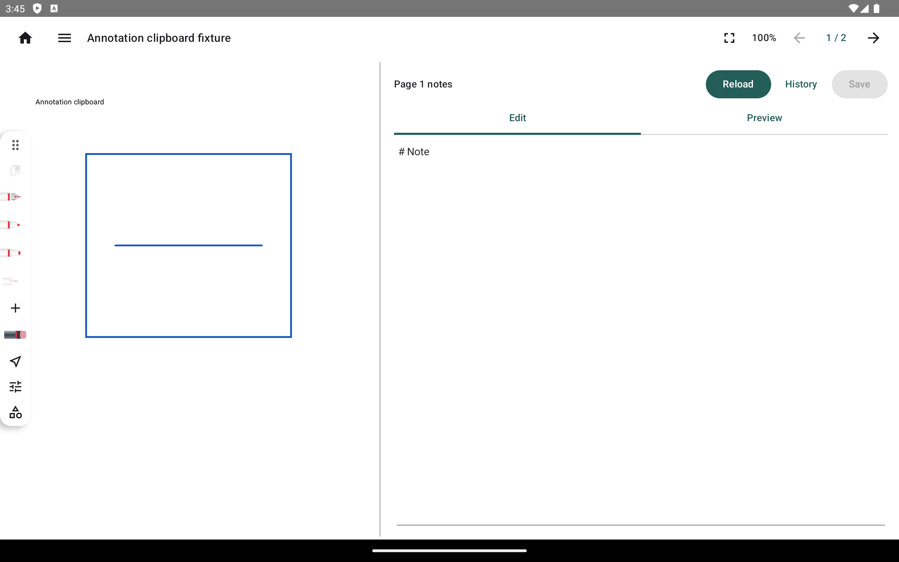

擦除后：

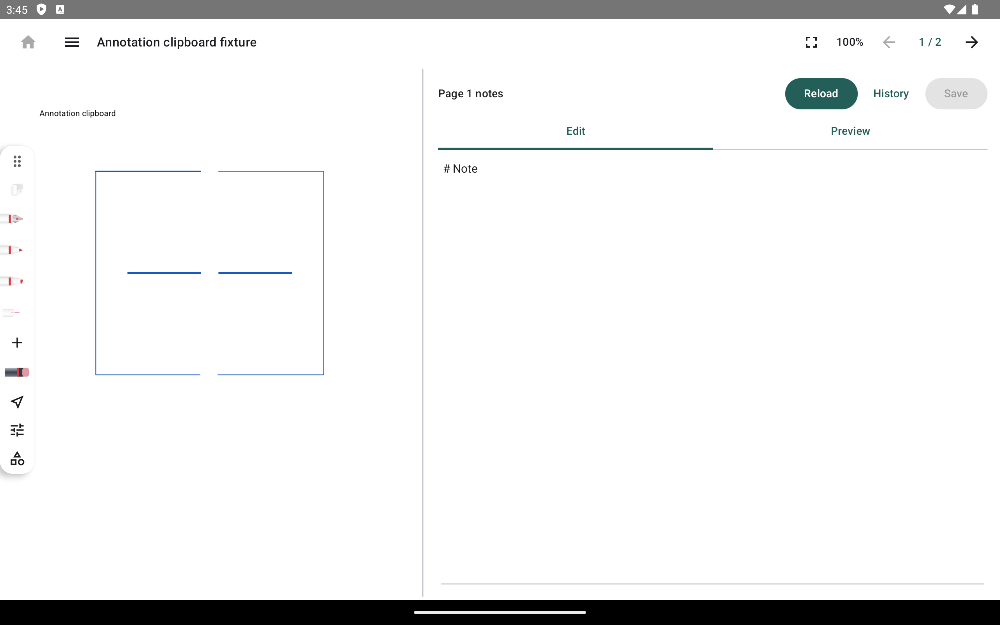

一次撤销恢复：

一次重做：

## 参考区域多材料选择

- 验收用例 `REF-SELECT-01`：`PdfAnnotationSelectionClipboardActivityTest.referenceRegionSelectionUsesFirstPenSampleAndUndoesMixedDeleteAsOneAction`。套索同时包住两段自由笔迹和一个原生矩形，其中一段笔迹从套索外开始、之后穿过区域；按参考源码，它因首个采样点在外而不选中。删除会移除首点在内的笔迹和矩形，保留穿越笔迹；一次撤销恢复全部三项。
- 回归用例 `REF-SELECT-02`：`InkSelectionClipboardActivityTest.selectCopyPasteDeleteAndUndoOperateOnCurrentPdfPage`。选中一段笔迹、复制并粘贴，再删除粘贴项；检查旧选区不会残留，并验证一次撤销／重做和页面持久化。
- 验收用例 `REF-SELECT-03`：`PdfAnnotationSelectionClipboardActivityTest.referenceRegionSelectionCopiesMixedMaterialsAndPastesAsOneUndoAction`。套索同时选中两段自由笔迹和一个原生矩形，复制得到三个独立剪贴板条目；粘贴后检查整组共同平移且相对位置不变；一次撤销恢复原页，一次重做恢复整组。
- 参考 `Pen.isInRegion()` 的 smali 在检查第一个非空笔迹样本后直接返回；Android 现按该行为决定自由笔迹是否进入选区。原生图形继续按参考 `Material.isInRegion()` 使用图形选择框和套索区域 bounds 判定。此前 Android 使用“任意样本落入即选中”，现已修正。
- 本次运行环境：Android 14/API 34、ARM64 `Pixel_Tablet_API34_Acceptance` AVD，横屏 2560 × 1600、320 dpi、浅色界面。四张截图在实现提交 `8a50052` 对应代码上由 Android `UiAutomation.takeScreenshot()` 从完整屏幕采集；测试使用合成 PDF 和注入到真实阅读器 `PenCanvasView` 的 stylus `MotionEvent`，不是实体手写笔。截图采集前等待剪贴板提示消失。
- `reference-region-copy-selected.png` 与 `reference-region-copy-pasted.png` 是本次 `REF-SELECT-03` 通过 Android `UiAutomation.takeScreenshot()` 从运行中的完整 2560 × 1600 屏幕采集的图。复制后截图包含 Android 系统剪贴板预览浮层。
- 选择逻辑参照恢复源码中的 `Selector.selectMaterials`、`Material.isInRegion`、`Pen.isInRegion` 和 `SelectionManager`。当前 Android 适配支持混合材料套索选择、组复制／粘贴、移动、改色和删除；移动、改色及组粘贴可单步撤销和重做。组粗细修改及参考选择器的其他材料仍未实现。图形与笔迹沿用现有 annotations.json 格式；Windows／macOS 和其他 Android 设备未改动或据此验收。
- 验收命令：`ANDROID_HOME=/Users/broccoli/Library/Android/sdk ANDROID_SERIAL=emulator-5558 ./gradlew :app:connectedDebugAndroidTest -Pandroid.testInstrumentationRunnerArguments.class=io.pagenote.android.PdfAnnotationSelectionClipboardActivityTest`；全类 23/23 通过，0 失败、0 跳过，唯一计入设备为 `Pixel_Tablet_API34_Acceptance`。JVM 命令 `./gradlew :feature-pen:testDebugUnitTest :app:testDebugUnitTest --rerun-tasks` 通过：feature-pen 153 项、app 662 项，均 0 失败。未运行其他设备；全量 App connected 仪器测试、实体笔、真机和桌面往返未验。

套索前：

套索包住两段笔迹和原生矩形；蓝色穿越笔迹首点在套索外，因此未选中：

删除选中组后，蓝色穿越笔迹仍保留：

一次撤销后恢复两段笔迹和矩形：

套索选中混合材料后：

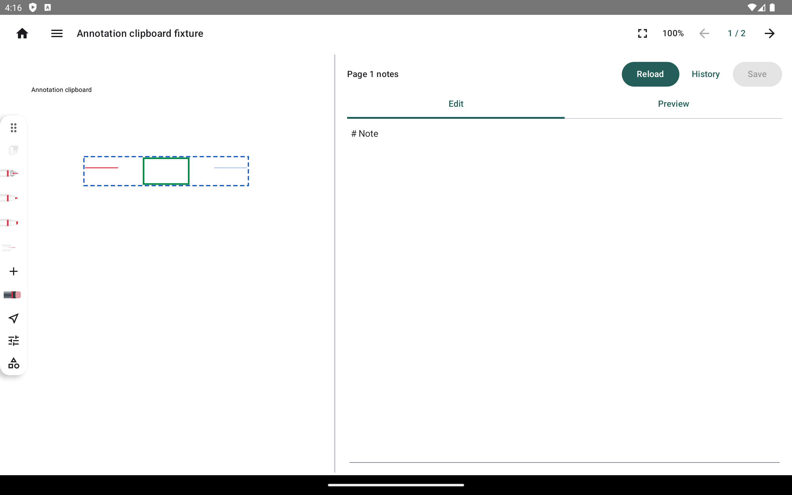

组粘贴后（各材料保持相对位置）：

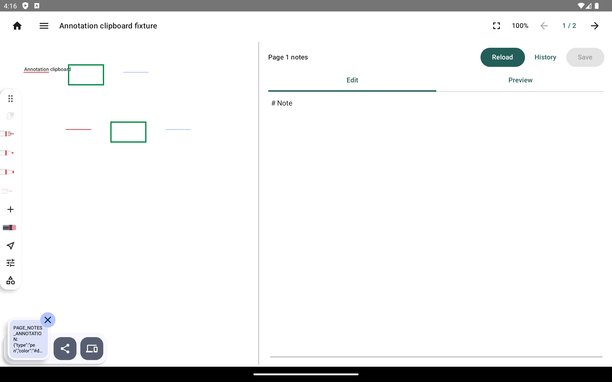

### 混合材料组移动与单步撤销重做

- 验收用例 `REF-SELECT-04`：`PdfAnnotationSelectionClipboardActivityTest.referenceRegionSelectionMovesMixedMaterialsTogetherAndUndoesAsOneAction`。套索选中两段自由笔迹和一个原生矩形，在选框内拖动；拖动中两层立即预览同一偏移，保存后检查三项坐标均增加文档坐标 `(100, 80)`，选区外的椭圆保持不变；一次撤销恢复原页，一次重做再次移动整组并保留选中状态。
- 验收用例 `REF-SELECT-05`：`PdfAnnotationSelectionClipboardActivityTest.referenceRegionMovePreservesEarlierPenUndoHistory` 和 `referenceMixedSelectionCommitsOnOwnerPointerUpAndRestoresOnCancel`。在同一文档先追加新笔迹再移动原混合组；验证组移动保留先前笔迹撤销记录，第一次撤销恢复组、第二次撤销移除新笔迹。多指手势中活动 stylus 指针抬起会提交组移动；调用 `cancelActiveGesture()` 会回滚预览且不写入页面。
- 混合历史也允许动作本身删除或新增项目，并保留手势期间新追加在页面尾部的其他材料；套索快照中的内容若被更改或重排，则拒绝用旧预览覆盖。原生编辑撤销后返回混合页顺序上下文；同步笔迹模型时不清空已有笔迹撤销／重做栈，新混合笔迹编辑才清除过时的笔迹重做分支。
- 选择／剪贴板仪器测试类 22/22 通过，包含混合材料删除、复制／粘贴、移动、多指抬起／取消、撤销／重做和混合历史顺序回归。JVM 测试：`:app:testDebugUnitTest` 661 项、`:feature-pen:testDebugUnitTest` 153 项，均通过。
- 五张图由本次运行中的 Android 应用经 `UiAutomation.takeScreenshot()` 采集：移动前、套索选中、拖动提交后、一次撤销和一次重做。运行代码 commit：`a6b2d0a`。设备：Android 14/API 34、ARM64 `Pixel_Tablet_API34_Acceptance` AVD，横屏 2560 × 1600、320 dpi、浅色主题。项目和 PDF 为仪器测试生成的合成数据；输入为合成 stylus 与多点 `MotionEvent`，不是实体触控笔。
- 移动只平移所选材料的点坐标，不更改 annotations.json 结构；未选材料保留原坐标。Windows／macOS 未改动。实体手写笔、真机触控、参考 App 运行时差分、桌面重开与往返保存、组粗细修改尚未验收。
- 验收命令（仅目标横屏平板）：`ANDROID_HOME=... ANDROID_SERIAL=emulator-5558 ./gradlew :app:connectedDebugAndroidTest -Pandroid.testInstrumentationRunnerArguments.class=io.pagenote.android.PdfAnnotationSelectionClipboardActivityTest`。运行结果：`Pixel_Tablet_API34_Acceptance(AVD) - 14`，22 项完成、0 失败、0 跳过。

移动前：

套索选中：

拖动提交后：

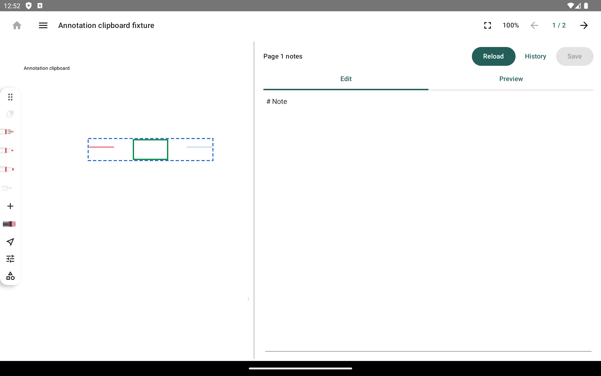

一次撤销：

一次重做：

### 混合材料组改色与单步撤销重做

- 在选择工具下套索圈住自由笔迹和原生图形，再打开浮动笔盒的通用样式按钮并选颜色；本次实现会统一更改被选材料的颜色，未选中的图形保持不变。多选粗细修改仍未实现。
- `PdfAnnotationSelectionClipboardActivityTest.referenceMixedSelectionChangesColorAndUndoesAsOneAction` 使用两段自由笔迹、一个原生矩形和一个选区外椭圆验证改色、页面保存、单步撤销及重做。压力点和非样式字段保持不变。
- 四张全屏截图由 Android 应用经 `UiAutomation.takeScreenshot()` 采集，设备为 Android 14/API 34、ARM64 `Pixel_Tablet_API34_Acceptance` AVD，横屏 2560 × 1600、320 dpi、浅色主题。测试材料为生成的 PDF 和合成笔迹；这是合成 stylus 事件输入，不代表实体触控笔。产品运行代码 commit：`7544395d6dd3f4c4319056e5988970c646c92117`。
- 选择／剪贴板仪器测试类 23/23 通过，`:app:testDebugUnitTest` 662 项通过。
- 项目 `annotations.json` 格式未变；改色作为包含笔迹及原生图形的单一页面历史项，因此一次撤销／重做作用于整组选中材料。参考应用运行时差分、真机、桌面打开／保存往返及完整统一动作栈未验收。

套索选中、改色前：

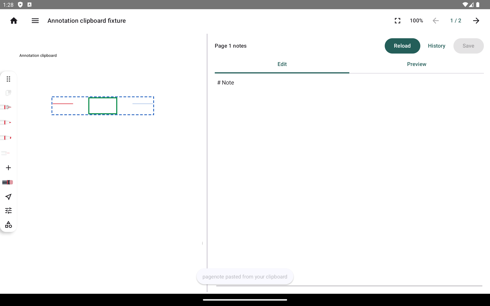

改色后：

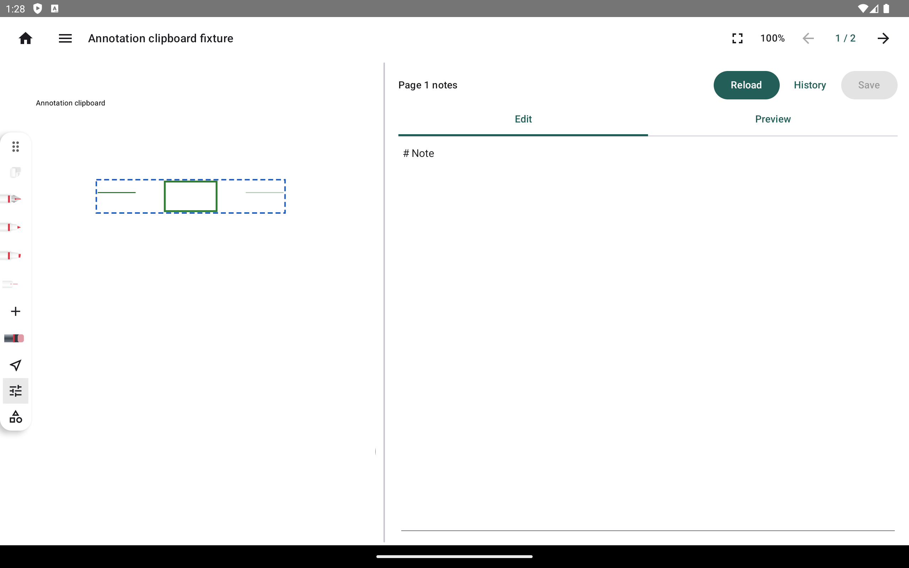

一次撤销：

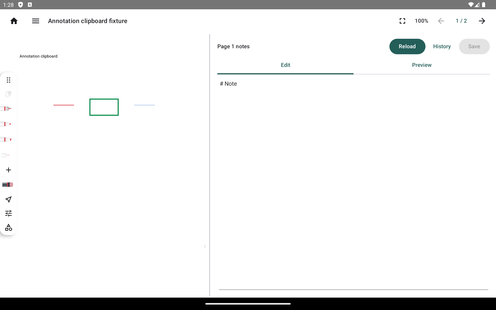

一次重做：

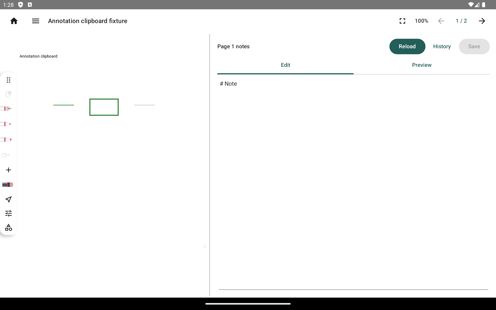
