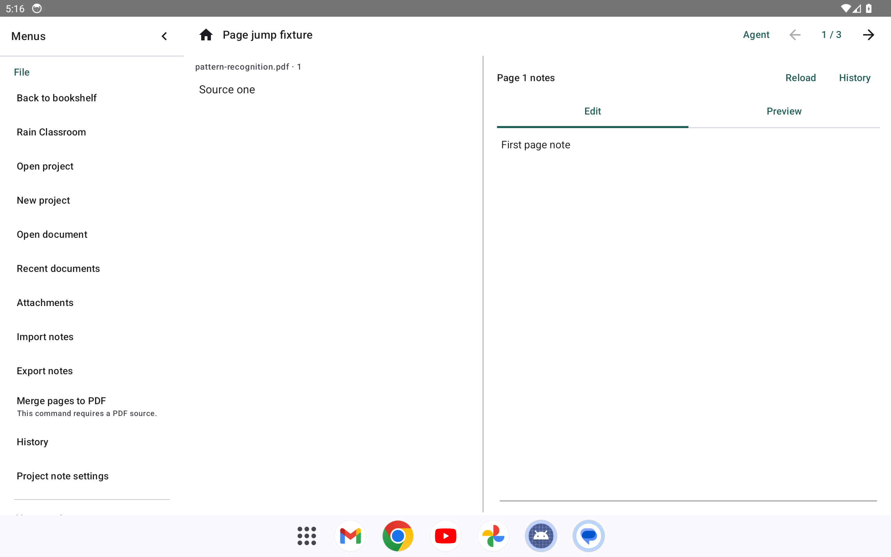
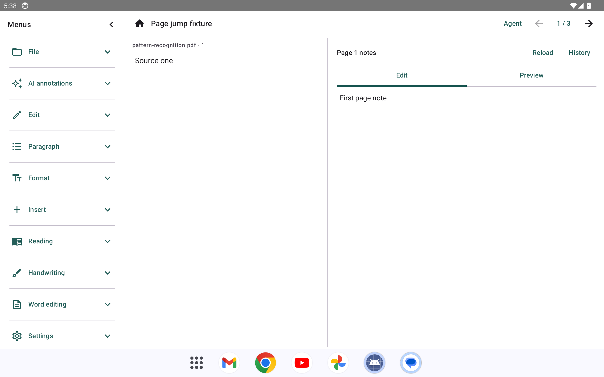
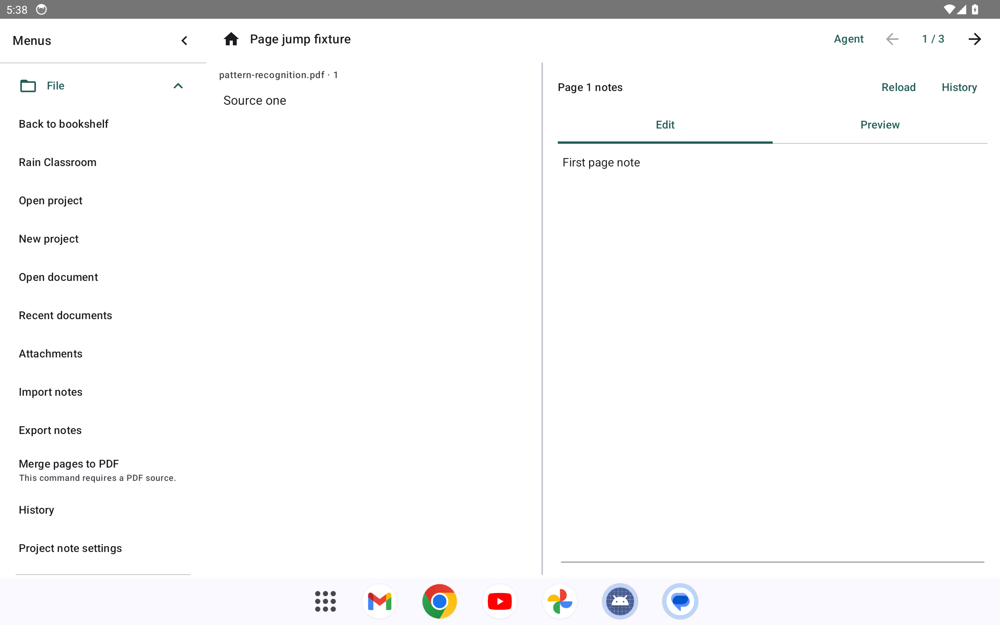
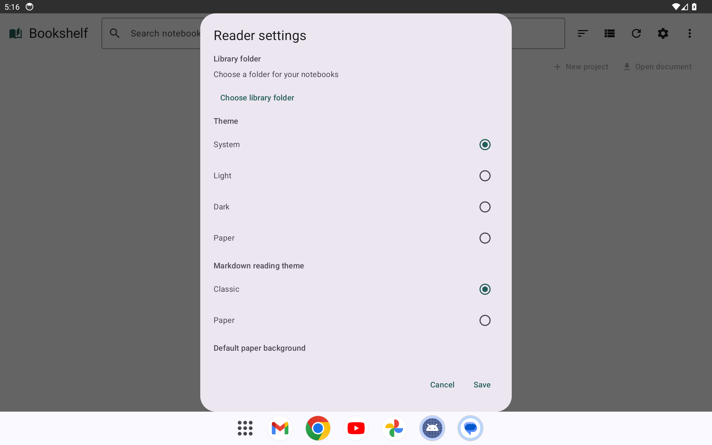
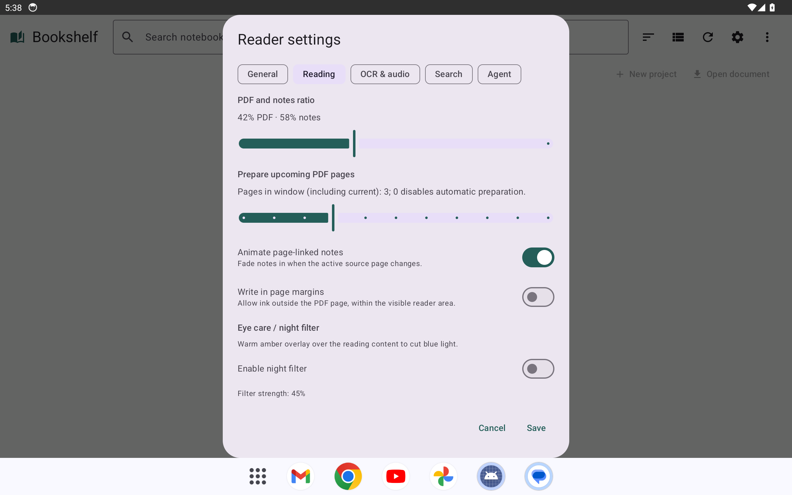
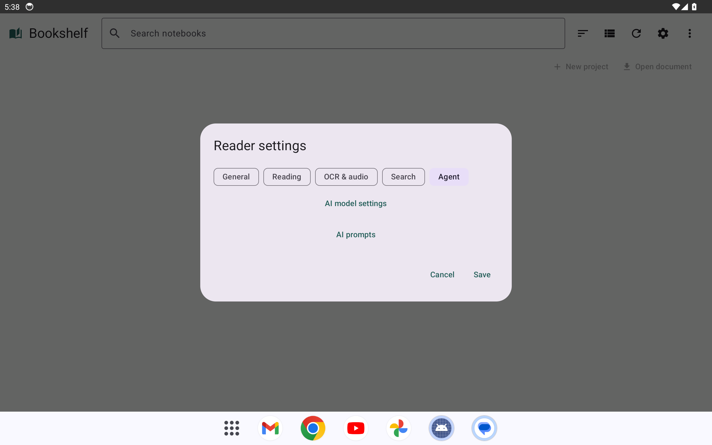
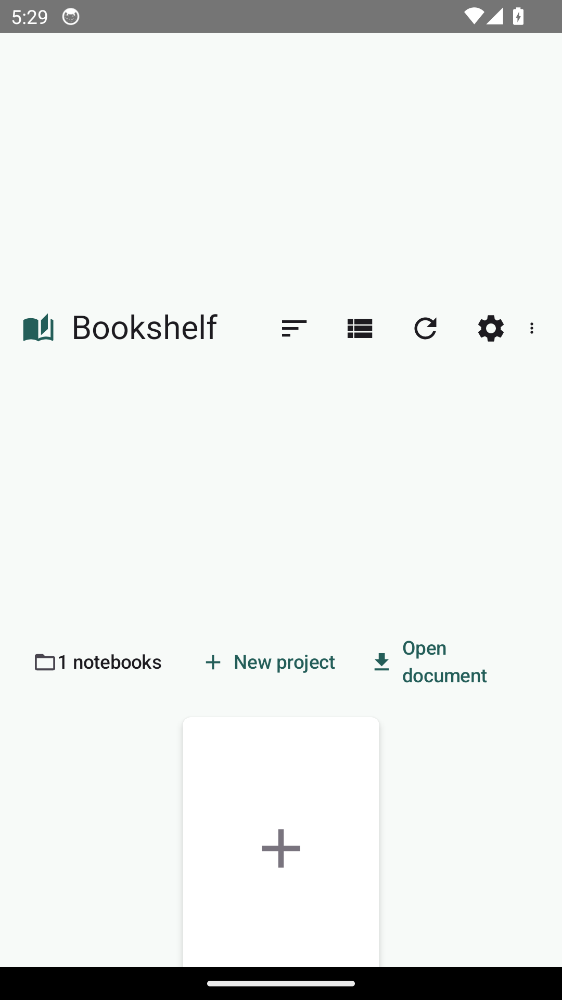
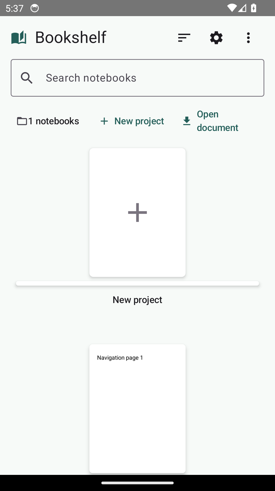
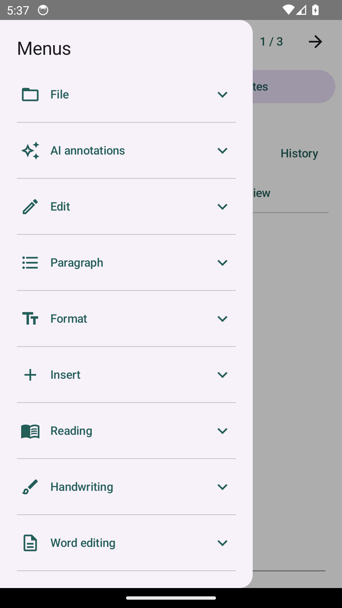

# Android 菜单与设置

[Android 首页](../README.md) · [工作区教程](workspace.md) · [功能表](../features.md)

本页展示未发布的 Android 开发源码。截图来自 Android 14／API 34、ARM64 模拟器、浅色主题：横屏为 2560×1600、320 dpi，窄屏为 1080×1920、420 dpi。内容为自编测试项目。改前运行代码为 `476b354`，改后运行代码为 `b67d96c`；维护者视觉审查另行进行。

## 阅读菜单

1. 在阅读页面点击左上角菜单按钮。
2. 菜单先显示“文件、编辑、插入、阅读、手写”等分组；点击分组查看其操作，再次点击可收起。打开另一组时，之前的分组自动收起。
3. 在窄屏，点击菜单外部或系统返回可关闭侧栏；平板可点击侧栏顶部收起按钮。

## 分类设置

在书架点击设置，或在阅读菜单的“设置”分组打开设置。顶部分类分别包含：

- **通用外观**：书架目录、主题、纸张背景和语言。
- **阅读手写**：双栏比例、预加载、翻页动画、手写边界及夜览滤镜。
- **识别录音**：OCR、公式识别、录音和离线转写。
- **搜索**：搜索索引范围和重建入口。
- **Agent**：模型和提示词配置入口。

切换分类不会丢失修改；点击“保存”统一保存，点击“取消”放弃本次设置草稿。进入 Agent 配置前会先保存当前设置。各模型和外部服务仍需按原有流程配置。

## 窄屏书架

搜索框在窄屏单独占一行；视图切换和刷新移到右上角“更多”菜单。目录、搜索、新建和打开项目仍可使用。

