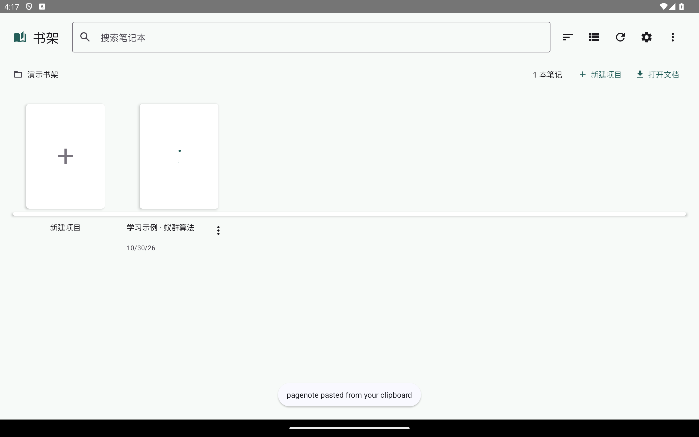
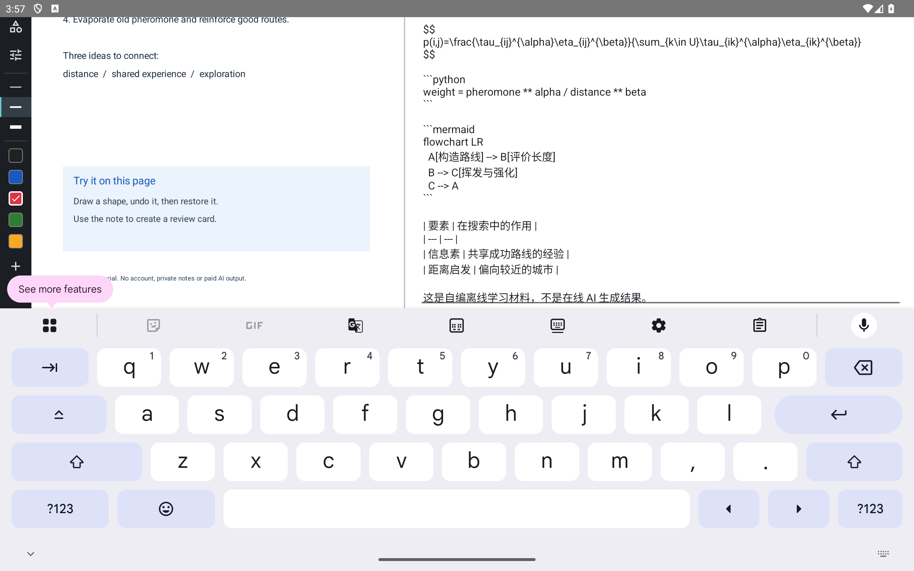

# 阅读课件与编辑逐页笔记

[教程目录](README.md) · [功能覆盖表](../features.md) · [本组截图环境](capture.md)

## 书架与目录授权

1. 启动应用，在书架选择课件目录，通过 Android 系统选择器授予读写权限。选择你保存项目的目录；桌面路径不能直接代替 Android 授权。
2. 打开项目封面。项目需要包含 `project.pagenote` 和它链接的原文、笔记及附件。
3. 阅读器左上角主页按钮返回书架。取消系统选择器会保留原状态，不会创建一个已授权的目录。

下面是使用合成课件的完整书架屏幕。封面打开的是实际 SAF 项目，未使用个人课程材料。

## 原文与笔记对应

左边显示 PDF，右边显示当前页笔记。右上角上一页／下一页切页；页码入口可用于定位页面。切页前会走笔记保存流程，写入失败或文件冲突需要先处理，不能把失败当成已经保存。

点击右侧“预览”查看渲染后的 Markdown；公式、代码、Mermaid 和表格是这份自编笔记的真实渲染结果。这里的说明文字是预置演示资料，没有调用在线 AI。

## 编辑、保存和键盘

点击“编辑”进入笔记输入区。修改后使用“保存”；“重载”会重新读取已保存文件，执行前确认是否要放弃当前草稿。历史入口可查看应用保留的历史版本。编辑与预览可以来回切换，但预览本身不是“已保存”的证明，应查看保存反馈。

下面专门展示键盘展开时的完整布局，便于检查课件、输入区和底部控件是否被遮挡。

选中文字后，可[发起 AI 动作或制作闪卡](study-tools.md)。需要把一段文字放到 PDF 上时，使用[画布富文本批注](canvas.md#富文本批注)，它与右侧整页 Markdown 编辑器是两个入口。

本轮验证了示例打开与上述显示状态；真机输入法、横竖屏切换、长时间编辑及持久目录授权仍需各自验证。
