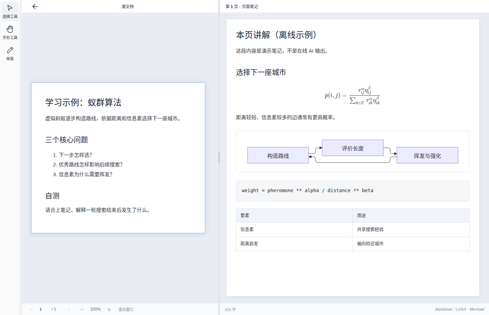

# PageNote Linux

PageNote 将课件与逐页笔记并排显示，支持阅读、批注、项目保存及可配置的 AI 讲解。Linux 复用共享桌面界面，通过 LibreOffice 转换 Office 文档。

当前为 **Ubuntu x64 实验性源码与本地构建**。Linux 独立开发版本 `1.1.0-beta.5-dev.3`，尚无正式版、公开 beta 下载或 Linux 远端维护分支；首次适配 PR 提交至共享 `beta`。Windows、macOS、Android 的版本和下载不变。

## 运行和构建

需要 Node.js >=22.13、npm，以及 Electron 所需的 GTK/NSS/音频系统库和图形会话。导入 Word/PowerPoint 还需 LibreOffice。Ubuntu 可通过系统软件管理器安装 `libreoffice`；无需 Microsoft Office。

```sh
npm ci
npm run build
./start.sh
```

`start.sh` 优先使用 `PAGENOTE_NODE_HOME` 指定的 Node，其次使用已有的 `~/.local/share/pagenote-runtime/node-v22.22.0-linux-x64`，最后使用 PATH。不会安装或修改全局 Node。桌面启动会准备 Electron 运行时；首次安装和构建需要网络。OCR 使用 CPU，安装跳过 CUDA 下载。

```sh
node scripts/platform.mjs linux info
node scripts/platform.mjs linux check
npm run package:linux:local
# 输出 release/beta-1.1.0-beta.5-dev.3/linux-unpacked/pagenote
```

已有同版本 Electron 时可用 `PAGENOTE_ELECTRON_DIST="$PWD/node_modules/electron/dist" npm run package:linux:local` 复用本机运行时。`npm run package:linux` 配置 AppImage/deb，但安装器尚未验收。浏览器模式为 `npm run launch`，开发模式为 `npm run dev`。

## 数据与升级

Beta 使用 `~/.config/pagenote-beta`，保留旧版 `~/.config/pagenote`；不自动复制账号设置或旧数据，不注册稳定版文件关联。通过应用“打开项目”选择既有 `.pagenote` 项目。项目格式仍为共享 beta 的格式版本 1，本次未修改格式或迁移旧项目；本次验证 Linux 保存重开，不宣称所有旧版本往返兼容。浏览器模式使用项目内 `data/`，与桌面目录不同。

源码入口为 `apps/desktop/linux/main.cjs`，复用完整 `desktop/main.cjs`；Linux 转换器保留在 `desktop/linux-office.cjs` 以兼容旧源码路径。独立版本见 `platforms/linux/version.json`。后续 Linux 平台线及发布保护尚待维护者建立，不创建未经批准的 stable 基线。

## 功能、截图与限制

[配图教程](guide/README.md) · [功能与截图覆盖表](features.md) · [验证记录](VALIDATION.md) · [更新日志](CHANGELOG.md) · [发布状态](releases/README.md)



- Office 转换使用 LibreOffice，版式可能与 Microsoft Office 不同；不提供 COM、AppleScript 或 Microsoft Office 内嵌编辑。
- AI 需用户自行配置服务；雨课堂需真实账号和网络。本次只验证本地模拟流程，未调用付费服务或登录真实账号。
- 本机为 Ubuntu 22.04 x86_64；其他发行版、ARM64、Wayland、多屏、AppImage/deb 安装流程未验证。
- 原生 Markdown S 保留共享 beta 实现；本 PR 不修改渲染器。图形硬件差异与模块证据见教程。

[项目总入口](../../README.md) · [共享已知问题](../../KNOWN_ISSUES.md)
