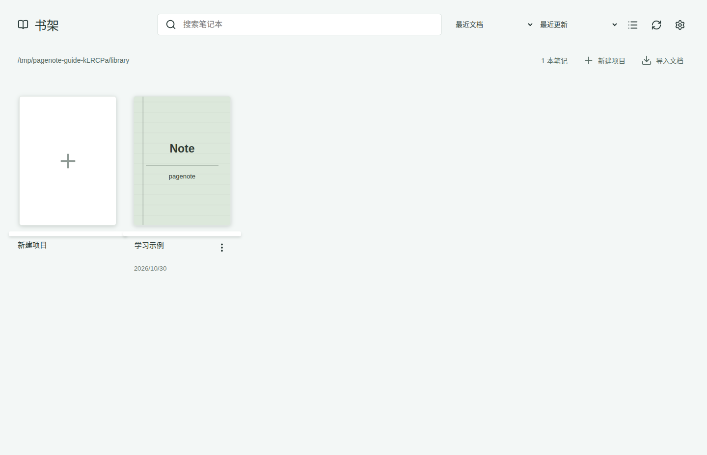
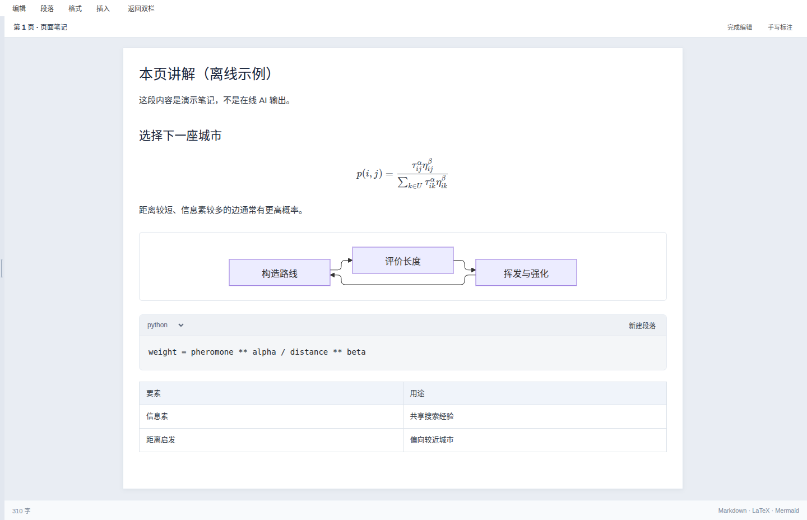
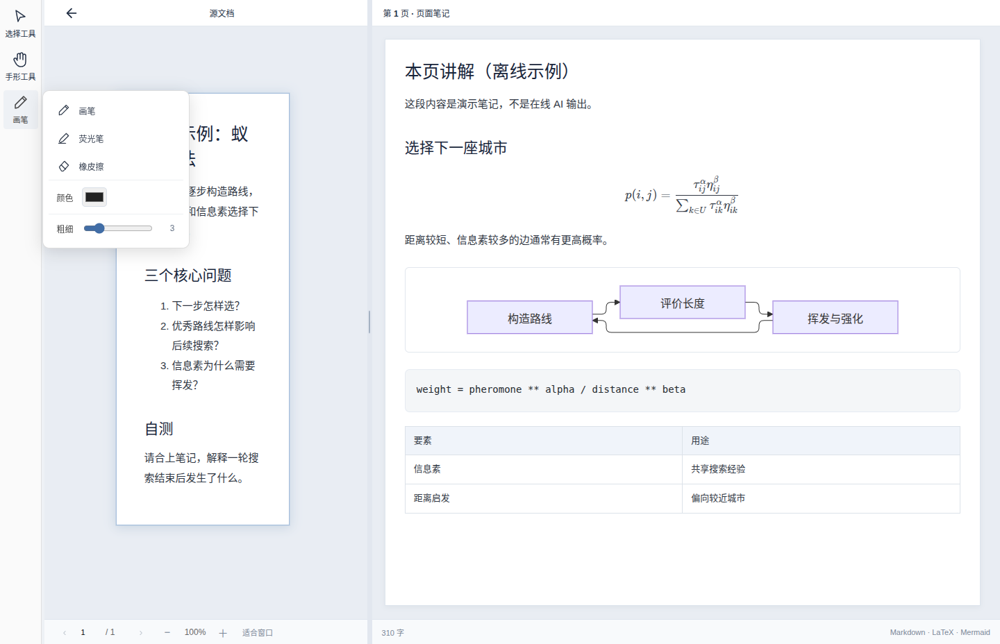

# Linux 配图教程

以下为 Ubuntu 上实际运行的 PageNote，使用合成学习资料和独立临时配置；不含用户账号或私人笔记。源码版本、提交、系统、尺寸和缩放记录于 [截图来源](images/current/provenance.json)。

## 1. 从书架进入阅读

启动后选择项目目录，点击“学习示例”项目卡片。首次导入文件可以使用打开文件入口；Word/PowerPoint 需预先安装 LibreOffice。

## 2. 对照课件和笔记

左侧显示课件，右侧显示笔记、公式和流程图。示例讲解为离线预置内容，非 AI 在线生成。

## 3. 编辑和批注

打开笔记编辑入口修改右侧内容；通过项目保存流程持久化。退出编辑后可按需展开批注工具，选择画笔，切回鼠标继续阅读。

## 4. AI 工作台

从菜单进入笔记处理工作台，配置自己的服务后再发起任务。截图仅展示空账号环境中的界面；本次未验证真实服务。关闭工作台返回阅读。

## 5. 交互学习笔记

[原生 Markdown S 的实际模块截图和操作记录](native.md)。

本次新增 Linux 启动和转换支持，未重新设计共享界面；上游尚无已发布 Linux 界面，因此没有可对照的上游 Linux“改前”包。截图展示当前真实状态，不用 Windows 或 Mac 截图替代。
