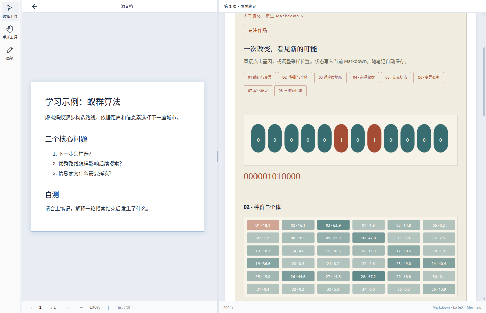
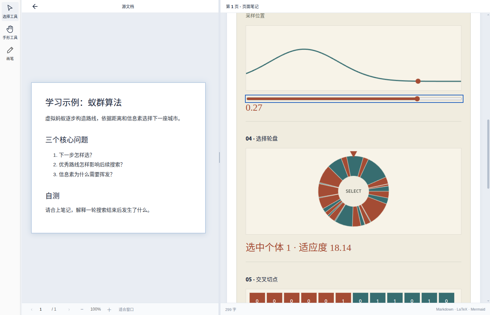
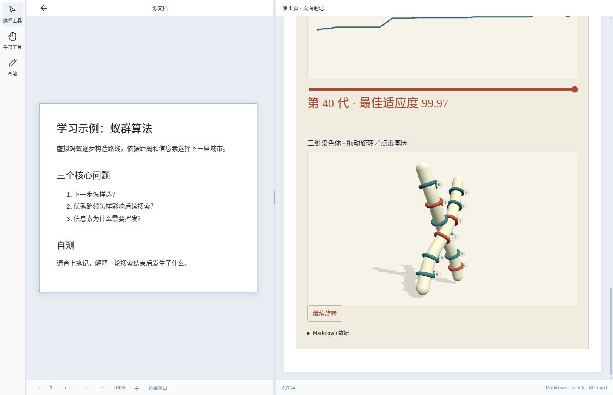

# 原生 Markdown S 本机验证

Linux 复用共享 beta 渲染器，本 PR 不修改引擎。使用 `examples/markdown-s-native.md` 合成学习笔记。[运行环境与提交来源](images/markdown-native/provenance.json)。运行提交 `9b403d8`，Linux 本地包 `1.1.0-beta.5-dev.3`；后续只补测试和证据。

## 按顺序操作

1. 进入学习项目，点击“专注作品”；修改基因后返回笔记。
2. 用键盘和滑杆更改采样位置，确认 SVG 与 Canvas 同步。
3. 选择个体、拖动轮盘和使用方向键；更改交叉切点和变异概率。
4. 查看第 40 代，观察图表数值；暂停并拖动三维染色体。
5. 刷选多个基因，保存到原有 Markdown 项目，完全退出应用后重开；脚本核对所有状态恢复及数据围栏外原文不变。

各步骤均有自动断言；没有创建 HTML 文件或 iframe。GPU 丢失测试触发降级提示，不代表所有显卡已验证。新平台无旧 Linux 引擎截图；本 PR 复用已有实现，不做视觉参考等价声明。

| 模块／状态 | 动作及可观察结果 | 真实截图 |
| --- | --- | --- |
| 专注作品 | 打开专注模式，显示独立作品导航 | [专注概览](images/markdown-native/native-focus-overview.png) |
| SVG 基因 | 点击“基因 1”，状态翻转，键盘操作同步 | [SVG](images/markdown-native/native-svg.png) |
| Canvas 采样 | 将采样位置设为 80，曲线上的位置标记改变 | [Canvas](images/markdown-native/native-canvas.png) |
| 种群 | 选择个体 2，选中编号改变 | [种群](images/markdown-native/native-population.png) |
| 选择轮盘 | 拖动并按方向键，选中个体改变 | [轮盘](images/markdown-native/native-wheel.png) |
| 交叉 | 将切点设为 8，子代分段变化 | [交叉](images/markdown-native/native-crossover.png) |
| 变异 | 概率设为 20%，显示预期 2.40 个突变 | [变异](images/markdown-native/native-mutation.png) |
| 图表 | 查看第 40 代，最佳适应度显示 99.97 | [图表](images/markdown-native/native-chart.png) |
| WebGL 三维 | 暂停后拖动，持久化角度改变 | [三维](images/markdown-native/native-three.png) |
| 三维专注 | 从作品导航切到三维模块 | [专注三维](images/markdown-native/native-focus-three.png) |
| 多基因刷选 | 连续拖动，至少三个基因改变 | [刷选](images/markdown-native/native-brush.png) |
| GPU 降级 | 主动丢失上下文后显示回退状态 | [降级](images/markdown-native/native-gpu-fallback.png) |
| 保存 | 更新同一 Markdown，完全重启后恢复 | [保存状态](images/markdown-native/native-note-saved.png) |

