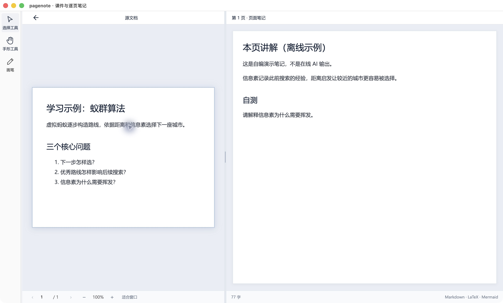
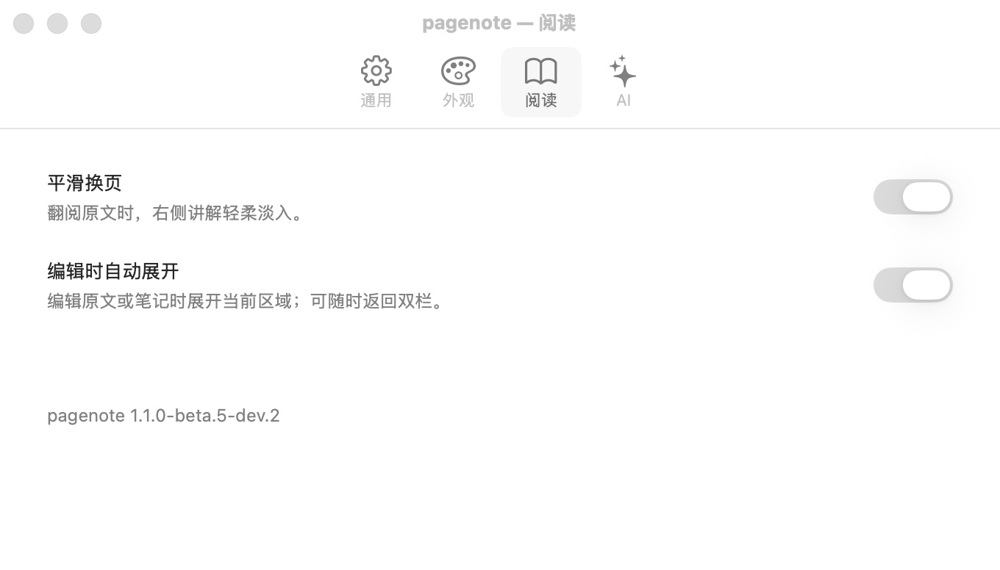

# PageNote macOS 版

PageNote 将课件与逐页笔记并排显示。Mac 版复用部分桌面逻辑，但采用 macOS 原生窗口、设置和系统适配；安装、Office 调用及触控板行为须按 Mac 验证。[返回项目总览](../../README.md)。

## 下载与版本

- 公开实验性测试版：**1.1.0-beta.4**，[Apple Silicon DMG](https://github.com/laihong06/pagenote/releases/download/v1.1.0-beta.4/pagenote-1.1.0-beta.4-mac-arm64.dmg) · [ZIP](https://github.com/laihong06/pagenote/releases/download/v1.1.0-beta.4/pagenote-1.1.0-beta.4-mac-arm64.zip) · [发布说明与校验](https://github.com/laihong06/pagenote/releases/tag/v1.1.0-beta.4)。
- 开发版本：**1.1.0-beta.5-dev.1**，尚未公开发布。
- 仅 Apple Silicon arm64；**Intel 包和获批稳定版均不可用**，不提供虚假的 macos/main 入口。

安装前退出旧程序，将应用放入 Applications；当前未完成签名、公证，限制见[已知问题](../../KNOWN_ISSUES.md)。

## Mac 的操作与边界

| 模块 | Mac 使用方式 | 与其他平台的区别 |
| --- | --- | --- |
| 阅读与逐页笔记 | 在双栏阅读页查看原文与笔记 | 采用 Mac 窗口、菜单和触控板适配 |
| 设置与 AI | 原生设置管理提示词及模型连接信息 | 不把 Windows 设置截图当 Mac 证据 |
| Office | 依赖本机支持的软件及 AppleScript 桥接 | 与 Windows Office 调用实现不同 |
| 项目与批注 | 文件打开、文字／区域批注及本地保存 | 系统权限、窗口和手势需独立测试 |
| 新共享渲染功能 | 以平台同步 PR 和 Mac 验证结果为准 | Windows 本地通过不等于 Mac 已支持或放行 |

## Mac 截图与验证状态

以下为 **2026-10-30 macOS 26.5.1／Apple Silicon 实机**运行共享源码 `6388245` 的完整窗口，另附真正的 AppKit 设置和原生 SVG／Canvas／图表／Three.js 操作前后图。[环境与来源](guide/capture.md) · [功能截图覆盖](features.md)。

本轮共补充 20 张原始截图。作者本机生产构建、基础采集、手动原生交互成功，三个交互值已从实际 Markdown 文件读回；未验证完整重启、Office 或所有手势。原生自动采集脚本在退出全屏等待处超时。基线的 [Mac CI](https://github.com/laihong06/pagenote/actions/runs/41019223250/job/123942472228) 在旧沙盒窗口最小化断言失败，后续原生作品检查被跳过，仍不能称为全部通过。

独立 Mac 目标开发版本仍为 **1.1.0-beta.5-dev.1**。此次未打包源码运行显示公共 `package.json` 的 **1.1.0-beta.5-dev.2**；截图来源同时记录两个值，不把显示版本差异当成新 Mac 发行。[编号操作与限制](guide/markdown-s.md)。

## 教程与版本记录

[按功能查看完整清单与截图状态](features.md) · [操作教程](guide/README.md) · [更新日志](CHANGELOG.md) · [各版本说明](releases/README.md) · [独立版本配置](../../platforms/macos/version.json)

教程和对应图片共同保存在 guide/ 目录，未采集的本系统截图明确标为待补；不以其他系统的截图冒充。开发源码不等于已发布包。

## 开发入口

[macos/beta](https://github.com/laihong06/pagenote/tree/macos/beta) 维护实验性实现；正式线需稳定基线获批后建立。在 Mac 上执行 node scripts/platform.mjs macos build；打包使用 node scripts/platform.mjs macos package --dir。
