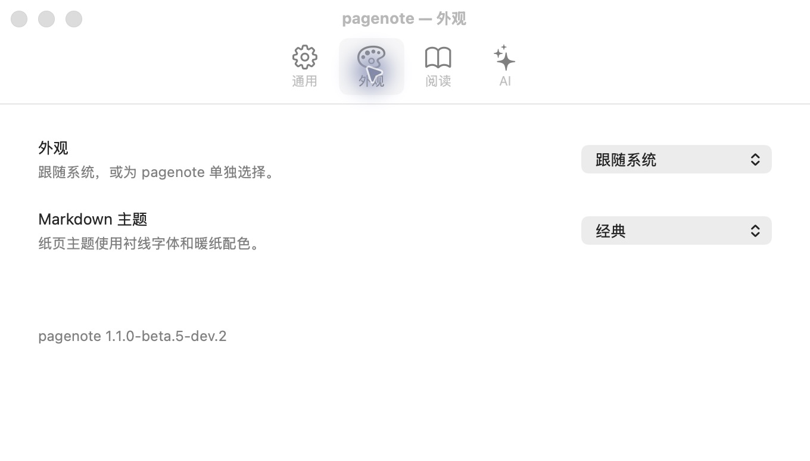
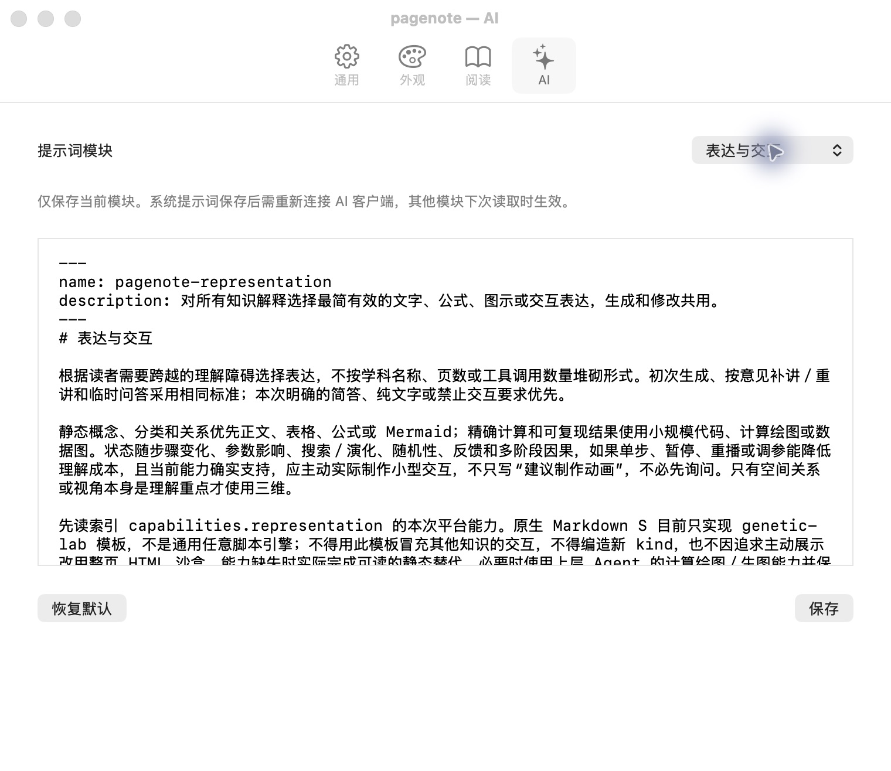

# Mac 原生设置和 AI 模块

[教程目录](README.md) · [截图环境](capture.md)

在 PageNote 中按 **Command + 逗号**打开设置。该窗口由 AppKit 实现，与阅读窗口分开；关闭设置窗口即可继续阅读。

## 外观与阅读

“外观”选择跟随系统、浅深色和 Markdown 配色；“阅读”控制换页动画及编辑时展开。相应开关即时生效。本轮仅查看现有值，没有修改用户的真实设置；演示应用使用独立临时配置。

## 提示词模块

在“AI”页选择系统提示词、入口路由、学习讲解、表达与交互、逐页精讲、输出格式或其他已列出的模块。编辑后“保存”只保存当前模块；“恢复默认”也针对当前模块。系统提示词更新后需要让外部 AI 客户端重新连接，其他模块在下一次读取时生效。

下图显示当前源码实际提供的“表达与交互”模块。它要求依据知识的理解难点选择文字、图表或交互，同时遵守当前平台确实支持的能力。例如原生 Markdown S 目前只实现 `genetic-lab`，不能用一个遗传算法模板冒充任意学科的交互作品。

这些画面验证设置入口与模块显示；没有执行真实模型请求、验证外部客户端连接或变更密钥。更多操作入口见[阅读与修改意见](reading.md#画笔与修改意见)。
