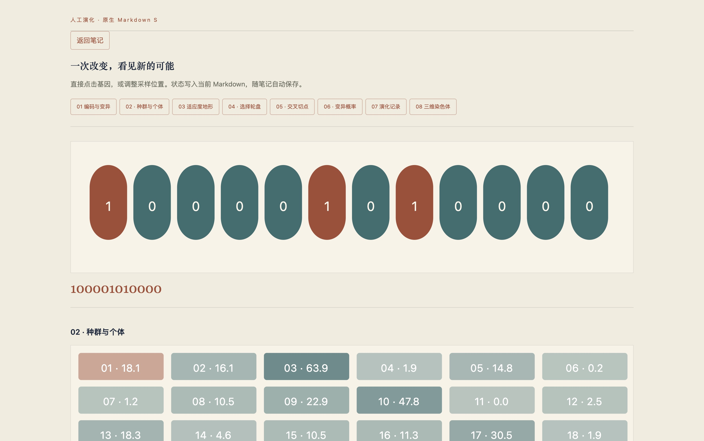
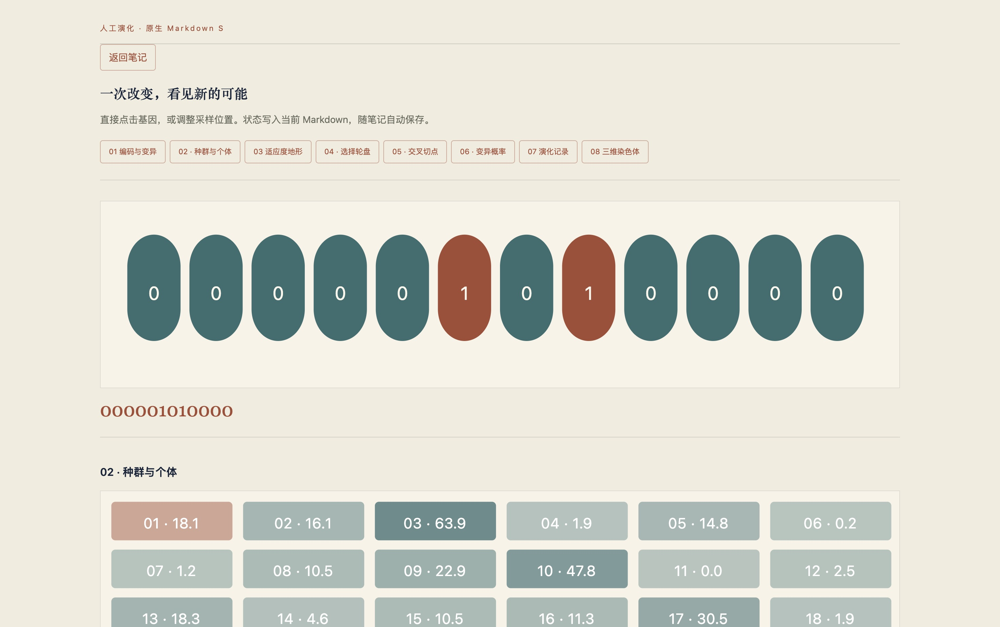
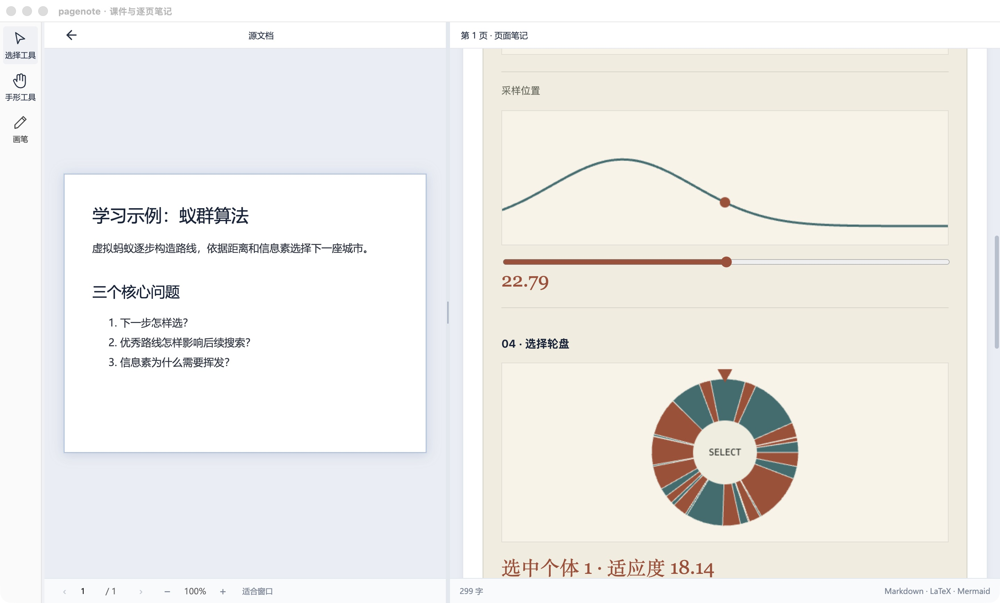
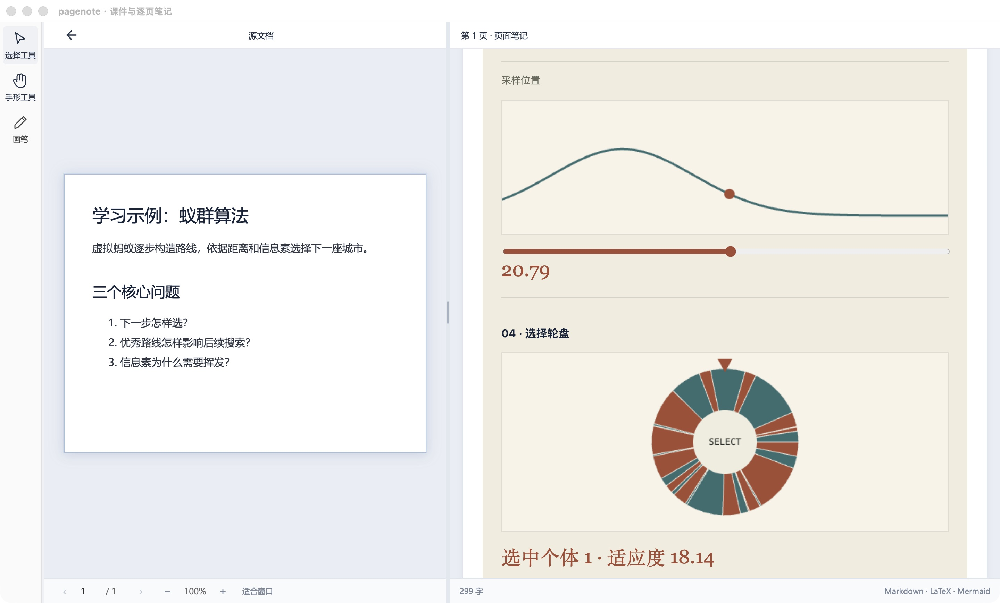
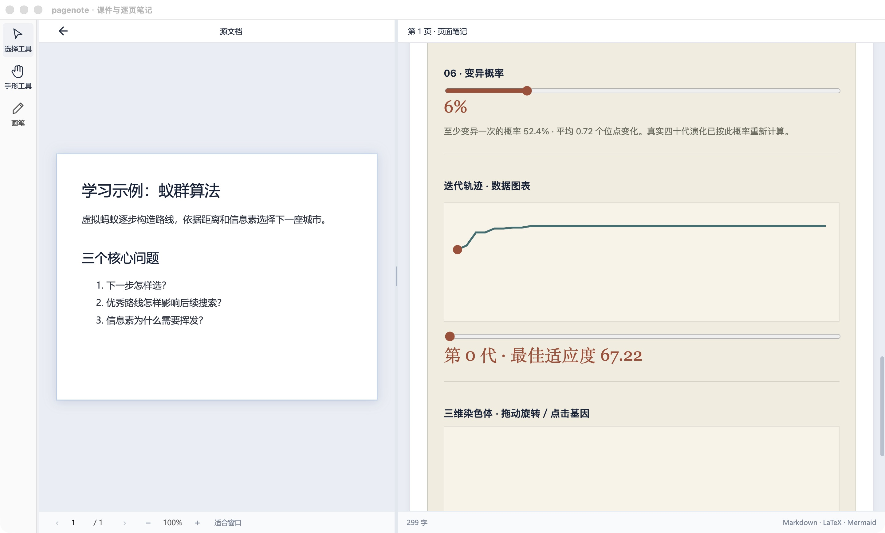
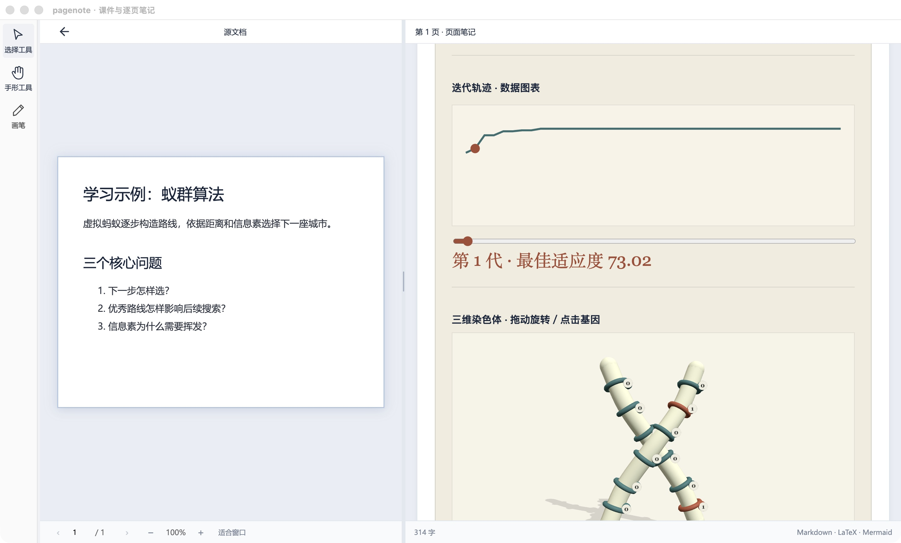
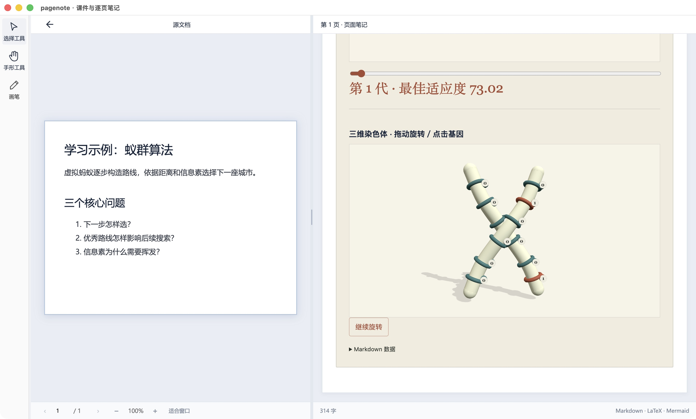
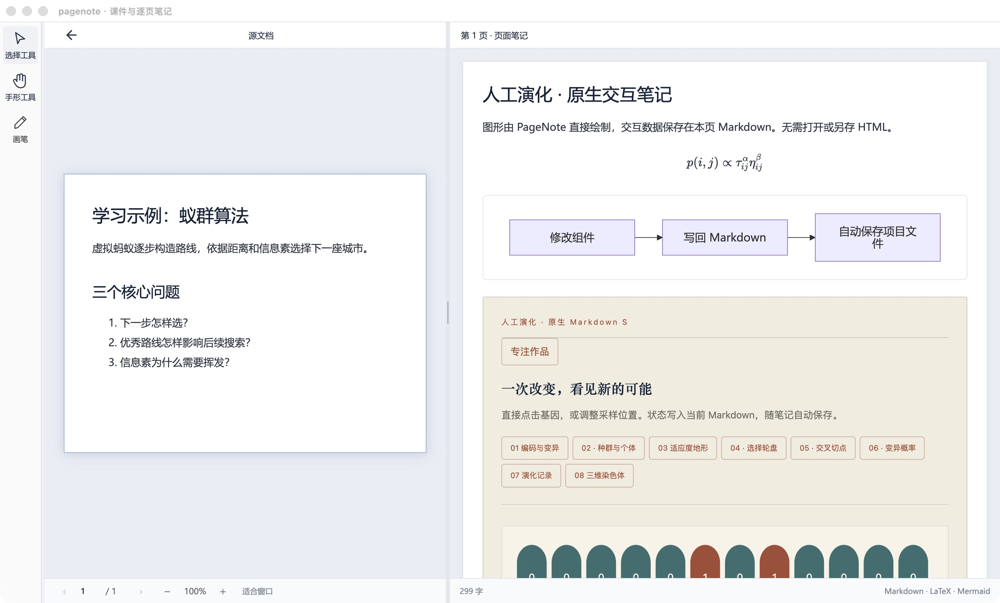

# Mac 原生交互笔记的逐步操作

[教程目录](README.md) · [功能表](../features.md) · [完整环境](capture.md)

本页使用仓库自编示例 [markdown-s-native.md](../../../examples/markdown-s-native.md) 的 `genetic-lab` 模板。图形由 PageNote 在笔记 DOM 中绘制，交互数据写在原有 Markdown 围栏中。这不是通用任意脚本引擎；旧 HTML iframe 兼容功能也不作为本页的原生证据。

这些是同一 Mac 应用上的编号操作，布局与色彩未经重排。四种显示模块各有单独图片。没有给定改前的历史 Mac 画面；这里的“前／后”只表示**同一次运行的交互状态变化**。

## SVG基因

1. 在作品中点击“专注作品”。
2. 初始编码为 `100001010000`。
3. 点击“基因 1”，该位由 1 变 0，编码变为 `000001010000`。
4. 点击“返回笔记”可退出专注模式。此用户路径在本轮实际操作成功。

## Canvas采样

通过“03 适应度地形”章节定位，调整“采样位置”。本轮将 50 改为 51，当前值由 22.79 变为 20.79；这表示在同一条函数曲线上换了采样点，不是模型生成结果。

## 原生数据图表

通过“07 演化记录”定位，调整“查看世代”。本轮从第 0 代切到第 1 代，最佳适应度显示由 67.22 变成 73.02。图表和数值随实际控件变化。

## Three.js三维课件

通过“08 三维染色体”定位。点击“继续旋转”，按钮变为“暂停旋转”；再点击暂停，按钮恢复为“继续旋转”，模型停在新的朝向。下图包含完整窗口和真正的三维绘制结果。

本轮没有验收所有拖拽／点选、GPU 丢失恢复、暂停状态重启保真或长时间资源释放。

## 保存证据和退出

实际项目的 Markdown 文件已读回并保留[保存后的自编样例](images/markdown-native/saved-notes.md)：首个基因为 0、`position` 为 51、`generation` 为 1。这里只据此确认这三个值已进入同一文件；不扩大为全部组件状态或完整重启恢复已通过。

本轮仓库原有自动采集脚本在快速进入／退出全屏的等待处超时，未完成其后续自动断言；上述实际界面操作另行采集成功。这个脚本结果保留在[审查记录](../../review/PR13-evidence-2026-10-30.md)，没有改写成自动专项全绿。
