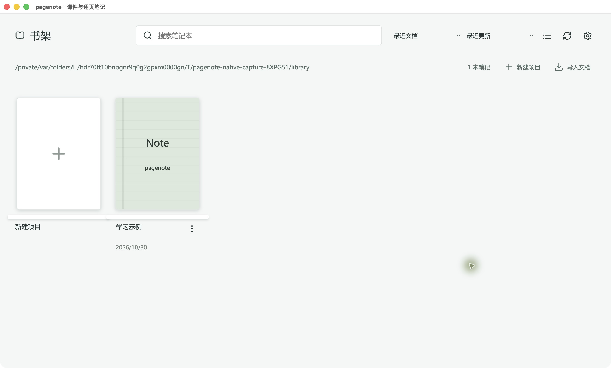
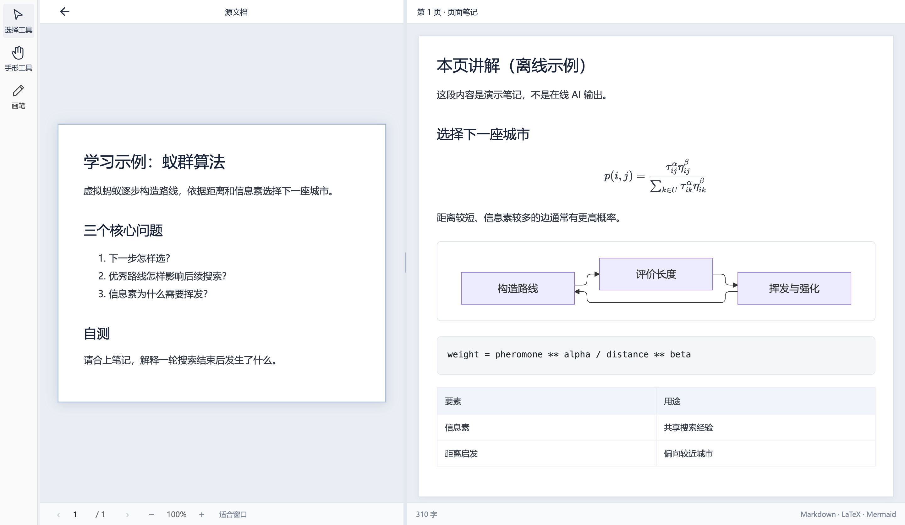
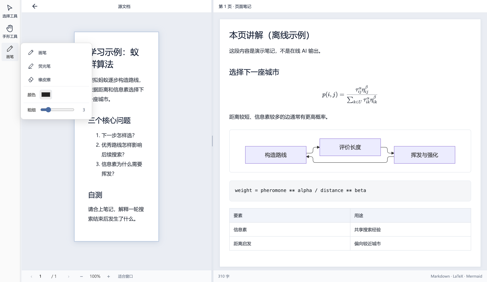
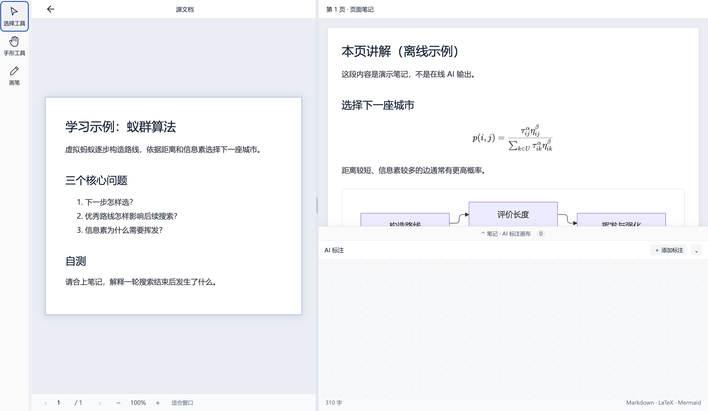

# 在 Mac 上打开、阅读和编辑

[教程目录](README.md) · [本组截图环境](capture.md)

## 从书架进入

在书架选择存放项目的目录，通过 macOS 文件选择器确认，再打开项目封面。左上角返回按钮回到书架。取消选择器会保留原来的书架。

下面包含原生窗口标题栏和交通灯按钮，展示实际 Mac 应用的完整窗口；使用的是临时目录中的自编课件。

## 双栏对照

原文和逐页笔记并排显示，各自滚动。底部页码切换对应笔记，放大／缩小和适合窗口作用于阅读区域。公式、代码和 Mermaid 直接在笔记中渲染。这是离线预置材料，画面里没有在线 AI 生成结果。

## 编辑与返回双栏

从编辑菜单的文件编辑入口选择右侧笔记区域，进入展开的编辑状态。可以修改当前页正文、公式或代码；“完成编辑／返回双栏”回到阅读。保存状态与界面模式是两回事，文件冲突需要按提示处理。

本轮采集了编辑布局；没有用它代替长文档保存、历史恢复或升级兼容验收。

## 画笔与修改意见

左侧画笔入口按需展开颜色、粗细等工具，选择工具可返回文字选择。下面保留工具展开时的完整内容区域，便于判断是否挤占阅读空间。

从 AI 标注／修改意见菜单打开对应一侧的工作台，记录局部或整体修改要求。关闭后继续阅读。桌面客户端通过 MCP 读取这些要求；需要由用户配置实际 AI 客户端，程序不会因打开工作台自行完成一次模型调用。

[原生提示词设置](ai-settings.md) · [原生交互课件](markdown-s.md)。
