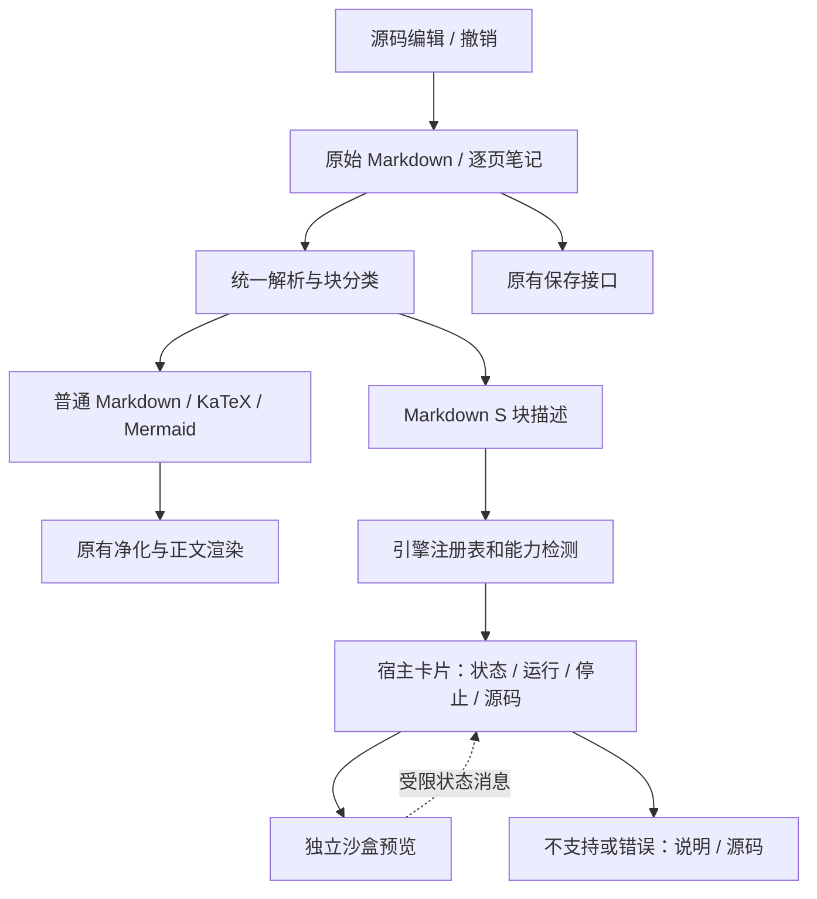

# Markdown S v1 架构与格式规范

状态：目标设计。实现进度见[入口](README.md)，开发任务见[实施指导](IMPLEMENTATION.zh-CN.md)，是否完成由[验收记录](ACCEPTANCE.zh-CN.md)证明。

## 1. 设计原则

1. 原始 Markdown 是内容的唯一事实来源；渲染 DOM、截图和缓存都不能替代源码。
2. 使用标准围栏表达扩展。暂不改文件扩展名，不强制迁移历史项目，不改变已有逐页笔记、项目标识和附件结构。
3. 普通 HTML 保持现有清理策略；只有明确标记的增强块进入交互执行路径。粘贴普通 `<script>` 不能自动获得执行权限。
4. 内容与宿主分权：组件可以画图和响应用户输入，不能获得笔记文件、AI 密钥、系统命令或桌面桥接权限。
5. 按平台发布真实能力。不支持某引擎时展示说明与源码，不能出现空白卡片或保存时删掉内容。
6. 首期默认静止，用户点击后运行。炫丽效果留在演示区域，不抢占阅读焦点，不覆盖应用菜单。

## 2. 总体数据流



图中的“统一”表示有一致的调度和数据约定，不要求替换现有 Marked、KaTeX 和 Mermaid。保留旧链路，逐项接入并回归。

## 3. 模块与责任

| 层 | 通俗说明 | 输入 → 输出 | 不能做什么 |
| --- | --- | --- | --- |
| 格式层 | 识别哪一段是演示及使用哪个引擎 | Markdown → 块描述、源码范围 | 执行脚本、重写无关正文 |
| 引擎注册表 | 按名称找到渲染方式 | 引擎名 → 校验器、依赖与能力要求 | 自动下载任意网络库 |
| 宿主卡片 | 用户看到的外框和操作按钮 | 描述 → 状态、运行、停止、源码入口 | 相信组件发来的 HTML 或执行请求 |
| 沙盒运行层 | 运行演示内容 | 已校验输入 → 隔离页面 | 访问文件系统、父页面和桌面桥 |
| 资源层 | 提供被允许使用的图片、字体、引擎 | 授权资源标识 → 有限资源 | 暴露任意绝对路径和整个项目目录 |
| 编辑与序列化 | 把编辑结果可靠写回笔记 | 原始块／用户修改 → Markdown | 将 iframe HTML、工具栏和错误文字存成笔记内容 |
| 平台适配 | 判断当前设备能运行什么 | 平台能力 → 可用、降级或未支持 | 把桌面结果直接当作 Android 结果 |
| 证据与诊断 | 帮用户和开发者定位问题 | 状态、错误、环境 → 有限日志 | 记录 AI 密钥、个人笔记全文和敏感路径 |

## 4. 文件协议

首期支持下列精确的围栏语言名；不认识的语言继续作为普通代码保存。

| 标记 | 源码内容 | 约定 |
| --- | --- | --- |
| `mds` / `mds-html` | HTML 片段，可含 CSS 与 JS | 两者是同一引擎别名 |
| `mds-svg` | SVG，可带 SMIL 或配套 HTML | 在隔离预览里运行，不注入宿主 DOM |
| `mds-canvas` | HTML、Canvas 与绘制 JS | 由作者创建画布；宿主提供停止入口 |
| `mds-three` | HTML 与使用 `THREE` 的 JS | 注入随软件打包的固定版本库，无需 CDN |
| `mds-chart` | JSON | 首期仅柱状图与折线图；不执行 JSON 内的函数 |

规则：

- 不用正则替代完整 Markdown 围栏解析，正确处理反引号、波浪号、嵌套列表和长围栏。
- 增强块内部的 `$`、反引号、HTML、JS 模板字符串不得被公式归一化或富文本转换改写。
- `mds-chart` 使用 `type`、`title`、`labels`、`values`。`type` 为 `bar` 或 `line`；数组等长，1–100 项；值为有限非负数；标签和标题只作为文本输出。其他图表类型后续单独扩展。
- 首期单块源码上限目标为 **200 KiB UTF-8 字节**，由 `TextEncoder` 计量。超限保留源码，说明不能运行；不得截断保存。
- v1 不添加必须存在的 front matter，不擅自升级项目格式版本。格式将来有破坏性改变时另写迁移提案及旧端降级测试。
- 非编辑状态切换不改变持久化内容。编辑后允许 Markdown 排版规范化，但组件源码必须逐字符保留；仅换行风格是否统一应明确并测试。

目标内部描述：

```ts
type MarkdownSBlock = {
  protocol: 1;
  engine: string;
  source: string;
  sourceRange?: { start: number; end: number };
};
```

运行编号、状态、iframe 引用、依赖缓存和性能统计放在内存中，不写回用户文件。DOM 上的 `data-*` 只是渲染副本，不能成为来自外部 HTML 的可信授权。

## 5. 引擎接口与生命周期

推荐接口；落地可调整文件组织，但不得删除责任：

```ts
interface RendererAdapter {
  id: string;
  validate(source: string): ValidationResult;
  capabilities(host: HostCapabilities): CapabilityResult;
  prepare(block: MarkdownSBlock, signal: AbortSignal): Promise<PreparedPreview>;
  mount(container: HTMLElement, preview: PreparedPreview): PreviewHandle;
}
interface PreviewHandle {
  dispose(): void;
}
```

状态流为：`idle → preparing → running → stopped`；准备或运行失败进入 `error`，能力缺失进入 `unsupported`。停止、换页、删除块、切项目、关闭窗口都必须清理 iframe、监听器、观察器、Object URL 和相关请求。

每次运行分配 generation，旧异步任务返回时检查 generation、源码版本和节点连接状态；已停止或被删除的块不得重新出现。首期同一笔记视图最多同时运行 2 个增强块，超过时明确提示先停止一个。离开可见区域的长期动画应暂停或销毁，并明确恢复时是否重置状态。

iframe 是内容权限边界，不是 CPU、GPU 或内存的硬隔离保证。主线程死循环、显存耗尽不能靠同线程定时器可靠终止；首期不得宣称能安全执行任意不可信代码。若产品需要执行不可信来源的任意 JS，必须进一步评估独立进程／受控执行环境，并将它作为单独阶段验收。

## 6. 安全与资源边界

### 首期默认策略

- iframe 使用 `sandbox="allow-scripts"`，不叠加 `allow-same-origin`、弹窗、下载、表单提交、顶层导航等权限。
- 不将 Electron preload、Node、文件操作、AI 配置或宿主 `pageNotes` API 暴露给组件；不向组件传递这些对象或凭证。
- CSP 默认拒绝资源；只为组件自身开放行内脚本和样式，图片可按策略使用 `data:` / `blob:`。首期不开放网络脚本、`eval`、任意 fetch、子 iframe、表单和外部字体。
- 相对 URL、远程图片、外部 CSS、外部模型不保证可用。普通 Markdown 图片仍走既有图片路径，不能和增强块资源策略混淆。
- 页面内链接、`location`、meta refresh 和自改 frame name 必须纳入测试。Electron 宿主对增强预览的导航做额外限制；不能只依赖注入一段点击拦截脚本。
- 组件不需要向宿主发送保存内容。将来需要高度、错误等消息时，只接收限定类型和长度；核对 `event.source`、实例标识与运行代次。opaque origin 的 `origin` 可为 `null`，不能仅凭 `origin` 判断可信。
- 错误文本用 `textContent` 呈现；图表标签不能拼接成未转义 HTML。组件不得修改宿主 CSS、导航栏、快捷键和批注层。

### 后续本地资源方案

通过项目附件管理器显式选择资源 → 验证真实路径仍在项目授权范围内（包含符号链接／junction 检查）→ 校验 MIME、大小与类型 → 为当前预览提供受限字节／URL → 停止时撤销。不能为了模型加载直接开放整个本地服务域名或 `file://`。

GLTF、纹理、字体、音视频和第三方引擎分别有资源需求；每增加一种必须补权限表、大小限制、离线测试和许可证记录。外部网站嵌入不是首期能力。

## 7. 编辑、保存、导出和降级

- 阅读态：运行／停止／源码折叠区，不自动执行。
- 编辑态：明确的“编辑组件源码”入口，支持保存修改、取消和撤销；不要让用户在渲染 DOM 内修改后误以为已保存。
- 保存时将增强组件还原为原始围栏。复制全文、切换富文本与源码、历史恢复、AI 修改和同步都必须保留组件源码。
- AI 生成组件只写源码，不自动运行；展示执行入口由用户选择。
- 普通 `.md` 导出保留围栏。静态打印／PDF 不保证记录动态瞬间，必须提供说明或显式生成的静态替代图；禁止宣称已支持交互 PDF。
- 独立 HTML 导出属于后续功能：必须将所需固定依赖与资源打包，离线验证，并延续执行策略；不能简单复制当前宿主 DOM。
- Android 旧端先证明“显示代码且保存不丢失”，然后才接入执行。若无法保留增强块，禁止该端静默重写含增强块的笔记，需给出只读或明确限制。

## 8. 平台与版本治理

| 层面 | 维护方式 |
| --- | --- |
| 格式与测试样本 | 跨平台共享，变更须写兼容说明 |
| Windows / macOS | 共用 Web 渲染逻辑，分别验证系统宿主、GPU 和包内依赖 |
| Android | 保留原生阅读器；先源码降级，再评估独立 WebView 适配，不照搬桌面桥 |
| Linux / 鸿蒙 | 仅规划；实际适配前不标支持 |
| 发布 | 按系统独立版本与 beta/main 流程，不能用共享规范版本代替软件版本 |

首期采用增量接入。只有渲染、编辑、保存、性能和回退证明齐全，才能扩大到默认体验。稳定晋级继续遵守现有发布政策及发起人明确批准。
