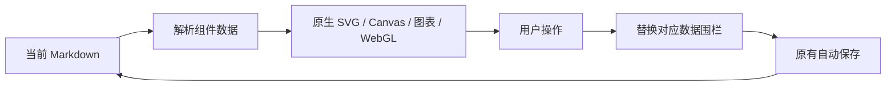

# Markdown S 原生渲染与同文件保存

本文件记录发起人的最新修正，优先于早期将独立 HTML 沙盒作为主方案的设计。**主要交付是 PageNote 自带的渲染组件直接参与笔记排版，交互状态与文字一同写回当前 Markdown。**旧 `mds-html`／`mds-three` 沙盒只保留历史兼容，不算原生能力验收。

## 数据与代码放在哪里

- SVG、Canvas、图表、Three.js 渲染代码属于 PageNote：`src/markdown-native.js`、`src/markdown-native-three.js`。
- 用户笔记只保存声明式 `markdowns` 数据围栏，包括版本、唯一标识、组件类型和状态；不创建必须另外保存的 HTML 文件。
- 原生 SVG、Canvas 和 WebGL canvas 直接挂载在 `.markdown-s-native` 节点中；没有 iframe、srcdoc、运行独立页面或另一次导出保存。
- 交互触发 `markdown-s-native-change`，宿主按唯一标识替换对应围栏，其余原文保持原样，然后复用 `editChanged → flush → 原 notes API → src/notes.md`。默认延迟保存和保存失败恢复沿用现有机制。
- 重新打开项目从同一 Markdown 重建视图；几何缓冲和 Canvas 像素是派生缓存，基因、滑块、世代、暂停状态和旋转角等可编辑参数才是持久化事实源。



## 当前原生格式

````markdown
```markdowns
{
  "version": 1,
  "id": "genetic-example",
  "kind": "genetic-lab",
  "genes": [1, 0, 0, 0, 0, 1, 0, 1, 0, 0, 0, 0],
  "position": 50,
  "generation": 0,
  "paused": true,
  "angle": 0.15
}
```
````

一个实验内各模块共享这份状态。`id` 在当前笔记中必须唯一；遇到重复或源码无法定位时拒绝写入并提示，不猜测修改目标。数据不合法时保留源码并显示诊断，禁止静默丢弃原文。

当前遗传算法模板使用 12 位二进制基因、36 个个体和 40 代演化；采样位置 0–100，变异概率 0–30%，暂停为布尔值，旋转角为有限数值。纯算法来自发起人提供的参考代码，经原生模块化后核对固定种子、40 代和 99.97 最佳适应度；并非静态示例曲线。

## 验证要求

1. 在真实笔记页面检查原生组件内部 iframe 数为零。
2. 点击 SVG 基因、移动 Canvas 滑块、调整图表世代和 Three.js 旋转状态。
3. 调用现有保存或等待自动保存后，直接读取项目 `src/notes.md`，核对对应状态和无关文字。
4. 不另存 HTML，完整关闭并重开应用，核对组件和持久化状态恢复。
5. 每个原生模块分别提供实机截图；旧沙盒截图不能作为原生模块的证明。
6. 源码重复标识、外部更新冲突、非法输入要拒绝错误写入；旧版可显示数据代码，不应丢失。

实际截图脚本覆盖种群、轮盘拖动／键盘、交叉、概率、40 代图表、三维拖动、连续划过、同文件保存和重开。具体已执行结果见本 PR 验证记录，不能将未执行平台记为通过。WebGL 离屏／后台不继续动画，删除视图销毁几何、材质、观察器和上下文；上下文丢失显示诊断，保留 Markdown 数据。

## 后续工作边界

原生章节、种群／选择／交叉／变异组件已有实现；后续重点是更多模板、长期资源验收与跨平台交付。HTML 参考用于学习视觉和算法，不通过嵌入整个页面代替这些原生能力。
