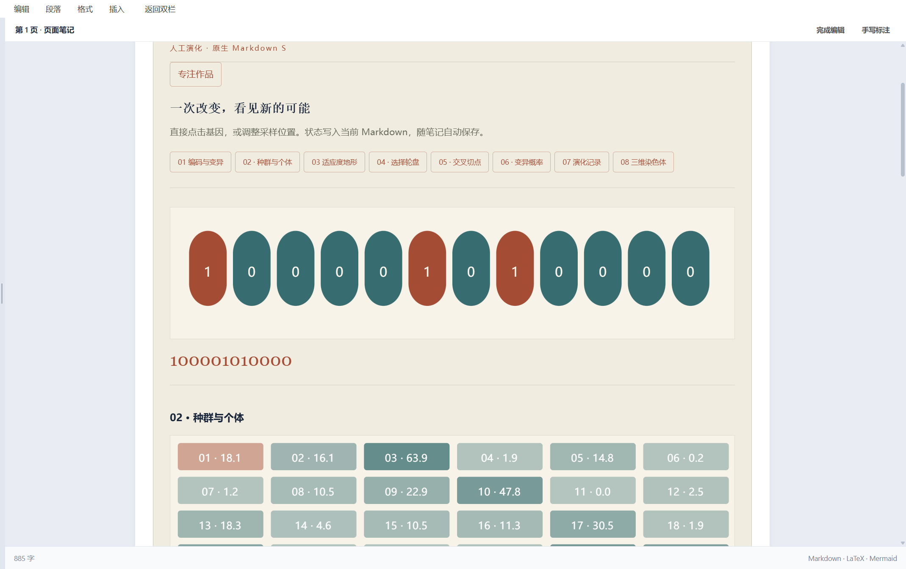
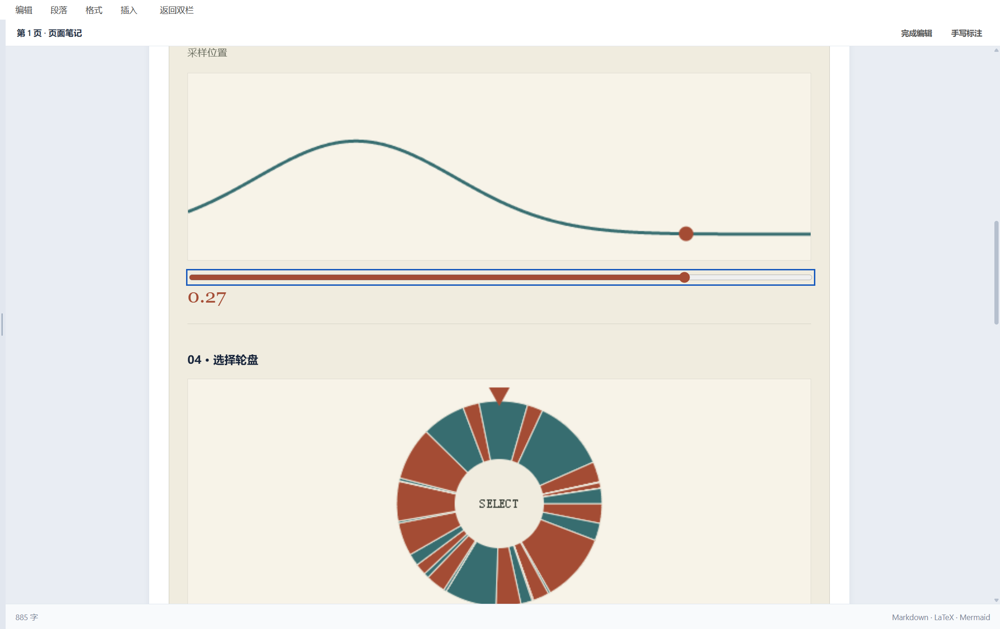
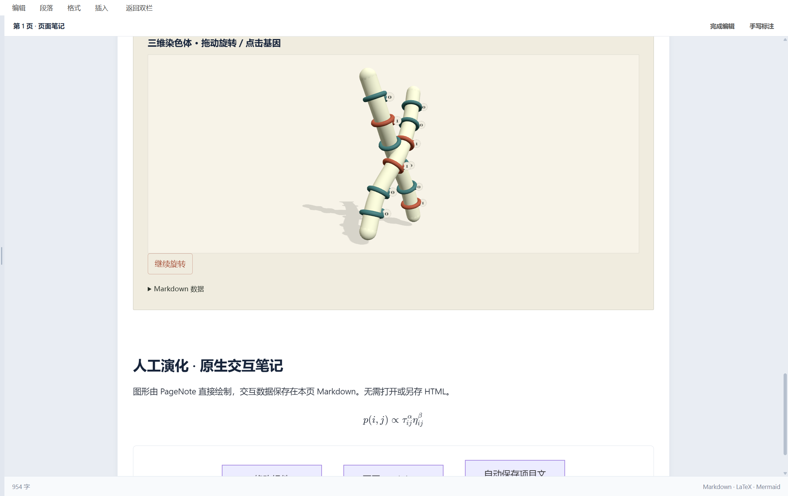

# 原生 Markdown S：视觉、交互与文件同步

本轮按发起人最新要求交付方向：**PageNote 直接渲染笔记组件，状态保存到同一份 Markdown。** 早期 iframe/整页 HTML 预览只保留兼容，不能作为这次原生能力的证明。

## 对照参考后的实际改进

参考《遗传算法交互实验室》的纸张色、宋体标题、赭红／青绿、图版层级和统一状态。本轮不是继续包装 HTML 页面，而是把纯遗传算法逻辑和 SVG、Canvas、Three.js 渲染器接入 PageNote。

| 原差距 | 原因 | 当前处理 |
| --- | --- | --- |
| 像库测试而不像学习作品 | 简单形状缺少教学模型、视觉系统和联动 | 纸张主题、八个原生章节、共享遗传算法状态 |
| 一张截图代替所有引擎 | 缺少独立操作及反馈 | SVG、Canvas、种群、轮盘、交叉、变异、图表和 Three.js 分别截图 |
| 修改只存在预览页面 | HTML 运行状态没有进入笔记模型 | 参数替换对应 Markdown 数据围栏，经原保存接口写入项目文件 |
| 长课件嵌套滚动 | 整页 HTML 被塞入固定高度 iframe | 原生节点加入笔记排版，共用 PageNote 滚动及章节定位 |
| 图表只是示例曲线 | 缺少真实演化模型 | 参考纯算法成为本地模块，36 个个体、40 代、固定种子最佳适应度 99.97 |
| 依赖靠用户处理脚本 | 课件源码与运行库混杂 | 引擎随 PageNote 打包；支持的参考 HTML 可从“导入笔记”识别为原生模板数据 |

参考是视觉与算法依据；不宣称原生模板已逐像素复制原网页或所有自定义效果。当前只支持已实现的遗传算法模板，不是任意网页的自动转换器。

## 每个模块对应截图

Windows 真实 PageNote 项目截图，来源和窗口参数见 [采集记录](../windows/guide/images/markdown-native/provenance.json)。每次操作之后直接核对项目 Markdown 文件，最后完整重启核对状态。没有用 HTML 页面截图冒充原生效果。

| 模块 | 操作和可见结果 | 截图 |
| --- | --- | --- |
| SVG 编码／基因 | 点击翻转、键盘编辑，编码与三维标记同步 | [SVG](../windows/guide/images/markdown-native/native-svg.png) |
| Canvas 适应度 | 滑块改变采样点与适应度 | [Canvas](../windows/guide/images/markdown-native/native-canvas.png) |
| 36 个种群个体 | 选择个体，染色体状态更新 | [种群](../windows/guide/images/markdown-native/native-population.png) |
| 选择轮盘 | 实际拖动与方向键选择，选中个体改变 | [轮盘](../windows/guide/images/markdown-native/native-wheel.png) |
| 交叉切点 | 切点调到 8，实际子代改变 | [交叉](../windows/guide/images/markdown-native/native-crossover.png) |
| 变异概率 | 调到 20%，反馈 2.40 个期望变化，重新计算真实演化 | [变异](../windows/guide/images/markdown-native/native-mutation.png) |
| 代际数据图表 | 切换第 40 代，最佳适应度 99.97 | [图表](../windows/guide/images/markdown-native/native-chart.png) |
| Three.js | 原生 canvas，实际拖动、暂停／继续，角度保存 | [三维](../windows/guide/images/markdown-native/native-three.png) |
| 连续基因划过 | 多个位点改变，每个位点一次 | [划过](../windows/guide/images/markdown-native/native-brush.png) |
| GPU 丢失降级 | 强制丢失上下文，显示诊断并保留 Markdown | [降级](../windows/guide/images/markdown-native/native-gpu-fallback.png) |

## 保存机制

组件数据位于 `markdowns` 围栏。PageNote 内置渲染器直接创建 DOM、SVG 和 canvas；用户操作修改对应的数据，再复用原有自动保存。原文页写入 `src/source.md`，笔记页写入 `src/notes.md`，不需要另存 HTML。无关段落保持原文；重复 id 和过期状态拒绝错误写入，支持 LF／CRLF。

“导入笔记”可以选择已识别的遗传算法 HTML 模板，转换的是原生教学数据与内嵌清单，而非把原 HTML 放进 iframe。未知 HTML 模板会给出未支持诊断，不执行其中的脚本。

## 剩余限制

Windows 的交互、文件保存和重开结果以实际日志为准；Mac 需要本 PR 的新 CI，Android 暂为源码保留，不能用 Windows 截图替代。长期 CPU／内存／显存、全部触摸设备和生产安装包验收仍需继续。PR 保持实验性，不宣称直接稳定交付完整平台产品。
