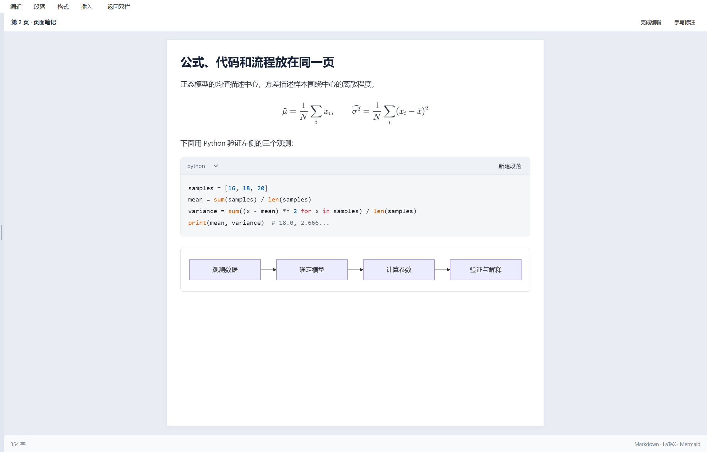
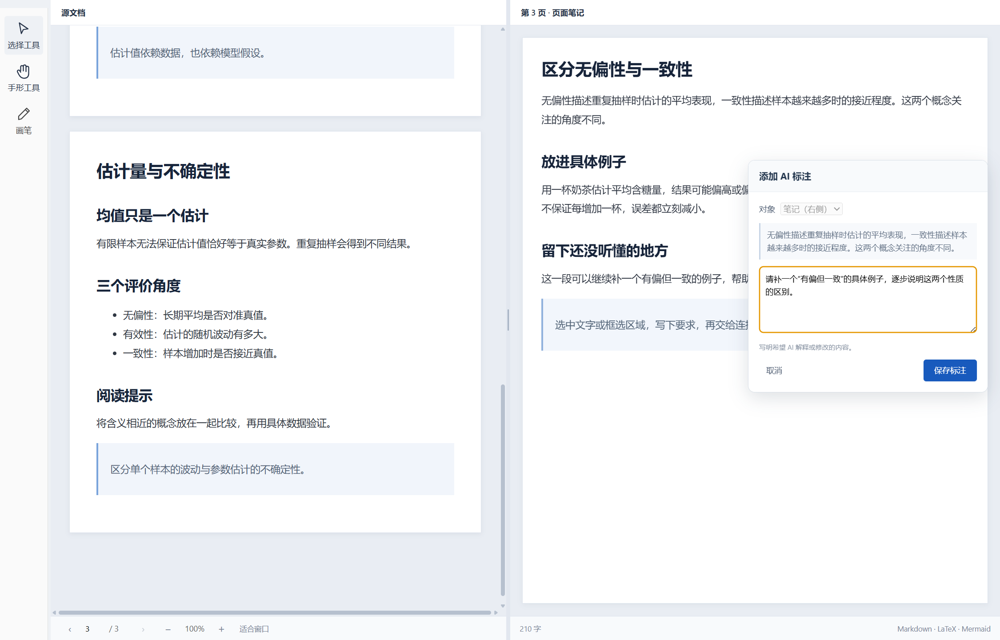
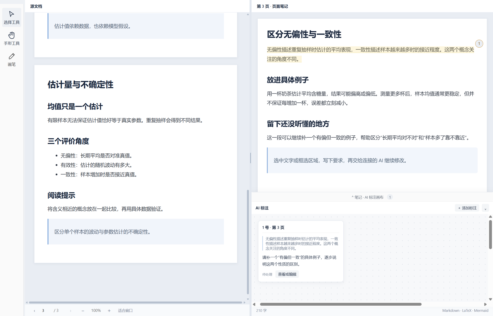
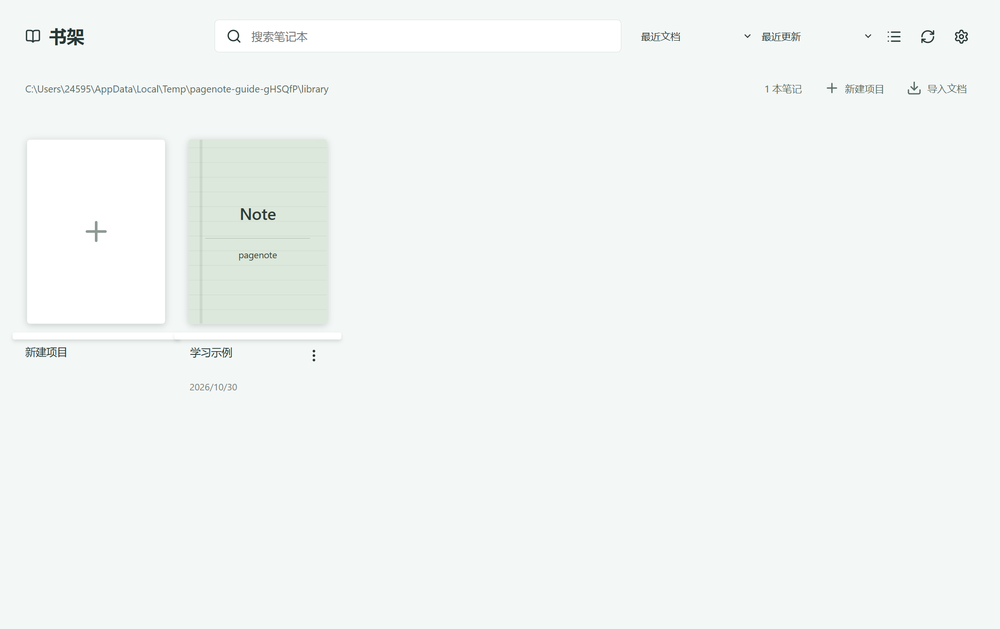
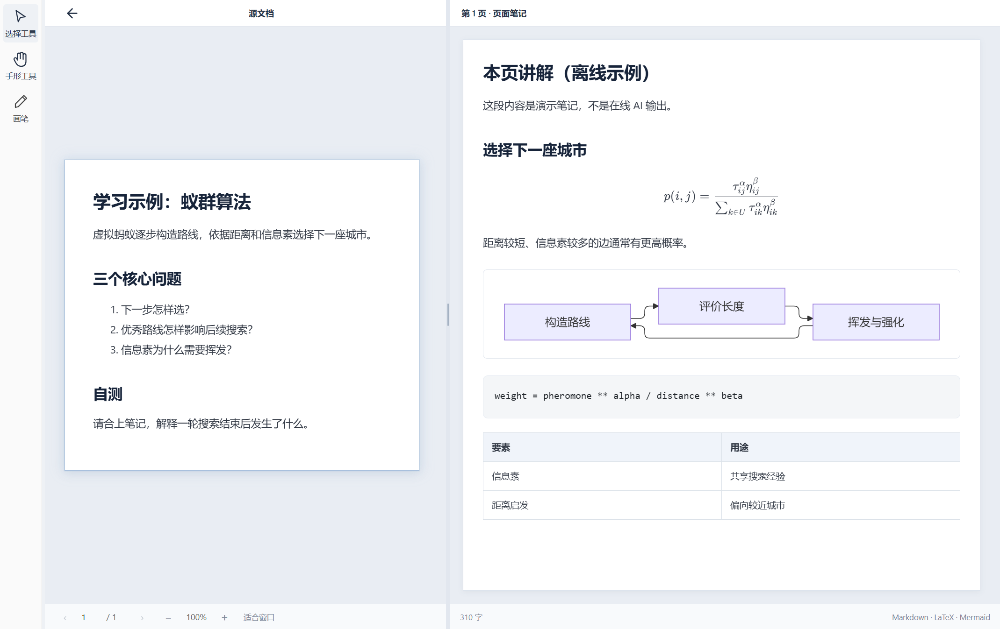
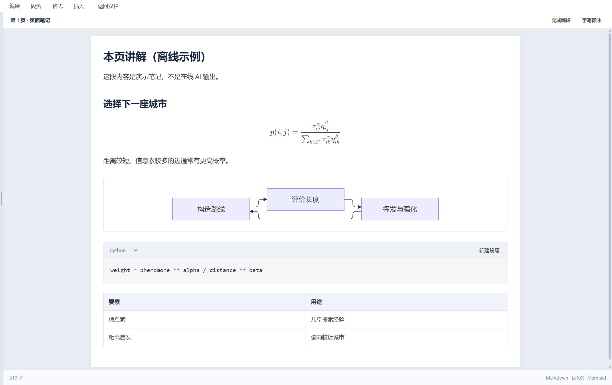
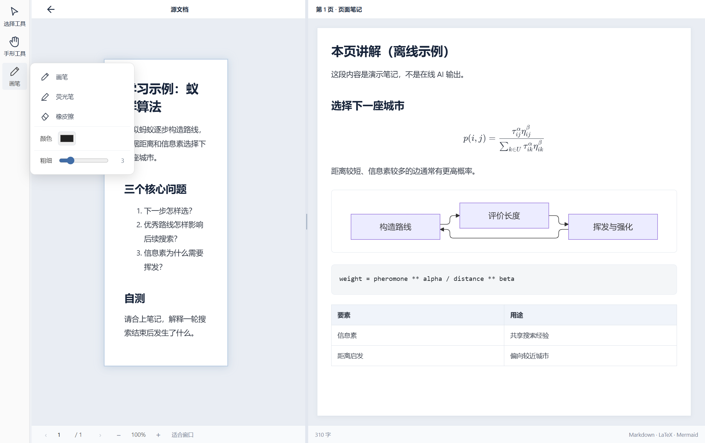
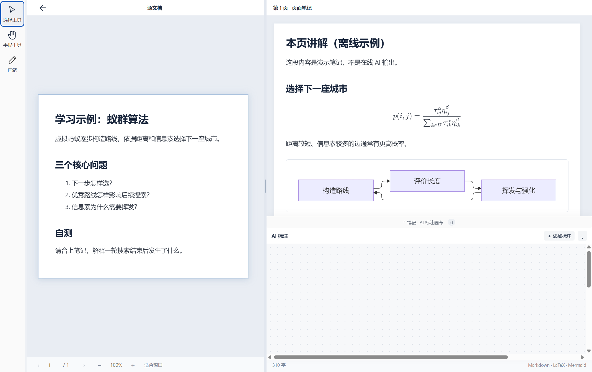

# Windows 配图教程

[平台入口](../README.md) · [功能表](../features.md)

教程和图片保存在同一 guide/ 目录树。每个模块按“入口 → 操作 → 结果”阅读。本目录已有截图来自 2026-10-15 Windows 2.0.0-beta.5 开发构建，仅说明历史基础界面，不是当前版本验收；新整合截图另附 provenance.json 记录来源。

## 1. 项目与书架

从 **启动书架／返回书架** 进入。绑定课件文件夹，在书架查找、打开或导入项目。完成操作后核对当前页、结果与保存反馈；退出面板返回阅读，需要撤回时使用模块提供的撤销／取消。测试开发；真实环境边界见验收记录。

截图状态：待采集对应系统和本模块实际运行画面；不能据此视为布局已验收。

## 2. 原文与逐页笔记

从 **阅读器页码与笔记区** 进入。左侧原文，右侧当前页笔记；切页保存并恢复位置。完成操作后核对当前页、结果与保存反馈；退出面板返回阅读，需要撤回时使用模块提供的撤销／取消。测试开发；真实环境边界见验收记录。

## 3. 笔记编辑与保存

从 **编辑按钮／笔记区** 进入。点击编辑，写入正文后保存；重开确认内容。完成操作后核对当前页、结果与保存反馈；退出面板返回阅读，需要撤回时使用模块提供的撤销／取消。测试开发；真实环境边界见验收记录。

## 4. 公式、代码、图表

从 **Markdown 笔记** 进入。用 LaTeX、代码围栏、Mermaid 表达内容。完成操作后核对当前页、结果与保存反馈；退出面板返回阅读，需要撤回时使用模块提供的撤销／取消。测试开发；真实环境边界见验收记录。

## 5. 选区、Tag 与批注

从 **阅读器选区工具与 Tag** 进入。选择文字或框选区域，添加意见，定位到原文。完成操作后核对当前页、结果与保存反馈；退出面板返回阅读，需要撤回时使用模块提供的撤销／取消。测试开发；真实环境边界见验收记录。

## 6. AI 工作台

从 **AI 工作台／连接设置** 进入。连接自己的兼容服务或外部 Agent，按页生成与修改讲解。完成操作后核对当前页、结果与保存反馈；退出面板返回阅读，需要撤回时使用模块提供的撤销／取消。需要可用的模型配置，未执行真实付费请求。

## 7. 提示词和模型设置

从 **设置 → AI 设置** 进入。配置模型与教学偏好，密钥留在本机。完成操作后核对当前页、结果与保存反馈；退出面板返回阅读，需要撤回时使用模块提供的撤销／取消。测试开发；真实环境边界见验收记录。

截图状态：待采集对应系统和本模块实际运行画面；不能据此视为布局已验收。

## 8. 笔与荧光标记

从 **阅读器笔工具** 进入。选择笔、颜色、粗细，书写并保存，撤销或擦除。完成操作后核对当前页、结果与保存反馈；退出面板返回阅读，需要撤回时使用模块提供的撤销／取消。测试开发；真实环境边界见验收记录。

## 9. OCR

从 **OCR／页面工具** 进入。识别扫描页或选区文字，结果用于讲解。完成操作后核对当前页、结果与保存反馈；退出面板返回阅读，需要撤回时使用模块提供的撤销／取消。需要本地模型，质量与材料相关。

## 10. Office 阅读与外部编辑

从 **导入与外部编辑菜单** 进入。借助本机支持的 Office 软件转换或打开文档。完成操作后核对当前页、结果与保存反馈；退出面板返回阅读，需要撤回时使用模块提供的撤销／取消。需要外部软件／服务；完整原生编辑不承诺。

截图状态：待采集对应系统和本模块实际运行画面；不能据此视为布局已验收。

## 11. 雨课堂

从 **雨课堂入口** 进入。配置账号，导入历史课件或授权实时采集。完成操作后核对当前页、结果与保存反馈；退出面板返回阅读，需要撤回时使用模块提供的撤销／取消。测试开发；真实环境边界见验收记录。

截图状态：待采集对应系统和本模块实际运行画面；不能据此视为布局已验收。

## 12. 历史、备份与迁移

从 **文件菜单／项目目录** 进入。恢复历史，复制完整项目文件夹迁移。完成操作后核对当前页、结果与保存反馈；退出面板返回阅读，需要撤回时使用模块提供的撤销／取消。测试开发；真实环境边界见验收记录。

截图状态：待采集对应系统和本模块实际运行画面；不能据此视为布局已验收。

## 13. 附件与导出

从 **插入与导出菜单** 进入。插入图片等附件，按支持格式导出笔记。完成操作后核对当前页、结果与保存反馈；退出面板返回阅读，需要撤回时使用模块提供的撤销／取消。测试开发；真实环境边界见验收记录。

截图状态：待采集对应系统和本模块实际运行画面；不能据此视为布局已验收。

## 14. 主题、缩放与阅读位置

从 **设置与阅读工具** 进入。调整浅深色、纸页样式、缩放；项目内保留位置。完成操作后核对当前页、结果与保存反馈；退出面板返回阅读，需要撤回时使用模块提供的撤销／取消。测试开发；真实环境边界见验收记录。

## 本轮 Windows 整合界面

来自本机实际运行的合成学习示例；环境、版本和源码状态见[采集记录](images/current/provenance.json)。截图展示界面，不代表在线 AI、真实 Office 或全部硬件已经验收。

### 书架入口

### 双栏阅读、公式与图表

### 渲染笔记编辑

### 按需展开的笔工具

### 独立 AI 批注工作台

