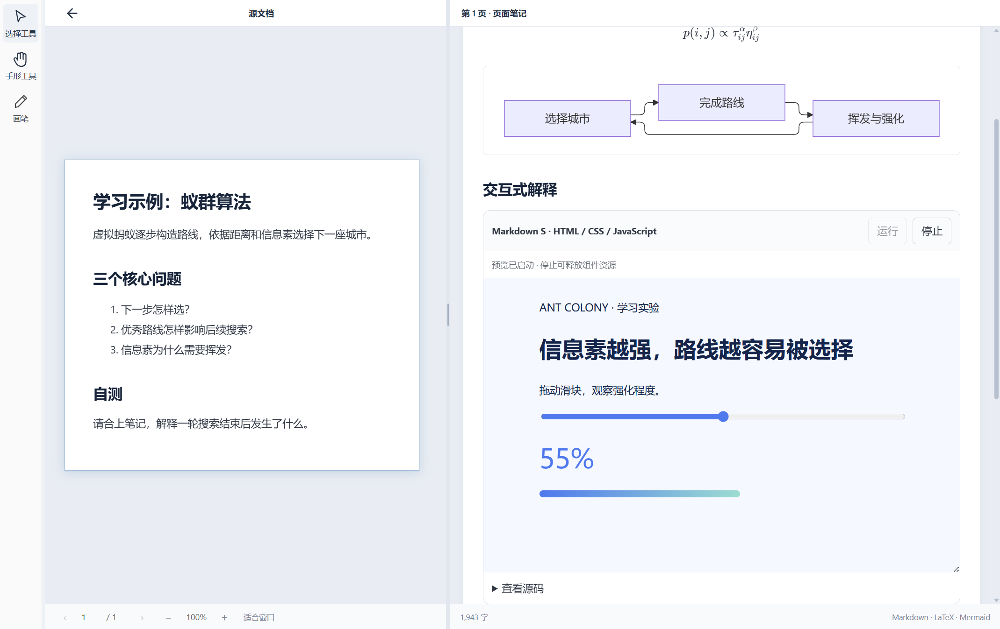
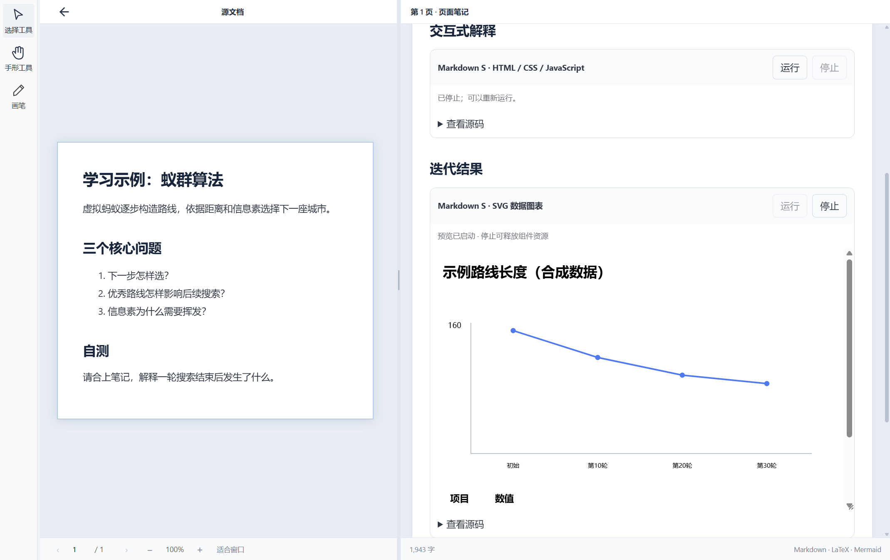
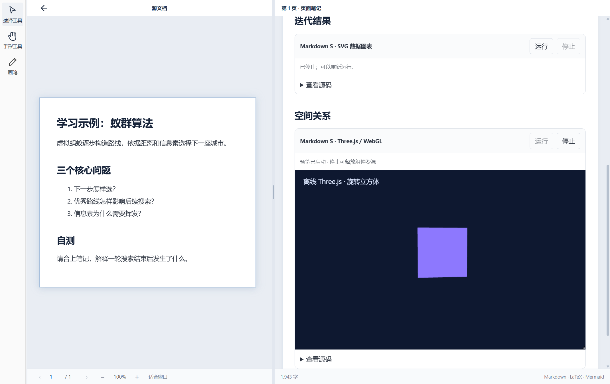

# Markdown S 离线演示

适用于当前开发分支，尚未包含在公开 beta.4 下载中。示例源码见 [markdown-s.md](../../../../examples/markdown-s.md)。

1. 在当前开发构建中打开项目，把示例内容复制到右侧页面笔记。
2. 点击增强卡片的“运行”；HTML 示例可拖动信息素滑块，图表展示合成数据，Three.js 展示旋转立方体。
3. 点击“停止”释放该预览，展开“查看源码”阅读实现。同一视图最多同时运行两个演示。
4. 进入笔记编辑模式，双击卡片标题修改源码；支持应用的撤销和重做。源码修改会停止原预览，需重新运行。
5. 保存并关闭项目后重开，源码应保留；动态运行状态不保存。

以下为 Windows 真实应用截图。环境、代码来源和工作区状态见 [采集记录](images/markdown-s/provenance.json)。它们展示开发版本，不代表 Mac 或 Android 验收。

专项测试已覆盖源码编辑、撤销、重做、HTML 交互、SVG、Canvas、图表、WebGL 像素绘制和停止；完整权限、设备兼容、旧端读写与长文档生命周期验收仍在进行。运行未知来源脚本前应检查源码，当前沙盒不提供 CPU／GPU 的硬资源隔离。
